# Day 51 — Workspace policy and approval-bound patches

## 1. Learning objectives

Constrain file access to a stable, owned workspace and reject absolute paths, traversal and symbolic link components. Produce a patch proposal tied to exact existing bytes and exact operation identity. Require a human approval step that the model cannot call, recheck the current revision immediately before writing, and consume approval once. State clearly why these checks do not replace operating-system isolation.

## 2. Required prerequisites

Know normalized paths, SHA-256, file reads/writes, JSON-compatible values, and the difference between authentication and authorization. Review Week 7 tool dispatch: a handler executes only after argument validation and policy gating. In this lesson, “owned workspace” means a directory controlled by the application and not concurrently modified by an attacker. If that assumption is false, use a stronger OS boundary.

## 3. Problem motivation

A model may produce `../../.ssh/config`, or may propose a safe edit and then have the file change before approval. Path string checks can miss symlinks, while a write based on stale text can overwrite a human’s intervening change. A reliable patch workflow needs a narrow root, bounded file input, content revision, exact approval binding and a final compare. These are separate checks; no single hash or path normalization establishes trust.

## 4. Intuitive explanation

Imagine a repair form describing one exact document revision and one exact replacement. A human signs that form. If the document changes, the signature no longer applies; if the destination or operation changes, it is a different form. The signature here is an application approval record, not a cryptographic signature: the app binds a human action to a proposal ID and consumes it once.

## 5. Deep technical explanation

`Workspace` resolves the configured root once. A relative path must be nonempty, not absolute, contain no `..` or `.` components, and use no backslashes or NUL. Every existing component is checked for symlinks before resolution; the resolved destination must remain under root. Reads require a regular file and read at most `max_bytes+1`, so an oversized file is rejected without loading the whole file. Text must decode as UTF-8.

A proposal stores the path, base SHA-256, hash of the replacement, session, tool name and a JSON-deep-copied argument object. The copy prevents a caller from mutating a nested dictionary after proposal creation. Approval matches session/tool/arguments exactly. Application resolves the path again, rereads current bytes and compares their digest to the base digest. It marks the proposal used before writing and cannot be reused. Approval is an application-facing API; never register it in the model-visible tool registry.

## 6. Mathematical foundations

Let b be original bytes, r replacement bytes, and H a collision-resistant digest such as SHA-256. A proposal records h_b=H(b) and h_r=H(r). Before write, require H(current)=h_b and an exact binding match B=(session, tool, args, path, h_b, h_r). This is optimistic concurrency control: the write proceeds only when the selected revision remains current. A digest detects changed bytes with overwhelming probability; it does not prove identity, authorship or benign intent.

For input size n, bounded reading costs O(min(n,M+1)) byte reads for configured maximum M. Hashing a complete allowed file costs O(n), which is acceptable only because n is already bounded. Approval state is one-shot: transition `proposed→approved→consumed`; there is no transition back from consumed. Two concurrent apply operations require synchronization in a multi-threaded service; the teaching class is not a concurrent approval database.

## 7. Architecture and execution diagrams

```mermaid
stateDiagram-v2
 [*] --> Proposed: hash current bytes and bind exact request
 Proposed --> Approved: human UI approves proposal id and binding
 Approved --> Consumed: recheck path, revision and binding; write once
 Proposed --> Denied: wrong identity or invalid path
 Approved --> Denied: stale revision / changed arguments
 Consumed --> Denied: replay attempt
```



This state machine controls mutation in the application layer. A separate container, VM or OS sandbox is needed for code execution, and should have an explicit filesystem/network policy.

## 8. Implementation from first principles

The public API is in `forgeagent/policy.py`. `propose_patch()` does not write bytes. `approve_patch()` checks the human decision against the stored binding. `apply_approved()` performs fresh path and content checks before mutation. The `TestExecutor` class is intentionally only an adapter: it delegates to an injected backend and raises `PolicyDenied` when no backend exists. It does not call `subprocess.run` as a substitute for isolation.

```python
from pathlib import Path
from hashlib import sha256
from tempfile import TemporaryDirectory
from forgeagent.policy import Workspace

with TemporaryDirectory() as directory:
    root = Path(directory)
    (root / "notes.md").write_text("Draft.\n", encoding="utf-8")
    ws = Workspace(root)
    old = ws.read_text("notes.md")
    base = sha256(old.encode()).hexdigest()
    proposal = ws.propose_patch("notes.md", base, old + "Reviewed.\n",
        session_id="review-17", tool_name="edit_note", arguments={"path": "notes.md"})
    assert ws.read_text("notes.md") == old
# Human UI reviews proposal['proposal_id']; the model cannot approve it.
```

## 9. Worked execution walkthrough

Suppose `notes.md` contains bytes `alpha\n` and the proposal records H=`h1`. A different client replaces it with `beta\n`, whose digest is `h2`. The reviewer approves proposal ID P for session S, tool T and args A. Apply checks the binding and reads the current file; because h2≠h1, it denies before writing. It does not silently regenerate the proposal using new bytes. A fresh proposal requires a new review. If the argument dictionary was mutated after proposal construction, its frozen canonical copy still binds the original A.

## 10. Independent laboratory

Run `python3 -m unittest tests.security.test_policy -v`. Add one test where approval succeeds, then attempt a second application; the second must be denied. Add a nested-argument mutation test: create a proposal with `{"path":"a","options":{"mode":"safe"}}`, mutate the caller’s options, and verify approval still uses the stored value. Add a `max_bytes=4` read of a five-byte file and verify rejection. These check actual `Workspace` behavior, not only the public exercise hash function.

## 11. Experiments

Create a root and a sibling secret. Try `../secret`, an absolute secret path, a file symlink, and a symlinked parent directory. Then test a normal file whose contents change after proposal but before approval, and one that changes after approval but before apply. The first two should fail path validation; the latter two should fail revision checks. A file at exactly the read limit succeeds; a file one byte larger rejects.

## 12. Failure analysis

`resolve()` and repeated symlink checks are not race-proof. A hostile process can replace a directory entry between the check and open/write, creating a time-of-check/time-of-use race. A safer OS implementation uses directory file descriptors, no-follow open flags, restrictive ownership/permissions and atomic operations; hostile multi-user work belongs in an OS sandbox. Also note that the current demonstration checks a symlink before read but does not use openat-style descriptor-relative traversal, so its documented stable-workspace assumption matters.

## 13. Engineering tradeoffs

A simpler path policy rejects harmless names like `.` and `..` even when normalization might make them safe. This reduces ambiguous interpretations across operating systems. Hashing bounded files and requiring a review for every write adds latency, but prevents stale implicit consent. Keeping approvals in memory means they disappear on restart; persistent approvals need durable, authenticated records and replay protection. This implementation uses no shell command and offers no arbitrary execution path.

## 14. Real-world connection

A coding assistant may generate a patch to a repository. A sound workflow shows the diff, path, current revision and proposed replacement to the user, then records approval for that exact patch. CI tests can run in a locked container after approval. Repository path policy is not enough for secrets or network egress; the test environment should expose only needed source files and deny credentials and external network unless explicitly required.

## 15. Common misconceptions

A path beginning with the workspace name is not necessarily contained after symlink resolution. A hash is not an approval token and does not identify who approved. A human’s approval of one set of arguments does not authorize a changed argument object. A subprocess is not an isolation boundary. “The write succeeded once” does not mean an approval can be replayed. Stable owned-workspace checks are useful defense, but their limits must be stated.

## 16. Technical examination

A proposal records path `src/a.py`, base revision h0, session `s`, tool `edit`, and args `{"path":"src/a.py"}`. The file is modified and restored to original visible text before apply; if exact bytes have the same digest, what can the system infer? Then the model changes args to `{"path":"src/b.py"}`. Explain why content equality for the original file does not permit applying to the new path. Finally, describe an OS-level mitigation for symlink swap races and why hashing cannot provide it.

## 17. Daily mastery gate

Pass when you can show a rejected traversal, rejected symlink, rejected stale content, rejected changed argument binding, successful exact approved write, and rejected replay. Also demonstrate that execution refuses when `TestExecutor` has no backend. In the explanation, distinguish the user’s approval event, the hash comparison, and OS isolation; they solve different problems.

## 18. Resources

Read `forgeagent/policy.py` and `tests/security/test_policy.py`. The official [MCP security principles](https://modelcontextprotocol.io/specification/2025-11-25) discuss user consent and authorization separately from protocol mechanics. For operating-system guarantees, consult the platform’s file API documentation for no-follow and descriptor-relative access; the repository does not claim such protections.

## 19. Revision and retention

Without looking at code, write the binding tuple and state transition diagram. Then answer: what byte sequence is hashed, when is it reread, what happens to the approval after write, and what attacker is outside the stable workspace assumption? Re-run the stale-write test after a break. If you cannot name the race, you have not yet separated path validation from process isolation.

## 20. Next lesson connection

Day 52 introduces reusable Agent Skills as structured instruction files. Skills can describe steps for preparing a patch, but their body cannot approve a patch or widen file access. The skill loader will use the same bounded-input and path-traversal principles while preserving a different trust label: content is read as untrusted text, not authorized as an operation.
