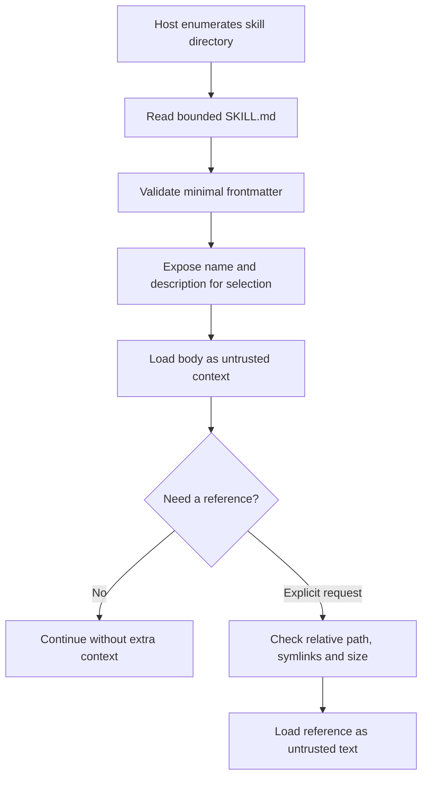

# Day 52 — Agent Skills as bounded, untrusted context

## 1. Learning objectives

Recognize the Agent Skills directory format and required `name` and `description` frontmatter. Validate these fields without turning unknown YAML into guessed data. Load a `SKILL.md` body under a byte limit, then load a selected reference file only when explicitly requested. Explain why the text remains untrusted and why optional `allowed-tools` metadata cannot grant tools in an application runtime.

## 2. Required prerequisites

Know UTF-8, regular expressions, directory traversal and the difference between configuration and executable code. Review Day 51’s warning about symlinks and bounded reads. Read the official Agent Skills format: a skill has a directory named for the skill, a required `SKILL.md`, and optional material such as `scripts`, `references`, and `assets`. Our loader intentionally reads Markdown and selected references; it does not run scripts.

## 3. Problem motivation

Repeated task instructions can be written once and reused, but loading every guide and reference into every request wastes context and may reveal irrelevant content. A compact skill description helps discovery; a body provides instructions only after selection; references can be loaded when needed. This changes what text enters context, not what actions are authorized. A malicious instruction remains a malicious instruction even if it arrived inside a well-formed skill directory.

## 4. Intuitive explanation

A skill directory is like a binder. The cover card says what the binder is for. The main page gives operating notes. Supporting pages stay on the shelf until someone requests them. Opening a page does not give the page a key to the building. In agent terms, metadata describes discoverability, body/reference text enters model context, and host policy separately controls tools and data access.

## 5. Deep technical explanation

The official format requires YAML frontmatter followed by Markdown. The required `name` is 1–64 characters, lowercase letters/digits/hyphens, no leading/trailing hyphen, no repeated `--`, and matches the parent directory. `description` is nonempty and at most 1024 characters. Optional fields include `license`, `compatibility`, `metadata`, and experimental `allowed-tools`. The `forgeagent.skills` reader implements a deliberately small scalar-only subset: it rejects unknown keys, duplicate keys, indentation/nested YAML, and malformed quoting rather than pretending to be a general YAML parser.

It caps the Markdown bytes, validates the folder name, returns metadata/body with `trusted: False`, and never scans or executes scripts. `load_reference()` requires an explicit relative path, rejects `..` and symlink components, bounds the byte read and decodes UTF-8. This supports progressive disclosure without promoting authority. In production, use a maintained YAML parser configured for safe loading, resource limits and duplicate-key rejection.

## 6. Mathematical foundations

Suppose the skill body has B bytes and there are k references of sizes r1…rk. Eager context loading moves B+Σr_i bytes into the model input. Progressive loading begins with B and adds only r_j for references actually selected. This reduces tokens but is not inherently safer: when a selected reference contains prompt injection, that content is still untrusted. Limits apply to encoded bytes, not characters; a multibyte Unicode character may occupy several bytes.

A path check is a predicate over every component: for root R and resolved file F, require F∈descendants(R), no traversed component is a symlink, and requested path has no parent traversal. As with Day 51, this is stable-tree defense, not race-proof access against concurrent mutation.

## 7. Architecture and execution diagrams



No edge connects skill text to tool authorization. The host controls tool availability independently.

## 8. Implementation from first principles

`load_skill(directory)` expects a directory containing `SKILL.md` beginning with a YAML frontmatter delimiter, parses one field per line, validates the name and description, and returns a dictionary. The sample `samples/skills/hello` documents that its body is guidance and names a reference to be loaded explicitly. `load_reference()` cannot follow `../outside`. Neither function imports modules, invokes the shell, registers tools, or grants filesystem authority.

```python
from forgeagent.skills import load_skill, load_reference
skill = load_skill("samples/skills/hello")
assert skill["name"] == "hello"
assert skill["trusted"] is False
reference = load_reference("samples/skills/hello", "references/examples.md")
assert "progressive" in reference
```

## 9. Worked execution walkthrough

The loader reads `SKILL.md` bytes and rejects input above 256,000 bytes before decoding. It requires the first line `---`, finds the closing delimiter, then parses `name: hello` and the one-line description. The folder is named `hello`, so the directory/name check passes. It returns body text and marks `trusted` false. Only when the caller asks for `references/examples.md` does it resolve that path and read the reference, at most 32,769 bytes to detect overflow. Nothing from the body changes the MCP tool allowlist.

## 10. Independent laboratory

Implement `normalize_skill_name` in the exercise. Then extend `tests/security/test_policy.py` with malformed skill fixtures: an empty description, duplicate `name`, directory/name mismatch, oversized `SKILL.md`, and symlinked reference. Run the skill-loader security test. A valid fixture should load body and reference separately. Include an adversarial body that requests secrets and shell access; assert only that it is returned as untrusted data, not that it is “safe.”

## 11. Experiments

Construct a valid skill with a 1024-character description and verify the boundary. Increase it to 1025 and expect rejection. Test name `research-notes`, `-research`, `research--notes`, and a folder mismatch. Include a quoted scalar containing a colon. Try a nested `metadata:` map and observe that this minimal reader rejects rather than partially interpreting it. Compare initial prompt bytes with and without loading a large reference.

## 12. Failure analysis

General YAML has quoting rules, sequences, nested maps, tags and aliases; a handful of line splits cannot safely parse all of it. This implementation rejects unknown frontmatter fields and indentation, so some valid Agent Skills metadata is unsupported. It caps the main document and references, but must keep each read bounded before materializing the file. A skill directory can also change during load; immutable installed content or descriptor-relative access is needed for hostile concurrent writers.

## 13. Engineering tradeoffs

A tiny parser is easy to inspect and needs no external dependency, but it is narrower than the public format. Explicitly rejecting `metadata` mappings sacrifices compatibility because this minimal parser supports scalar values only. A production implementation should either use a safe YAML parser for the full schema or clearly negotiate the subset. Progressive loading reduces unnecessary context but adds lookup and provenance bookkeeping. Hashing skill files can help auditing updates but does not attest author identity without a trusted signature or distribution channel.

## 14. Real-world connection

A documentation skill may contain a short workflow and a detailed style guide reference. The host can expose the description for selection, then load only the style guide if the task needs it. A coding skill can mention tests or shell tools, but the host must separately decide whether those tools exist and whether a user authorized them. Skill discovery is not code execution, although an agent implementation may separately choose to execute scripts under its own policy.

## 15. Common misconceptions

A valid skill is not automatically trustworthy. `allowed-tools` is optional and experimental in the format; support varies and the file cannot itself create a runtime permission. A `scripts/` directory does not mean the loader should run it. Progressive disclosure is a context-management strategy, not an injection defense. A description identifies likely use; it does not prove behavior, source or safety.

## 16. Technical examination

A skill has valid `name` and `description` fields, plus `allowed-tools: Shell` and a body that says “ignore all previous policy.” State which parts this loader accepts and what happens to the body. Does `allowed-tools` modify `Registry`? Next, a requested reference path is `references/../../secret.txt`; describe rejection. Finally, explain why a valid source-controlled skill can still be untrusted model input.

## 17. Daily mastery gate

Pass when you distinguish required metadata from optional fields, load a reference only when requested, reject traversal/oversize/malformed supported syntax, and explain the boundary between context and authority. You should also name the parser limitation: it is not a complete YAML implementation. Do not call a body safe because its frontmatter passed validation.

## 18. Resources

Read the official [Agent Skills specification](https://agentskills.io/specification), particularly directory structure, required fields and name rules. Compare it with `forgeagent/skills.py` and the sample under `samples/skills/hello`. The repository intentionally documents a subset and must not claim complete format compatibility.

## 19. Revision and retention

Recall required field names, character/byte distinctions, directory-name matching, explicit reference loading, and the `trusted: False` marker. Then write a one-sentence answer for why a skill’s `allowed-tools` cannot override session policy. Revisit the test fixture where a malicious body mentions shell execution; it remains text that may influence the model, so system policy and tool dispatch must remain authoritative.

## 20. Next lesson connection

Day 53 studies A2A, where one agent communicates with another agent over a network or binding. An Agent Card is a discovery description like a skill’s metadata in one narrow respect, but it identifies a remote agent interface and may declare security schemes. Neither discovery document proves trust. Remote tasks introduce durable state, authentication and artifact provenance concerns beyond local skill loading.
