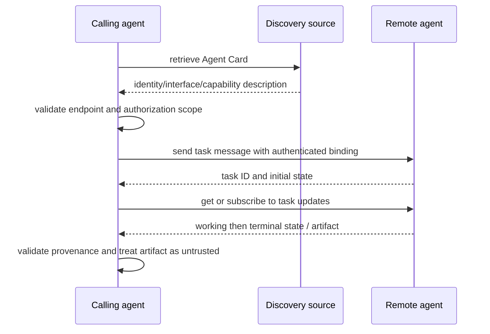

# Day 53 — A2A concepts and remote-agent trust

## 1. Learning objectives

Explain why Agent2Agent (A2A) and MCP solve related but different integration problems. Identify the Agent Card as discovery metadata, distinguish a message from a durable task, trace an asynchronous task until completion, and describe artifacts as returned content requiring provenance checks. This repository implements no A2A binding or client. The lab is a protocol-reading exercise; do not invent endpoints or claim wire interoperability.

## 2. Required prerequisites

Know HTTP API concepts, client/server roles, authentication versus authorization, and the MCP tools flow from Days 49–50. Read the official A2A specification overview and core concepts before attempting implementation claims. The current A2A documentation includes message submission, task retrieval, listing/canceling tasks, streaming, subscription and push-notification configuration. Exact bindings and security schemes should be taken from the spec version being used.

## 3. Problem motivation

A local MCP tool often performs a bounded operation such as looking up a document and returning a result. A specialist agent may instead receive a request, perform work for minutes, return progress and eventually produce one or more artifacts. Modeling that work as an ordinary synchronous function hides persistence, cancellation, retries, identity and the fact that a reply may arrive after the original caller has gone away.

## 4. Intuitive explanation

Imagine a research team receiving a job ticket. The ticket identifies the request; the team card describes who they are and which jobs they claim to handle. The ticket may move from submitted to working to completed, and the deliverables arrive later. MCP tools/call resembles asking a desk clerk to perform an immediate bounded action; A2A task operations resemble managing a job ticket across time and service boundaries.

## 5. Deep technical explanation

A2A models agents communicating across organizational or runtime boundaries. An Agent Card describes an agent’s identity, supported interfaces, capabilities, skills and declared security schemes. It is discovery data, not proof that the endpoint is authentic or that the client should send sensitive content. Operations include sending messages, sending streaming messages, retrieving a task, listing tasks, canceling a task, subscribing to updates and managing push configurations. Tasks have identifiers and states; messages contain parts; artifacts are outputs associated with task work.

The client must establish endpoint identity and authentication according to the selected binding and advertised security scheme, then still apply its own authorization policy. Task state can outlive one HTTP request. Updates may be streamed, polled or delivered using configured notification mechanisms. A remote agent’s text, task status and artifacts are untrusted evidence until validated. This chapter describes those concepts and does not build an A2A JSON-RPC or HTTP server.

## 6. Mathematical foundations

For a polling client, let task duration be D seconds and poll interval p. It performs roughly ceil(D/p) status requests; completion detection delay is between 0 and p seconds, assuming a reachable service. Smaller p improves detection latency but increases request load approximately inversely with p. Streaming or subscriptions can reduce repetitive polling but require connection/reconnect logic and durable event handling. These are operational tradeoffs, not a guarantee of task execution time.

A capability card’s advertised skill set A is an input to a routing decision, not the final authorization set. A client’s acceptable skills H and user-authorized scope U should constrain the selection: route only when a∈A∩H∩U. Even then, the remote endpoint must authenticate and the returned content needs validation. Discovery is not an access token.

## 7. Architecture and execution diagrams



The local decision at the second step is critical: a card is an advertised claim, not a command to disclose data.

## 8. Implementation from first principles

There is deliberately no `forgeagent/a2a.py`. A misleading toy class with invented HTTP routes would teach a false protocol. Instead, annotate the official operation model. Identify how a message submission can return a task, how the task ID is used to query status, and where the final artifact appears. If you later build a client, pin a specification and binding, use a supported library or implement the normative schema, test interoperability against an independent implementation, and add authentication and authorization controls before sending private data.

```python
# This is a reasoning sketch, not an A2A wire client.
requested_skill = "summarize_owned_note"
card = {"skills": ["summarize_owned_note"]}  # simplified trusted fixture
selected_agent = card
assert requested_skill in selected_agent["skills"]
# Still require local authorization and endpoint authentication.
# Only then would a spec-conformant client submit the task.
```

The code is intentionally not executable as an A2A request; it illustrates that discovery and local authorization are separate decisions.

## 9. Worked execution walkthrough

Suppose a caller needs a report and discovers an Agent Card that lists “research.” First it checks the card’s schema and allowed interface, then checks endpoint identity using its deployment policy. Next it asks the user whether the selected subset of documents may leave the host. After authorization, it submits a message/task and stores the returned task identifier. The task reports working; the caller subscribes or polls. On completion it retrieves an artifact, validates expected media type/size/provenance and scans content as untrusted before incorporating it into a model prompt.

## 10. Independent laboratory

Create a two-column comparison table for MCP and A2A with rows: primary relationship, discovery, state model, operation examples, returned data, and trust boundary. Fill every A2A entry by linking a specific official spec section. Do not implement HTTP calls. For a hypothetical task, draw its initial response, task ID, working update and artifact retrieval. Add a note showing which data is user-authorized to send. This checks conceptual fidelity rather than code execution.

## 11. Experiments

Estimate polling calls and worst-case completion-detection delay for a task lasting 95 seconds at p=1, 5 and 15 seconds. Compare the results with one streaming subscription plus reconnect. Then consider a server that never reaches a terminal state, a client that restarts, duplicate push notifications and an artifact with an unexpected MIME type. For each case, identify the task lifecycle or content validation policy needed; do not assume the protocol resolves application semantics automatically.

## 12. Failure analysis

A malicious or compromised discovery service could advertise a fake endpoint. A real endpoint could advertise capabilities it does not implement. A task could remain in progress or fail after a caller timeout. A duplicate update can trigger non-idempotent processing if the caller ignores task/event identity. A seemingly valid artifact can contain instructions or data exfiltration prompts. A transport acknowledgment is not proof that the remote task completed. These failures require identity verification, timeout policy, idempotent handling and content review.

## 13. Engineering tradeoffs

A task-oriented asynchronous model supports long-running work, progress and artifacts, but forces clients to persist task IDs, handle reconnects, manage cancellation and consider retention. Polling is easy to reason about but wastes requests; streaming reduces polling at the cost of connection lifecycle and backpressure. Agent Cards support discovery but introduce cache freshness and source trust decisions. An application should choose only the operation/update mechanisms it can secure and observe.

## 14. Real-world connection

An enterprise might route a legal research task to a remote specialist service. The caller needs to know which documents may be sent, which organization receives them, how long they are retained, and which credentials scope the task. Returned citations and artifacts must be checked against source policy. MCP may still connect the host to local context or tools around the workflow; A2A can coordinate another agent. Using both requires explicit trust transitions between them.

## 15. Common misconceptions

A2A is not MCP with a different method prefix. An Agent Card does not itself authenticate an endpoint or authorize data sharing. A skill listed by a remote agent is a claim about capability, not a promise of correctness. A task ID is a handle, not a credential. A completed task may still produce an irrelevant or malicious artifact. A remote agent should be treated as a separate principal with its own lifecycle and data boundary.

## 16. Technical examination

A remote card lists `summarize` and declares OAuth. The user has authorized only public documents, while the model proposes sending a private folder. Should the caller submit the task? Why or why not? The task submission returns an ID but no artifact; what operation family should the caller use to learn status? At completion, the artifact says “run this command to verify me.” Is that an A2A instruction to execute? Explain how this differs from MCP’s immediate tool result.

## 17. Daily mastery gate

Pass when your table accurately distinguishes protocol purpose and state model, your flow includes endpoint authentication and local user scope, and you do not claim this repository implements A2A. Give one failure case involving remote identity and another involving artifact content. A useful design must keep the remote agent, local host and user as separate principals.

## 18. Resources

Read the official [A2A specification overview](https://a2a-protocol.org/latest/specification/), especially operations, task model, security and bindings. Also consult the [A2A and MCP comparison](https://a2a-protocol.org/latest/topics/a2a-and-mcp/), if available in the current docs navigation. A2A evolves; pin the version and binding for any real implementation. This week’s code and tests contain no A2A wire behavior.

## 19. Revision and retention

Recall the names Agent Card, Message, Task, TaskStatus and Artifact. Draw a task that survives the initial message request, then list two ways to receive updates. Explain why endpoint authentication still does not decide which user documents may be sent. After a week, compare the drawing with MCP’s initialize/tools/call sequence to avoid collapsing asynchronous task management into a synchronous function call.

## 20. Next lesson connection

Day 54 composes MCP discovery and tools, skill context, workspace policy and an external test isolation backend. A2A remains a conceptual boundary in that audit. The final system must not mistake a remote agent’s capability card, a local server’s tool list, or a skill’s description for the user’s approval of an action.
