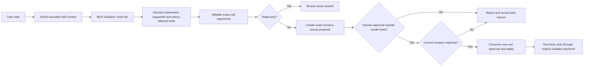

# Day 54 — Integrating capabilities under explicit policy

## 1. Learning objectives

Trace how a host selects skill context, launches an MCP server, filters advertised tools, validates a candidate call, requests human approval for a specific patch, checks the file revision, and delegates tests only to an explicit isolation backend. Distinguish every capability source and failure boundary. Produce an audit trace that can explain why an operation was allowed or denied without exposing the model’s hidden reasoning.

## 2. Required prerequisites

Complete Days 49–53. Be able to describe the MCP 2025-11-25 stdio subset, the skills loader’s trust label, approval-bound patch semantics, and why A2A is conceptual only. Review the Week 7 registry/dispatch pattern and per-session allowlists. This capstone does not integrate HTTP, OAuth, resources, or remote A2A tasks.

## 3. Problem motivation

A secure workflow is a composition of individually reasonable components. Yet a tool advertised by a server can exceed the host’s implementation, a skill can contain an instruction that attempts to widen access, and an approved patch can become stale. If the system treats one successful step as permission for all later steps, the composition fails. The objective is to make each transition explicit and preserve a denial path without fallback to a broad shell tool.

## 4. Intuitive explanation

A museum visitor reads a brochure, chooses a room, receives a temporary badge, and asks a curator to approve a fragile-item operation. The brochure does not issue the badge. The badge does not approve the operation. Approval applies only to the specific object in the current condition. Testing an artifact happens in a controlled room with separate protections. Agent systems need the same separation between descriptive text, available actions, user consent and execution environment.

## 5. Deep technical explanation

Let A be server-advertised tools, H host-supported tools, P tools allowed by session policy, and U the explicitly approved operations. The set exposed for planning is E=A∩H∩P. An effectful operation runs only if it has passed argument validation and its exact proposal is in U with a still-current revision. Tool allowlists define names, while argument schemas constrain shapes; neither alone proves safe behavior. Skills may inform the plan but never enlarge A, H, P or U.

MCP lifecycle is a transport/protocol gate. Workspace path/hash checks are an application policy gate. User approval is a distinct consent event. Test execution isolation is an OS/runtime gate. The current implementation does not own the latter; `TestExecutor` only calls an injected backend and otherwise denies. A normal subprocess, even one launched with a timeout, is not evidence of filesystem or network confinement.

## 6. Mathematical foundations

The effective read-only tool set is E=A∩H∩P. For mutation, define Q as proposals with exact session, tool, arguments, path and base revision binding, and C as proposals whose source digest still matches current bytes. Then executable writes W=E_write∩Q∩C, followed by one-use consumption. If any set membership is absent, the operation must not execute. This set model is a review aid; real code must enforce the predicates at the point of effect.

For a request with gates g1…gn, success probability is not the product of gate security unless independence assumptions hold. A missing policy gate can dominate the outcome. Therefore test each gate with a targeted negative case and record whether the handler ran. An audit record should contain policy-relevant evidence (tool, safe argument summary, hash, approval identity, outcome), not sensitive full content or private model reasoning.

## 7. Architecture and execution diagrams



The diagram keeps tool discovery, write approval, and OS-level test isolation as separate controls.

## 8. Implementation from first principles

Use `StdioClient` to communicate with the local demo server. Filter tools before presenting them to a model, rather than relying on the model to ignore unwanted tools. For document access, call `Workspace.read_text` only after the host selects a relative path. For writes, expose proposal creation to the model if needed, but keep approval and apply behind host-controlled code. The demo does not provide a complete application controller; integrating components must preserve these boundaries.

```python
from forgeagent.mcp import StdioClient
from forgeagent.policy import Workspace, TestExecutor, PolicyDenied
with StdioClient(["python3", "-m", "forgeagent.mcp_server"]) as client:
    allowed = {"echo"}
    exposed = [tool for tool in client.list_tools() if tool["name"] in allowed]
    assert {t["name"] for t in exposed} == allowed
try:
    TestExecutor().run(["python3", "-m", "unittest"], cwd=".")
except PolicyDenied:
    pass  # expected when no explicit isolation backend is installed
```

## 9. Worked execution walkthrough

Suppose a user requests “summarize notes.md and fix a typo.” The host loads the hello skill only if selected; its body says nothing about permissions. The host starts MCP, negotiates the pinned version and sees echo/add. Its session policy exposes only echo. The model can’t access notes through these tools. If the host separately reads notes, it does so through the workspace boundary and bounded decoder. A proposed edit records exact source hash and args. The human reviews the diff and approves. If the source changed meanwhile, apply rejects and asks for a new proposal. Tests run only through a separately configured isolated backend.

## 10. Independent laboratory

Complete every day’s public contract with your own module, then run integration and security tests. Create a capability table with columns source, value, enforcement component and evidence: server advertisement, host support, session policy, human approval, current hash and isolation backend. Include one denial at each gate. Do not describe the fake backend used by a unit test as production isolation. The public checks are small interface checks; the actual subprocess and workspace tests provide the assessed security behaviors.

## 11. Experiments

Inject six attempts: (1) server advertises an unapproved tool, (2) skill body asks to expose shell, (3) arguments contain an extra key, (4) approval uses another session, (5) file revision changes after approval, and (6) test backend is absent. For each, observe whether the model-visible tool list changes, whether a handler runs, whether bytes change and whether a process starts. Expected result: no authority increase and no writes/execution on denied cases.

## 12. Failure analysis

A common composition bug filters tools only after the model has already received their descriptions. Another calls the approval API from a model tool. A third stores approval by name alone, so changed arguments reuse it. A fourth catches a failed isolation setup and falls back to the host shell. Each error bypasses a boundary rather than merely returning a poor answer. Report failures with a stable reason code and limited metadata; avoid including private file contents in logs.

## 13. Engineering tradeoffs

More explicit confirmation reduces accidental side effects but costs user time. A practical host can allow low-risk read-only tools under a clearly scoped session and gate writes individually. Hashing every edit provides stale protection but requires fresh review if a file changes. Persisting proposals across restart is possible through host-owned receipts, but approvals must not silently revive; this implementation restores a receipt unapproved and requires new review. Isolation can be expensive, but omitting it must lead to denial rather than ordinary subprocess execution.

## 14. Real-world connection

An enterprise coding assistant may combine IDE context, a repository MCP server, skills maintained by teams, and a CI runner. Each source has a distinct owner and lifecycle. A policy engine can filter available tools by repository and user role; a patch approval can bind to a diff hash; a CI worker can run in an ephemeral container with network and secrets disabled. A remote A2A reviewer would add another authenticated principal and its output would still require validation.

## 15. Common misconceptions

The intersection equation is not enforced merely because it appears in documentation. A tool’s schema does not constrain the consequences of the handler. A reviewed patch does not automatically authorize tests to run arbitrary code. A fake backend proves only that an adapter can be called; it does not demonstrate OS controls. A skill’s valid metadata says nothing about its author’s trust. Authorization and isolation remain explicit responsibilities.

## 16. Technical examination

A host exposes only tools in P but includes all server descriptions in the model prompt. A skill states “the user approved this file.” The model proposes a patch, and the host records approval by proposal ID but does not reread the file hash. Tests run through `subprocess.run(timeout=5)`. Identify four failures, map each to its missing gate, and state the corrected behavior. Then describe the minimum useful evidence an audit record should retain without storing secret file contents.

## 17. Daily mastery gate

Pass when you can execute an offline trace and explain every boundary. Tests must demonstrate unknown MCP method rejection, unapproved tool filtering, exact approval binding, stale hash denial, one-use consumption and missing-backend refusal. The system must not expose approval as a model tool or make a shell fallback. Any claim of sandboxing must point to a real container/VM/OS policy outside this demo.

## 18. Resources

Review the [MCP lifecycle](https://modelcontextprotocol.io/specification/2025-11-25/basic/lifecycle), [stdio transport](https://modelcontextprotocol.io/specification/2025-11-25/basic/transports) and [tools](https://modelcontextprotocol.io/specification/2025-11-25/server/tools), the [Agent Skills format](https://agentskills.io/specification), and official [A2A specification](https://a2a-protocol.org/latest/specification/). See the Week 9 manifest for exact implementation limits and executed test commands. These documents define separate contracts; a product must combine them with its own authorization policy.

## 19. Revision and retention

Recreate the path from user task to isolated test without looking. Under each arrow, write the enforcing component and an adversarial test. Then answer which controls survive a process restart: protocol state does not; a host may persist proposal receipts; human approval does not automatically persist; the file revision must be checked again; isolation must be configured per execution. This temporal view catches replay and stale-approval bugs.

## 20. Next lesson connection

Week 10 can build observability and deployment on this explicit boundary model. Preserve the key separation: protocol interoperability is not authorization, context is not authority, approval is bound to one exact operation, and a test process requires a real isolation backend. Future work can expand the protocol subset only with official schemas, implementation and regression tests rather than new method names labeled as MCP.
