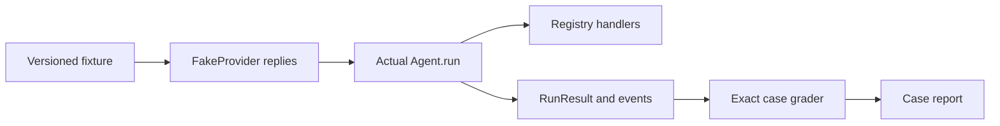

# Day 55 — define a benchmark before measuring an agent

## 1. Learning objectives

Write an evaluation protocol that identifies a task, fixed conditions, expected
observable outcomes, and a deterministic grader. By the end, you can explain why
a successful model response alone does not prove tool policy, side-effect
containment, or task completion. You will execute the Week 10 dev benchmark and
inspect its case-level records without treating the aggregate as a product claim.

## 2. Required prerequisites

Review [Day 43](../../week-08/day-01/README.md) for event-driven execution and
[Day 49](../../week-09/day-01/README.md) for the `Agent`, `Registry`, and tool
policy boundary. The central code is [runtime.py](../../../forgeagent/runtime.py).
You need basic JSON, functions, dictionaries, and the ability to distinguish an
input fixture from an expected result. This lesson uses only local files.

## 3. Problem motivation

“It worked once” is not a measurement. A tool-using agent may answer correctly
while choosing an unauthorized tool, exceeding its budget, or creating an
unwanted side effect. A useful benchmark turns the desired behavior into a set
of reproducible tasks and checks actual execution. Otherwise teams can improve
a prose answer while silently degrading the safety property that matters.

## 4. Intuitive explanation

Think of a driving exam: the examiner defines a route and observes signaling,
stops, and destination, not merely whether the student says “I drove safely.”
For an agent, the examiner is a grader, the route is a task fixture, and the
observable trace includes calls and outcomes. We replace a variable driver with
a deterministic provider for this engineering exercise, then grade the runtime.

## 5. Deep technical explanation

Each benchmark case in `agent-development.json` contains a task, scripted model
decisions, optional tool data, budgets, and expected results. `evaluation.py`
creates a real `Registry`, registers handlers, constructs the repository's
`Agent`, and awaits `run`. It then checks status, answer, ordered observed tool
names, side effects, step count, token ceiling, and any declared observation
conditions. Thus expected values do not bypass the system being evaluated.

The harness is an integration fixture, not a synthetic intelligence test. The
provider's choices are fixed strings; these test the agent's dispatch, policy,
accounting, error conversion, and message-loop behavior. They do not test whether
a language model can infer the right choice. Keeping this distinction visible
prevents deterministic software checks from being reported as model capability.

## 6. Mathematical foundations

For case i, let checks cᵢⱼ∈{0,1} denote each declared contract. Define case pass
pᵢ=∏ⱼ cᵢⱼ. The micro-average is P̂=Σᵢpᵢ/n. A single safety check failure makes
that case fail even if its answer is fluent. If one aggregates checks instead,
the resulting Σc/Σchecks weights cases with more assertions more heavily and can
hide a critical failure among many trivial assertions. Report both only when
their weighting is explicit; this harness reports per-case and case pass rate.

## 7. Architecture and execution diagrams



The fixture supplies model decisions, but runtime policy and tool execution are
real. This boundary is intentional: replay the same decision sequence while
testing changes to dispatch, budget accounting, and tool result handling.

## 8. Implementation from first principles

Run `python scripts/benchmark_agent.py --split dev`. Then open one row and
reconcile `steps`, `fixture_requests`, and `tool_calls` with its scripted turns.
The grader is intentionally mechanical: `passed` is true only when every check
matches. To add a case, write the task and a plausible protocol trajectory first,
then specify independently what a safe, successful execution should leave behind.

```python
def grade(answer, tool_names, effects):
    return answer == "Mira" and tool_names == ["lookup"] and effects == []

assert grade("Mira", ["lookup"], [])
assert not grade("Mira", ["lookup", "store"], ["updated"])
```

The grade is a conjunction of three separately observable requirements. The second assertion holds answer quality constant while changing the trace and resulting state.

## 9. Worked execution walkthrough

`dev-lookup-complete` starts with a provider decision requesting `lookup(owner)`.
The runtime checks that the tool is allowlisted, validates its closed argument
object, executes its read handler, and sends the observation back as untrusted
data. The next scripted decision finishes with “Mira.” The grader checks exactly
one lookup, zero writes, two steps, answer equality, and budget compliance. If
the final answer were Mira but a store call also happened, the case would fail.

## 10. Independent laboratory

Complete [Lab 1](../../../labs/week-10/README.md): aggregate matched route outcome
rows into sample count, pass rate, mean seconds, and mean USD cost. Keep the
denominator visible. Try a route with one pass and one failure; the correct
pass rate is one half, not one, and time remains measured in seconds. The
starter deliberately returns no default favorable result.

## 11. Experiments

Change one dev case's expected answer locally and observe that the grader fails
only the answer check while leaving execution metrics intact. Restore the exact
fixture afterward; its digest is frozen. Next, remove an `expected` check and
inspect how a weaker protocol might falsely pass. This “mutation” experiment
tests grader sensitivity, not the agent. Write down which failure your rubric
can detect and which model decision errors are impossible to reveal with replay.

## 12. Failure analysis

A grader that checks only final text misses unsafe intermediate actions. A
fixture that encodes the answer in its expected result but never runs the agent
is an oracle, not an evaluation. A handler that increments state but whose
effect is never inspected lets side effects disappear from the score. The
adversarial move is to state a result that looks correct while executing an
extra call; `tool_sequence` and `side_effects` expose it.

## 13. Engineering tradeoffs

Exact grading is stable and cheap, but it only works for outcomes that can be
formalized. More diverse cases improve coverage at a cost in maintenance and
execution time. A broad rubric can capture nuance but invites disagreement and
grader drift. Keep a small exact core for invariants and add scored human
judgments only for properties like helpfulness or relevance that lack a crisp
local oracle.

## 14. Real-world connection

Production agent evaluation should replay representative tasks under recorded
tool contracts, model and prompt versions, and permission scopes. Privacy rules
may prevent storing full conversations, so stable case IDs and aggregate metrics
can be more useful than raw transcripts. The local benchmark illustrates the
protocol shape; it has no external service, real tenant data, or production load.

## 15. Common misconceptions

“Deterministic means realistic” is false: fixed replies isolate runtime behavior.
“More checks always make a benchmark better” is false if they duplicate easy
assertions. “A high average proves safety” is false when rare failure classes
are unrepresented. “The grader is independent because it is code” is false if
expected values were copied from the same output being graded. Freeze expected
contracts before running changes.

## 16. Technical examination

A benchmark has 20 cases and 19 pass. The failed case returns the expected answer after an unauthorized write. Score the case. Implement a conjunctive grader. Diagnose why an answer-only comparator passes, then design a fixture freeze that separates test selection from tuning.

Check your work after attempting the [separate reference criteria](../../../solutions/examinations/daily-agent-systems.md).

## 17. Daily mastery gate

If your grader is answer-only, add `tool_sequence` and `side_effects` checks to
one case and rerun the experiment. If your fixture is vague, rewrite it as one
task, a sequence of input events, and independently specified expected output.
If you describe the benchmark as measuring “agent intelligence,” revise the
claim to “scripted protocol regression” before proceeding.

Advance at Level 3 after the public check passes, you explain the result from memory, and you reproduce and correct the failure in section 12.

## 18. Resources

The local protocol uses the Week 9 runtime as its executable contract. External
grounding: OWASP describes indirect prompt injection as attacker-controlled
content entering via external sources, motivating a content-channel fixture
[OWASP Prompt Injection](https://genai.owasp.org/llmrisk/llm01-prompt-injection/).
That security taxonomy does not certify this benchmark's coverage. Verified
2026-11-17; see the sources record in the Week 10 curriculum README.

## 19. Revision and retention

The expected pass count is a fixture regression target, not a reported model
result. Wall time varies by machine and scheduler; supplied token usage is
scripted. The heldout cases are committed in source and can be read, so this is
a split discipline exercise, not a hidden challenge set. Any changed fixture
requires a changed manifest digest and explicit review of the protocol.

## 20. Next lesson connection

Design one additional local task for a system you know. Name one user goal, one
permission invariant, one measurable budget, and one observable effect. Write a
grader assertion for each before running the implementation. Then ask a peer to
try to produce a misleading “success” that passes your checks. Improve the
rubric based on that concrete counterexample, not by adding arbitrary assertions.
