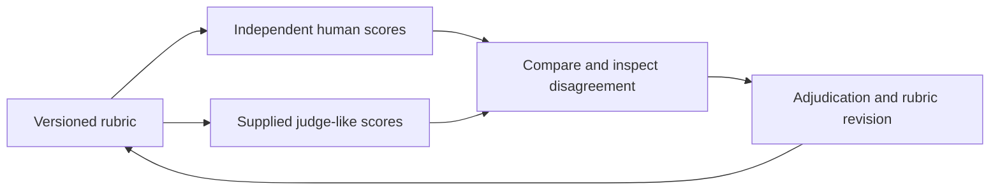

# Day 56 — calibrate model graders and repeat trials

## 1. Learning objectives

Separate deterministic grading from rubric-based judgment, calculate agreement
with a small set of human labels, and describe where an automated judge disagrees.
You will run an offline calibration exercise using scores already supplied in
the lesson. You will not call a live model or imply that the exercise validates
one. The target skill is to make grader limitations visible before using them
to summarize subjective agent behavior.

## 2. Required prerequisites

Read [Day 55's exact grader](../day-01/README.md) and [Day 56's uncertainty
discussion](../day-02/README.md). Understand labels, counts, and dictionaries.
The independent exercise is [Lab 5](../../../labs/week-10/README.md), and its
reference implementation computes exact agreement. Our benchmark's grading
module deliberately has no model call or judge prompt.

## 3. Problem motivation

Some outcomes are not boolean: was a response helpful, did it address the user's
intent, or was its explanation complete? A rubric can make these questions
repeatable, but two reviewers can interpret the scale differently. A model
judge adds another source of disagreement and bias. Calling its score “ground
truth” hides the issue. Calibration compares its supplied ratings with explicit
human judgments and gives the disagreement somewhere concrete to start.

## 4. Intuitive explanation

Imagine a bathroom scale tested with known weights. Calibration does not make
the scale infallible; it measures whether its readings track reference values
under tested conditions. A grader is similar, except humans are not perfect
reference masses and rubric interpretation can differ. A supplied score table
lets learners practice the arithmetic and analysis without spending money or
claiming a live model was asked to judge anything.

## 5. Deep technical explanation

Before scoring, define the rubric with dimensions, anchors, and an evidence rule.
For example, relevance 0 means unrelated, 1 means partial, and 2 means directly
addresses the request; reviewers cite the sentence supporting each judgment.
Freeze that rubric before examining grader output. Then score a shared sample
independently, compare exact agreement and disagreement direction, adjudicate
using a third reviewer or discussion, and revise ambiguous anchors. Preserve
pre-adjudication scores; otherwise disagreement disappears from the audit trail.

Exact agreement is simple but treats every mismatch equally. Weighted agreement
can penalize a 0-vs-2 gap more than a 1-vs-2 gap. Correlation can be high while
one rater systematically assigns higher values. For a binary pass label, also
inspect false accepts and false rejects relative to the human panel. Small,
conveniently chosen samples do not establish general agreement across domains.

## 6. Mathematical foundations

Given m paired items, exact agreement is A=(1/m)Σᵢ I(hᵢ=gᵢ). In the provided
table of 8 examples, 6 agree, so A=0.75. If two are false accepts for a safety
criterion and none are false rejects, the symmetric statistic conceals the
asymmetric risk. Let TP,TN,FP,FN use human panel adjudication as reference; false
accept rate FP/(FP+TN) deserves separate attention where an unsafe response
passing is materially more costly than a helpful response being rejected.

For ordinal grades, a normalized absolute error can be
E=(1/m)Σ|hᵢ−gᵢ|/2 when values are on 0..2. This preserves distance but still
assumes equally spaced labels. If labels are categorical, use a confusion matrix
and class-specific recall instead of pretending they are numeric.

## 7. Architecture and execution diagrams



The loop modifies the rubric only after preserving the original scored sample.
If you revise anchors, rescore a fresh sample to avoid fitting the calibration
set itself.

## 8. Implementation from first principles

The [Lab 5 fixture](../../../labs/week-10/checks.py) gives two rows with labels
`yes,yes` and `no,yes`; exact agreement is one half. Run
`python labs/week-10/checks.py --day 5`. The check verifies arithmetic, not
quality of the labels. Add rows for all four confusion outcomes and calculate
false accept rate only when its denominator is nonzero; otherwise represent it
as unavailable, not zero.

```python
human = [True, True, False, False]
grader = [True, False, True, False]
counts = {(h, g): 0 for h in (False, True) for g in (False, True)}
for pair in zip(human, grader, strict=True):
    counts[pair] += 1
assert counts[True, False] == counts[False, True] == 1
```

The two Boolean axes index the confusion counts. Starting with all four cells at zero preserves cells absent from the sample. Strict pairing detects mismatched run lists.

## 9. Worked execution walkthrough

Consider eight responses with human pass labels `[1,1,1,1,0,0,0,0]` and grader
labels `[1,1,0,1,1,0,0,0]`. Agreement is 6/8=0.75. The grader missed one human
pass and accepted one human fail. If the final four are security-sensitive,
that false accept must be investigated even though the overall accuracy looks
respectable. Review the exact item, rubric anchor, and evidence rather than
changing the label to improve a metric.

## 10. Independent laboratory

Run the supplied calibration table and implement the exact agreement starter.
Extend it to report confusion counts. Build a calibration exercise from 12
short answers: have two people score independently before revealing the
synthetic judge scores. Record which rubric word caused each disagreement.
Do not use answer keys that simply repeat the synthetic grader's labels; the
human reference must be separately produced.

## 11. Experiments

Create two rubric versions: one with “complete” undefined and one with a
specific criterion such as “names both the observed timeout and the fact that
the write outcome is unknown.” Have reviewers score the same shuffled sample
without seeing rubric version labels. Compare disagreement count and error type.
An improvement on the calibration sample may reflect clearer instructions or
sample memorization; test a fresh set before adopting the revision.

## 12. Failure analysis

Reviewers who see model scores first may anchor toward them. A model that favors
long answers can reward irrelevant verbosity. If graders see different context
than users, their judgment may be based on evidence unavailable in deployment.
Finally, a high correlation does not rule out a consistent offset: compare the
per-item signed difference gᵢ−hᵢ and examine false accepts, not only one scalar.

## 13. Engineering tradeoffs

Human review costs time but supplies transparent interpretation; model grading
can scale but needs prompt/version records, bias checks, and periodic human
calibration. Adjudication improves consistency but may erase minority reviewer
signals if raw ratings are discarded. Keep rubric, scores, rationales, and
adjudication separately versioned. A confidence score from a judge is not a
replacement for calibration data.

When a live judge is eventually introduced, preserve every repeated judgment.
For one binary task repeated m times, r/m estimates observed decision stability
for that prompt and configuration. Across a representative set of distinct
tasks, Wilson intervals can describe sampling uncertainty. Do not pretend the
repeated calls to one task are independent users: report unique task count and
trial count separately, and inspect disagreement by item.

## 14. Real-world connection

Quality evaluation often combines exact checks for schema and policy with human
or rubric ratings for relevance and clarity. A useful report keeps these axes
separate. An answer can be relevant but unsupported, or safe but incomplete.
Model-graded metrics are best treated as a measurement instrument with observed
error characteristics rather than as an oracle.

## 15. Common misconceptions

“Humans define objective truth” ignores reviewer variability. “Agreement equals
validity” ignores shared bias and weak tasks. “A judge prompt is a rubric” is
false unless dimensions and anchors are explicit. “An offline exercise proves
our production judge is calibrated” is false: this lesson only teaches the
procedure with fixed example scores and no actual model call.

## 16. Technical examination

**Prompt:** Human labels `[1,1,0,0]`; judge labels `[1,0,1,0]`. Give accuracy,
false-accept rate, and one limitation. **Key:** accuracy 2/4=0.5; FP=1 and
TN=1, so false-accept rate=1/2; a four-item sample cannot establish broader
calibration. Five points: two for arithmetic, one for denominator, two for the
limitation and separating judge score from truth.

## 17. Daily mastery gate

If you only reported agreement, construct the confusion matrix. If scores were
shown to reviewers first, repeat blind. If the rubric lacks examples, add one
positive, one boundary, and one negative anchor per dimension. If you said this
lesson tested an LLM judge, correct the statement: it only used supplied scores.

Advance at Level 3 after the public check passes, you explain the result from memory, and you reproduce and correct the failure in section 12.

## 18. Resources

All exercise scores are local fixed examples. The automation is standard Python
in [calibration.py](../../../solutions/labs/week-10/calibration.py); the lab
starter contains no network calls. The lesson draws its process design from
measurement practice: define the target, retain raw observations, and expose
uncertainty. It intentionally makes no claim that a vendor grader or human panel
has been calibrated by this dataset.

## 19. Revision and retention

The worked result, 6/8 agreement, is arithmetic on a constructed table. It is
not evidence about any model. Even a large agreement sample only supports the
sampled prompts, rubric, language, and domain. Changes in model, judge prompt,
user population, or application context require new calibration observations.
Sensitive examples need a privacy review before storage or external grading.

## 20. Next lesson connection

For a writing or support agent, define one subjective dimension and three scored
anchors. Collect ten blind human ratings and compare with a non-live synthetic
score column. Present raw disagreements, exact agreement, and the consequential
false-accept cases. Decide whether the rubric, judge instructions, or task set
needs revision, then test the proposed change on new examples.
