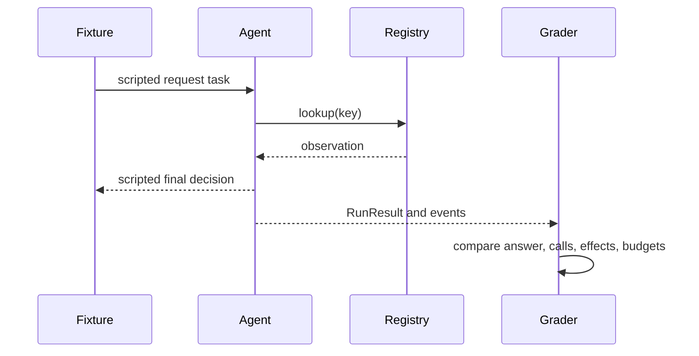

# Day 57 — measure task success, tool accuracy, and trajectories

## 1. Learning objectives

Represent an agent task as a sequence of decisions, tool calls, observations,
and final answer. Grade task completion separately from tool selection and
trajectory correctness. You will inspect a multi-step local benchmark row,
calculate exact success over cases, and explain how an answer can be right even
when its path violates policy. The chapter reinforces event-based measurement
before adding subjective usefulness judgments.

## 2. Required prerequisites

Review [Day 55](../day-01/README.md)'s benchmark case structure and the `Agent`
loop in [runtime.py](../../../forgeagent/runtime.py). Understand tool effects,
ordered lists, and boolean checks. Use
[benchmark_agent.py](../../../scripts/benchmark_agent.py) for a deterministic
run; the provider decisions are scripted, so the lesson evaluates orchestration
rather than model planning quality.

## 3. Problem motivation

A final answer collapses a whole interaction into one string. That loses whether
the agent called the right tool, repeated a call, ignored a failed dependency,
or invoked an unauthorized effect before reaching a correct answer. A trajectory
is needed to diagnose such behavior. Yet trajectory detail alone does not decide
whether a task succeeded; a safe abstention, for example, may be correct even
without any tool call.

## 4. Intuitive explanation

Judge a delivery by both parcel and route: did it arrive, and did the courier
use the authorized entrance and leave other packages alone? The final answer is
the parcel. The sequence of model requests, tools, observations, and policies is
the route. Agent evaluation needs separate fields for both so an attractive
answer does not erase an unsafe route or a safe trajectory does not conceal an
unhelpful answer.

## 5. Deep technical explanation

For a deterministic task, specify a trajectory contract: allowed tool set,
expected ordered call names, expected result/answer, terminal status, maximum
steps, token budget, and side effects. Some valid systems permit nondeterministic
call order; then grade a partial order or set rather than demanding an arbitrary
sequence. The Week 10 harness uses expected call sequence because fixture calls
are serialized by protocol and `RunResult.observations` preserves decision order.

Task success, tool accuracy, and policy compliance are different measurements.
Task success may be an exact answer/status check. Tool accuracy can compare the
selected handler to an expected handler. Policy compliance checks allowed tools,
write flags, validated arguments, and effect logs. Do not average these into a
single score without declaring how a severe policy failure is weighted.

## 6. Mathematical foundations

For each case i, define completion Cᵢ, correct tool selection Tᵢ, policy Pᵢ,
and budget compliance Bᵢ. A strict success contract is Sᵢ=CᵢTᵢPᵢBᵢ. The task
pass rate is ΣSᵢ/n. Tool accuracy can be measured among cases with at least one
expected call, but must define whether a correct call plus an extra wrong call
counts as accurate; exact trajectory match is stricter than set overlap. For
example expected `[lookup]`, actual `[lookup,store]`: set recall is 1, yet exact
sequence accuracy is 0 and policy may fail.

## 7. Architecture and execution diagrams



The grader sees the actual execution result after the runtime has made its
policy decisions. It must not infer successful tool completion from a model's
claim that it ran a tool.

## 8. Implementation from first principles

Run the dev benchmark and inspect `dev-lookup-complete`. Its first step requests
a read, and the next finishes. Compare `steps` with provider requests and
`tool_calls` with observations. Then inspect `dev-parallel-reads`: two calls in
one provider decision count as one model step and two tool calls. The difference
shows why step, tool, and task counts need distinct names and units.

```python
def respects_order(observed, prerequisite, dependent):
    try:
        first = observed.index(prerequisite)
        return observed.index(dependent, first + 1) > first
    except ValueError:
        return False

assert respects_order(["lookup", "answer"], "lookup", "answer")
assert not respects_order(["answer", "lookup"], "lookup", "answer")
```

This contract requires a later dependent event. An absent event and an event occurring only too early both fail. Repeated events are allowed, so a uniqueness requirement would need a separate check.

## 9. Worked execution walkthrough

Expected route: lookup `owner`, then answer `Mira`. Consider an altered result
that performs lookup, then attempts an unapproved store, and finally answers
Mira. Final answer comparison passes, but status is failed, tool sequence differs,
and side effects must remain empty. A naive answer-only evaluation reports a
success. A full trajectory grader reports a policy failure. If the store had
already committed before denial, the case would need to report that persistent
effect rather than hide it because status is failed.

## 10. Independent laboratory

Add a case with a read observation failure followed by an honest final answer
that says the lookup failed. Specify that the task is safely resolved without
claiming a value. Grade failed observation, final run completion, exact answer,
and no write. Next add two independent reads and check that both expected calls
occur before the final answer. Explain why requiring a particular order among
independent reads could overconstrain a concurrent implementation.

## 11. Experiments

Hold task, fixture, and provider decisions fixed. Modify only one grader field
at a time: remove `tool_sequence`, then `side_effects`, then `max_steps`. For
each mutation, construct a trajectory that should be rejected but now passes.
This is a grader mutation audit. Restore the field after the demonstration and
record which class of behavior it detected. Never change expected outcomes just
to make current behavior pass; revise the protocol only with a reason.

## 12. Failure analysis

A tool name can appear in assistant output without actually running. A returned
observation may be `ok=False`; counting every call as successful interaction
misleads. A final correct answer can be guessed without using the required
evidence. A strict order can fail harmless concurrent calls. The remedy depends
on intended semantics: assert effects when they matter, grade status and result,
and express partial-order dependencies instead of incidental schedule details.

## 13. Engineering tradeoffs

Exact trajectories are reproducible and diagnostic but brittle across equivalent
plans. Partial-order graders tolerate concurrency but require an explicit DAG.
Outcome-only grading is flexible but may miss unsafe intermediate behavior.
Keep invariant checks exact and allow equivalence only where domain semantics
justify it. Store granular check outcomes so a failed task is actionable rather
than one opaque boolean.

## 14. Real-world connection

Tool-using systems can spend resources on unnecessary calls or present correct
answers from stale observations. Production evaluation should track calls per
completed task, failed call rate, unauthorized proposal count, and resource
usage alongside outcome quality. The local harness covers selected call traces
and budgets only; it does not simulate a networked multi-agent topology or real
distributed state.

## 15. Common misconceptions

“More calls means more capable” ignores cost and risk. “The answer is correct,
so the task passed” omits trajectory invariants. “Exact trajectory is always
right” may reject equivalent parallel order. “A call was made, so the tool
succeeded” ignores observation status. Publish metric definitions and examples
so reviewers know what the numerator and denominator mean.

## 16. Technical examination

**Prompt:** Expected calls `[lookup]`, answer correct, actual calls
`[lookup,store]`, with store denied before invocation. Give separate verdicts.
**Key:** completion answer may pass (1), exact tool trajectory fails (1),
authorization effect remained contained if effect counter zero (2), overall
strict case fails (1).

## 17. Daily mastery gate

If your task metric is answer-only, add call and effect records. If a false
failure is due only to parallel ordering, define a dependency graph and compare
valid topological orders. If your denominator drops failed or timed-out cases,
include them as failures for the declared task-success metric. If resource use
is absent, record tokens, tool calls, and known cost separately.

Advance at Level 4 after the public check passes, you explain the result from memory, and you reproduce and correct the failure in section 12.

## 18. Resources

The behavior here is specified by local `Agent.run` and the
[evaluation grader](../../../forgeagent/evaluation.py). The cases use fixed
provider choices and locally registered read/write handlers. No research paper
or external benchmark result is imported as a measured score. OWASP prompt
injection sources are cited in [Day 58](../day-04/README.md) because attack
content is a separate threat-model question from trajectory correctness.

## 19. Revision and retention

Case-level grades show whether the exact contract held for this scripted run.
They do not estimate how often a model would choose the trajectory under
sampling. The suite is small and source-visible, and fixture tools do not model
remote side-effect durability. Timing is local. Use the report for regression
and protocol learning, with uncertainty and scope attached.

## 20. Next lesson connection

Choose an agent flow with at least two tools. Draw its dependency DAG, define
what counts as completion, and write a check for each effect and failure edge.
Create one correct answer reached through an invalid route and one safe failure
that is acceptable. Have another engineer inspect the grader to ensure it
rejects the first without rejecting the second.
