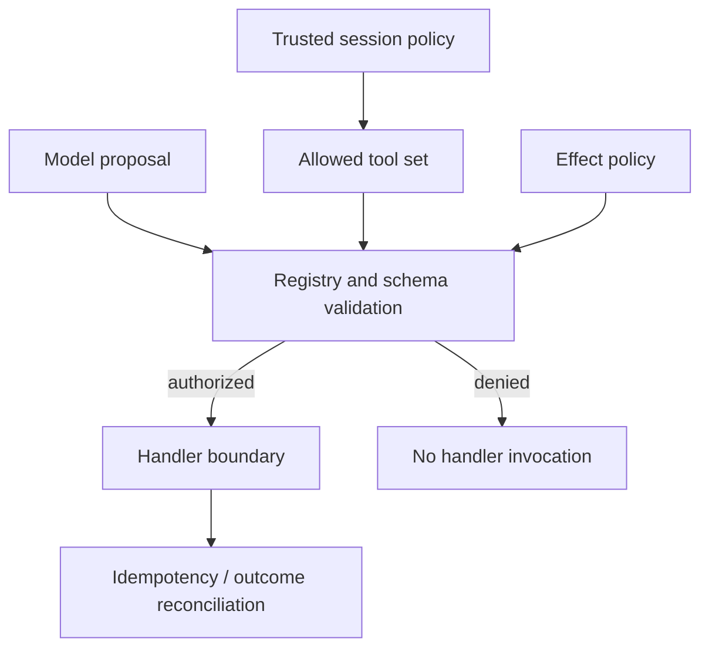

# Day 59 — enforce least privilege and inject faults at boundaries

## 1. Learning objectives

Design capability scopes for agent tools, enforce them in trusted runtime code,
and test failure paths where authorization, validation, timeout, or cancellation
occurs. You will distinguish “the model was told not to” from “the handler was
unreachable,” and explain why a timeout can leave a remote operation's outcome
unknown. The outcome is a narrow permission contract plus evidence from actual
execution, not a phrase-based security score.

## 2. Required prerequisites

Review the `Tool`, `Registry`, and `Agent` definitions in
[runtime.py](../../../forgeagent/runtime.py), plus
[Day 58](../day-04/README.md)'s malicious observation trajectory. The runtime
uses closed-object schemas and a separate `allow_write` gate. Security contracts
are in [test_agent_security.py](../../../tests/security/test_agent_security.py).
Know async cancellation and exception basics.

## 3. Problem motivation

An agent may have access to tools with different consequences: search, read,
send, delete, and purchase. Giving every tool to every task creates avoidable
blast radius. A model can make a mistaken or injected call, and provider text
is not an identity credential. The host must compute its allowed tool set from
trusted user/session policy and constrain effects even when the requested action
is syntactically valid.

## 4. Intuitive explanation

A library card might permit reading books but not changing the building alarm.
We do not ask the reader to promise not to touch it; the control system denies
access. In the agent, `allowed` is the checked tool set and `allow_write` is an
additional effect gate. Argument schemas limit what each permitted tool can
receive. Each is a separate control: passing one does not imply passing the
others.

## 5. Deep technical explanation

The runtime derives discoverable tools from registered names intersected with
the `Agent.allowed` set. Discovery limits what is advertised but is not the
security check: `Registry.prepare` again verifies that a proposed call is
allowlisted, registered, and effect-permitted. Then `validate_arguments`
enforces a small closed-object schema (keys, required values, primitive types,
length/range/enum). Only after all calls and dependency layers are preflighted
does dispatch invoke handlers. These checks defend the local interface, not
against a malicious handler or compromised process.

Timeouts constrain waiting, but cancellation is not rollback. If a remote API
accepted a request just before the client timed out, a retry can duplicate the
effect. Use idempotency keys, query operation status, or design compensating
actions. For an async local task, cancellation propagates and the agent records
the event then re-raises; the external caller must decide how to handle it.

## 6. Mathematical foundations

Least privilege can be represented as set inclusion. Let R be tools registered,
A the task's authorized tools, and P the tools proposed by the model. A valid
call requires name∈R∩A and effect policy E(name)=allow. The model proposal does
not enlarge A. If a session has k read tools and one write tool, and the task
needs only two reads, exposing k+1 tools increases available action choices but
does not improve the formal authorization rule. Limit A to the task's need.

For write effects, let N be attempted calls and X actual handler starts. A
denied path should maintain X=0. Recording only the final agent status cannot
establish X=0; instrument the handler or durable side-effect boundary.

## 7. Architecture and execution diagrams



The set and effect policy come from host code. The model can propose a call but
cannot mutate either input.

## 8. Implementation from first principles

Run `python -m unittest tests.security.test_agent_security`. Then trace a
disallowed write through `prepare`: it raises before a handler call. The
`effects` list is an observable local substitute for durable state. Extend the
test to validate that unknown fields and wrong types also leave it empty. If a
handler was entered before argument validation, fix call ordering rather than
adding a prompt instruction.

```python
effects = []

def prepare_update(arguments):
    if set(arguments) != {"value"} or type(arguments["value"]) is not str:
        raise ValueError("invalid update")
    return arguments["value"]

try:
    effects.append(prepare_update({"value": "new", "extra": True}))
except ValueError:
    pass
assert effects == []
```

Python evaluates the argument to append first. A validation error exits before append mutates the list. Field equality rejects extra keys even if value is a valid string.

## 9. Worked execution walkthrough

The model proposes `store(value="secret")` with the tool registered but write
permission false. The tool name is in the task's allowed set, so tool selection
alone passes. The effect gate rejects it. Dispatch's exception is converted to
a failed agent run; no observation for that attempted call is returned, and the
handler's counter remains zero. A grader that expects an empty observation list
must separately confirm the effect counter, since logs can be missing or
misleading.

## 10. Independent laboratory

Complete Lab 6's boundary assessment. Add three cases: registered-but-not
allowed read, allowed-but-write-disabled store, and allowed read with invalid
argument. Record whether the handler started. Next simulate a timeout after an
external “accepted” marker and explain why the agent's timed-out status cannot
prove the marker was rolled back. Add a reconciliation query or idempotency
contract to the design.

## 11. Experiments

Keep model decisions constant and change only the host policy set. In one run,
allow `lookup`; in another, omit it. Verify that same proposal invokes the tool
once and zero times respectively. Then leave the name allowed but disable write
effect. The isolated changes demonstrate three independent gates. Use fresh
effect counters between runs; reusing state can make a denied action look like
a successful call from a previous trial.

## 12. Failure analysis

Using `allowed` only in the tool description is not enforcement. Building the
allowlist from a model-generated plan lets the planner self-authorize. Catching
all exceptions and reporting success hides failed effects. A retry after timeout
may duplicate an accepted remote write. Finally, a cancellation event says the
caller stopped waiting; it does not say downstream work stopped or was undone.

## 13. Engineering tradeoffs

Narrow scopes can make tasks impossible when requirements are underspecified.
Resolve this by requesting a specific capability through an explicit policy
workflow, not by silently widening every task. Per-user, per-resource scopes
improve isolation but require trustworthy identity and lifecycle management.
Extra validation can reject legitimate inputs; schemas need versioning and
boundary examples. Idempotency and reconciliation add state, but reduce duplicate
effects after uncertain outcomes.

## 14. Real-world connection

An agent integrated with payment, email, code execution, or file deletion should
receive a minimum capability set bound to the authenticated caller and current
task. A UI confirmation can be one control, but server-side authorization must
still validate the exact target and operation at effect time. This local
runtime's registry is a teaching analogue, not a complete authentication or
tenant isolation system.

## 15. Common misconceptions

“Registered means authorized” omits task scope. “Allowed means safe” omits
arguments, effect, target ownership, and handler semantics. “Timeout means
failure” ignores uncertain remote acceptance. “Cancellation undoes the action”
is incorrect unless the underlying transaction provides that guarantee. A safe
report names which check ran and which state it observed.

## 16. Technical examination

A tool is registered and advertised but absent from `allowed`. The model supplies valid arguments. Predict the result. Write one test independent of schema validity. Diagnose direct invocation of the handler and explain where to enforce authorization on retry.

Check your work after attempting the [separate reference criteria](../../../solutions/examinations/daily-agent-systems.md).

## 17. Daily mastery gate

If one global allowlist serves all tasks, derive per-task capabilities from
trusted identity and policy. If unauthorized tests check only returned text,
instrument the actual handler/effect. If timeouts retry automatically, add
idempotency and outcome lookup before retrying writes. If cancellation handling
swallows `CancelledError`, propagate it and record the lifecycle result.

Advance at Level 4 after the public check passes, you explain the result from memory, and you reproduce and correct the failure in section 12.

## 18. Resources

The local executable policy is in `Registry.prepare` and `dispatch`; the direct
security checks are in the Week 10 test suite. OWASP recommends least privilege
and implementing sensitive capabilities in application code in its primary
LLM01 guidance, which supports this threat-model choice:
[OWASP LLM01:2025](https://genai.owasp.org/llmrisk/llm01-prompt-injection/).
Checked 2026-11-17. This mapping is an engineering interpretation, not a formal
conformance statement.

## 19. Revision and retention

Tests establish behavior for the local Python boundary and fake side-effect
counter. They do not prove remote transaction semantics, OS sandboxing, identity
binding, race freedom in a distributed service, or production permission policy.
The runtime's cancellation test covers waiting on a provider. Callers must
reconcile external operations independently.

## 20. Next lesson connection

For one consequential tool, list the authenticated principal, resource owner,
operation, validated arguments, permission source, and effect record. Design a
test for denial at each layer plus timeout after remote acceptance. Name the
idempotency or reconciliation strategy. Verify that the model can neither
expand its allowed set nor bypass the effect-time ownership check.
