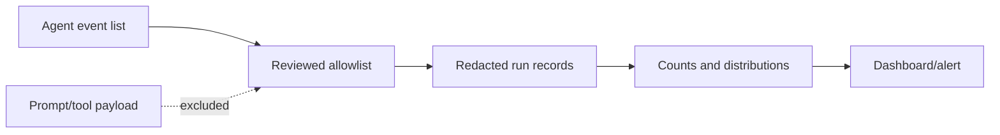

# Day 60 — use observability for quality-latency-cost decisions

## 1. Learning objectives

Describe a trace as a causal record of one agent operation, distinguish it from
aggregated metrics, and export useful run metadata without copying conversations
or tool payloads. You will inspect the runtime's event list, summarize run
latencies in seconds, and compare route costs in explicitly named USD units.
You will also identify measurements the current implementation does not provide.

## 2. Required prerequisites

Read the `RunResult` and event appends in
[runtime.py](../../../forgeagent/runtime.py). Review [Day 56](../day-02/README.md)
for timing uncertainty and units. The implementation is
[telemetry.py](../../../forgeagent/telemetry.py), with the contract in
[Lab 3](../../../labs/week-10/README.md). Dictionaries and basic percentile
selection are sufficient.

## 3. Problem motivation

An aggregate “slow” alarm says a problem exists but may not reveal whether time
went to a provider wait, a tool, or repeated steps. A raw transcript can answer
more, but it often includes user data, retrieved content, and secrets. Telemetry
must preserve enough structure to diagnose systems while excluding content that
should not enter routine operational records.

## 4. Intuitive explanation

A trace is like a trip itinerary with named stops and elapsed time. A metric is
like counting hundreds of trips by duration. Logs are detailed notes from one
stop. For an agent, spans might represent overall run, provider request, and tool
call. A safe operational trace need not carry the question or tool arguments;
it can record that a model step began and how long the run took.

## 5. Deep technical explanation

The Week 9 runtime appends events such as `model_start`, `model_end`, `tool_start`,
`tool_end`, `failure`, `cancelled`, and `run_end`. Tool events currently include
call identifiers and names, but the telemetry layer deliberately discards both.
It retains reviewed low-cardinality fields such as event type, status, step,
success flag, selected failure code, and run duration. The `summarize` function
reports aggregate status counts, event counts, provider-reported tokens, and
known cost.

Run duration comes from `run_end.seconds`; current runtime does not timestamp
each provider and tool event, so this implementation cannot correctly derive
provider-span or tool-span latency percentiles. Do not subtract adjacent events
without timestamps. This limitation is explicit and suggests a future protocol
change: monotonic start/end timestamps or duration fields for each span, with
correlation identifiers generated outside sensitive payloads.

OpenTelemetry semantic conventions standardize names, kinds, attributes, and
units for traces and metrics. A local summary is not an OTel exporter and does
not claim semantic-convention compliance, but the same discipline applies:
name units and avoid high-cardinality attributes. See the official conventions
resource in section 18.

## 6. Mathematical foundations

For sorted run durations t₁≤…≤tₙ, this implementation uses nearest-rank style
p95 index ceil(0.95n), with one-based rank. For n=5, ceil(4.75)=5, so p95 is the
maximum observed duration. With n=100, rank 95 is selected. This makes small
sample p95 jump sharply; disclose n. Known cost is
C=(input_tokens·rᵢ+output_tokens·rₒ)/10⁶ in USD if rates are USD per million
tokens. If rates are zero or unspecified, cost is not provider billing; it is
the arithmetic implied by those rates.

For a route comparison, report a vector (Q,L,C), where Q is an explicitly
defined task success fraction, L is a latency distribution in seconds, and C
is known cost in USD under stated rates. Avoid collapsing this vector into a
weighted score unless weights encode an approved tradeoff. Apply safety gates
first; then compare routes on matched cases. A route with 1% better completion
but a forbidden side effect is not rescued by lower cost.

## 7. Architecture and execution diagrams



The filter sits before export. “Redact later” is dangerous because a raw event
may already have been copied to a log or analytics sink.

## 8. Implementation from first principles

Run [Lab 3](../../../labs/week-10/README.md). The public test passes an event
containing `prompt` and `tool`; output must omit both. Then call
`forgeagent.telemetry.summarize` on a pair of actual `RunResult` objects and
inspect output keys. The route comparator accepts already-graded rows and
reports mean cost in USD and median latency in seconds; it cannot infer why
one route differed or determine that the tasks were comparable.

```python
from math import ceil

def nearest_rank(samples, fraction):
    ordered = sorted(samples)
    return ordered[ceil(len(ordered) * fraction) - 1]

assert nearest_rank([0.18, 0.10, 0.11, 0.12], 0.50) == 0.11
assert nearest_rank([0.18, 0.10, 0.11, 0.12], 0.95) == 0.18
```

Nearest rank is defined for a nonempty list and a fraction in (0, 1]. Sort O(n log n), then locate the one-indexed rank with a zero-indexed offset. Validate those input assumptions in a reusable API.

## 9. Worked execution walkthrough

Suppose events are `model_start(step=1)`, `tool_start(name=lookup)`,
`tool_end(ok=True)`, `model_end(calls=1)`, and `run_end(status=completed,
seconds=0.12)`. The safe summary retains event names/counts, step, completion,
and 0.12 seconds. It omits tool name and call ID. Across four runs, durations
0.10, 0.11, 0.12, 0.18 yield nearest-rank p50=0.11 and p95=0.18. Four points
are not a stable tail estimate; report n=4 beside the percentile.

Suppose route A passes 9/10 tasks at p50 0.8 s and $0.010 known cost, while B
passes 8/10 at p50 0.5 s and $0.006. The quality/latency/cost vector makes the
tradeoff explicit. If B's missed task is a critical authorization invariant,
the decision gate rejects B even though it is faster and cheaper. If both pass
the same hard gates, a product owner can decide whether 0.3 seconds and $0.004
justify one fewer completion, with sample uncertainty in view.

## 10. Independent laboratory

Implement [route comparison](../../../labs/week-10/starter/route_comparison.py)
and redaction. Add a key such as `answer_text` and confirm the safe output drops
it by default. Compare routes only after confirming equal case identities and
compatible rates. Include `cost_unit: USD` and `latency_unit: seconds` in your
report rather than emitting bare numeric fields that downstream readers might
misinterpret.

Use the route comparator to summarize a small set of matched route rows. Include
sample size next to rates, list any hard-gate failure, and label rates as known
accounting from supplied assumptions. Avoid saying B is more efficient in
general based on one run; say that B had these observed values on this fixed set.

## 11. Experiments

Create a trace containing the same event types but insert a synthetic secret in
every unexpected string field. Run it through the allowlist and inspect the
serialized output for the marker. Then add a new field, `tenant_email`, and
verify it remains absent. This tests the default-deny export contract. Next
calculate how p95 changes after adding one slow sample; discuss that the new
measurement is real even if the sample is inconvenient.

## 12. Failure analysis

Allowlisting `message` or `result` because one dashboard needs it leaks future
content silently. A trace ID is useful for correlation but can become a join key
to sensitive records; operational policy still matters. A p95 with 3 samples
is simply the maximum under nearest rank. A cost field with unknown rates should
not be filled with 0, because 0 means the configured rates yielded zero.

## 13. Engineering tradeoffs

The current telemetry is tiny, deterministic, and content-free, but it has no
distributed context propagation, clock-quality metadata, or per-tool latency.
Adding durations improves diagnosis and may alter runtime instrumentation. Adding
tool names improves aggregation but creates cardinality and disclosure tradeoffs.
Decide what is necessary, retain a small reviewed attribute set, and keep raw
content out of default dashboards.

## 14. Real-world connection

OpenTelemetry's conventions cover spans, metrics, events, and resource attributes
so independent services can agree on operation names and measurements. Its
concepts are portable; a handwritten local dictionary is not a compatible SDK.
For production, use a supported exporter and enforce data minimization before
span attributes are attached. Confirm retention and access controls with the
telemetry backend owner.

## 15. Common misconceptions

“A trace requires full prompt capture” is false. “Redacted means anonymous” is
false if stable identifiers can be joined to a user. “p95 is the slowest task”
is only true at this sample size and rank convention. “Token count equals cost”
ignores pricing units, caching, provider billing details, and unreported usage.

## 16. Technical examination

**Prompt:** An event includes status, duration, prompt, tool arguments, and
call ID. Which fields may this exporter retain by default, and what percentile
unit is reported? **Key:** reviewed event/status/seconds fields only; seconds.
Full credit also notes a call ID may be a sensitive correlation key and current
runtime gives whole-run latency, not per-span latency.

## 17. Daily mastery gate

If you emitted event dictionaries unchanged, implement default-deny field
selection and rerun Lab 3. If you reported only cost without currency or rate
provenance, carry the unit and caller-supplied-rate caveat. If you computed tool
latency from event order alone, remove the claim until each span has a monotonic
duration measurement.

Advance at Level 4 after the public check passes, you explain the result from memory, and you reproduce and correct the failure in section 12.

## 18. Resources

OpenTelemetry defines semantic conventions as common names and meanings for
operations and telemetry attributes. Source checked 2026-11-17:
[Semantic Conventions](https://opentelemetry.io/docs/concepts/semantic-conventions/)
and [general conventions](https://opentelemetry.io/docs/specs/semconv/general/).
The local code is standard library only; it is a teaching summary and not an
OpenTelemetry implementation.

## 19. Revision and retention

Telemetry values are derived from the local `RunResult` only. There is no
exporter, external collector, live provider, or privacy compliance certification.
Known cost uses configured rates; local benchmark rows use illustrative fixture
rates. Whole-run latency reflects host scheduling and is not suitable for a
service-level objective. These are measurement examples, not production results.

## 20. Next lesson connection

Choose three operational questions you need to answer during an incident.
For each, list the smallest safe attributes and their units. Add a synthetic
payload field to test that exports omit it. Identify any correlation key that
could reidentify a person, and set an access/retention rule before enabling an
exporter. Record unsupported latency claims as gaps in the instrumentation.

Add one decision paragraph with per-route completion, p50/p95 seconds, mean
known USD cost, hard-gate status, and one uncertainty caveat. Do not rank routes
until their cases and resource accounting match.
