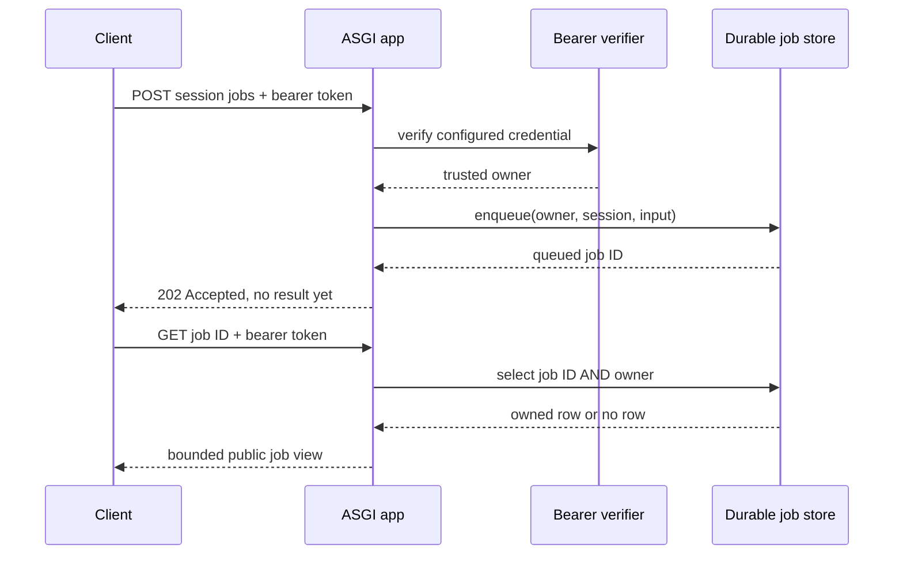

# Day 61 — FastAPI, bearer authentication, and session ownership

## 1. Learning objectives

Build a narrow ASGI boundary for an agent that already has a callable execution interface. By the end, you can distinguish routing from execution, derive an owner from authenticated credentials, scope every read and write by that owner, reject invalid requests before they become jobs, and explain why a session identifier is only a name rather than proof of permission. You will trace a 202 response through admission and later status lookup, and name the response data that must never include prompts, tokens, stack traces, or another tenant's records.

## 2. Required prerequisites

You need Python functions, exceptions, JSON, SQLite transactions, HTTP verbs, and the Week 2 owner/document boundary. Week 5 introduced asynchronous calls, timeouts, and bounded concurrency. Week 7 separated provider/agent behavior from the loop; Week 8 introduced persistent events and idempotent operations; Week 10 established redaction and the rule that untrusted content is data, never an authority signal. None of those weeks requires FastAPI. The service chapter uses framework names, then reduces the central boundary to a standard-library function so the lesson is executable without installing an extra.

## 3. Problem motivation

A local `agent.run(text)` call has one caller and one process. A network endpoint has multiple principals, retries, malformed input, concurrent work, and a public error surface. If a handler accepts `owner` from JSON, a caller can ask for someone else's records. If the handler runs the whole model call before returning, the HTTP request becomes a fragile worker. If an exception string is returned, it can disclose paths, credentials, or prompt content. A service must define identity and ownership before choosing a framework.

## 4. Intuitive explanation

Think of a front desk. A badge is checked against a trusted roster; the visitor does not get to write their own name on a form and thereby become that person. The desk then labels a folder with the verified identity plus a session label. The session label helps find a folder inside that identity's cabinet, but it cannot open any other cabinet. The service's dependency function acts like the badge reader; endpoint code receives a trusted owner value rather than re-parsing request text.

## 5. Deep technical explanation

FastAPI is an ASGI application: an ASGI server calls it with a scope, receive callable, and send callable. Starlette supplies routing and response machinery underneath. A route should validate transport shape and convert trusted identity into a domain call; it should not silently become the agent runtime. In this project `create_app` accepts a mapping from bearer secrets to owner IDs and an injected async `run_handler(owner, session_id, input_text)`. This keeps credentials outside user-supplied text and lets Week 12 add an agent without making this service import that future module.

Bearer tokens are secrets: configure them through deployment secrets, compare them without ordinary string equality, and never log them. The sample token in the operations guide is disposable. A production system needs token issuance, rotation, revocation, TLS, and preferably an identity provider; a static map is an educational adapter, not a complete identity lifecycle. Authentication answers “which configured principal presented a valid credential?” Authorization answers “may that principal read this row?” The database query must include both `job_id` and `owner`; returning 404 for a foreign job avoids confirming that the identifier exists.

## 6. Mathematical foundations

Let `T` map credentials to owners, and let `J` be a job row. Authorization is the predicate `T[token] = J.owner`. A lookup by identifier alone proves only `J.job_id = requested_id`, which is insufficient. The correct selection is the conjunction `J.job_id = requested_id AND J.owner = authenticated_owner`. For `n` configured tokens, constant-time comparison still costs O(n); this is acceptable for a tiny demo roster, while a hashed token index or external identity verifier is better at scale. Never optimize by trusting a body field.

## 7. Architecture and execution diagrams



The diagram separates admission from status. A 202 response does not claim that the agent ran successfully; it states that durable admission succeeded. A later status request observes the job state.

## 8. Implementation from first principles

The next function models the security-critical predicate without a framework. The client can choose a session name, but the owner is resolved from the trusted token map. The second function intentionally queries using both identity components. A real route adds Pydantic validation and maps a missing row to a generic 404. Run this block with the repository's ordinary Python; it makes no network call and uses only the standard library.

```python
def authenticate(authorization, credential_to_owner):
    scheme, separator, supplied = (authorization or "").partition(" ")
    if not separator or scheme.lower() != "bearer":
        return None
    import hmac
    for configured, owner in credential_to_owner.items():
        if hmac.compare_digest(supplied, configured):
            return owner
    return None


def can_read(row_owner, authenticated_owner):
    return row_owner == authenticated_owner


assert authenticate("Bearer alpha", {"alpha": "owner-a"}) == "owner-a"
assert authenticate("Bearer owner-a", {"alpha": "owner-a"}) is None
assert can_read("owner-a", "owner-a")
assert not can_read("owner-b", "owner-a")
```

The credential value `alpha` is test data, not a deployable secret. In a real application, use a generated secret in a secret manager and do not print it.

## 9. Worked execution walkthrough

Suppose token `demo-a` maps to `alice`, and the request is `POST /sessions/build-7/jobs` with `{"input":"summarize the patch"}`. FastAPI parses the JSON into a bounded string model. The auth dependency validates `demo-a` and returns `alice`. The route calls `enqueue("alice", "build-7", text, limit)`. The store writes owner, session, input, queued state, and event in one short transaction, then the route returns 202 with a random job ID and state. Later, token `demo-b` maps to `bob`; `GET /jobs/<id>` performs a two-column lookup and returns not found. The request body cannot change the owner at either step.

## 10. Independent laboratory

In `labs/week-11/starter/ownership.py`, implement `lookup(owner, identifier, rows)` and `submit(token, session_id, text, credentials)`. Return `None` for foreign or absent rows, reject empty session identifiers and overlong text, and never infer an owner from the session. Use `python labs/week-11/checks.py --day 1`, then `--day 1 --module learner-work/week-11/ownership.py`. Add one test where a user supplies their own owner string as the credential and is still rejected. Compare the finished behavior with `solutions/labs/week-11/ownership.py` after recording your prediction.

## 11. Experiments

Change the session name while keeping the token fixed; identity should stay the same and rows should remain owner-scoped. Change the token while keeping the session fixed; access should move to the second configured owner and the first owner's job should become invisible. Try empty input, a 4,001-character input, malformed JSON, a missing authorization header, and a well-formed unknown bearer token. Record the status and public error code for each. Confirm that none of the response bodies echoes the supplied prompt or token.

## 12. Failure analysis

The classic isolation bug is `SELECT * FROM jobs WHERE job_id=?`; it becomes an insecure direct object reference when identifiers are guessable or leaked. A second bug accepts `owner` in a body and uses it for later SQL. A third returns 403 only after confirming a foreign identifier exists, creating an enumeration side channel; a generic 404 is a reasonable policy for this API. Finally, authentication can be correct while authorization is wrong: verify that every status, list, and cancellation operation repeats the owner predicate.

## 13. Engineering tradeoffs

The sample uses a static credential-to-owner mapping because it exposes the trust boundary with no external account dependency. It requires a restart to rotate tokens and keeps a small roster in process memory. The service routes make owner identity a dependency, which is convenient and testable, but a real multi-tenant deployment may use signed OIDC claims and tenant membership checks. Session IDs are client-selected labels. No route treats them as a secret or as a substitute for owner identity. Input is persisted because workers execute after the request ends; status responses never return it.

## 14. Real-world connection

The same owner scoping appears in job APIs, object storage, billing dashboards, and support tools. A repository agent should normally be authorized against a workspace or repository identity supplied by trusted server configuration, not a string embedded in a prompt. If an organization has roles, the decision becomes a policy check over principal, action, resource, and context. This week's small conjunction is the first layer; it is not a complete authorization policy language.

## 15. Common misconceptions

“A random job ID is authorization” is false: IDs leak through logs, browser history, screenshots, and support tickets. “A session name is private” is also false; names are often predictable and user-controlled. “FastAPI handles security” is false: it helps express dependency injection and validation, but application code still chooses the credential source and SQL predicate. “HTTPS makes the owner field trustworthy” confuses transport confidentiality with request authority. Keep identity in trusted credentials and use it in every storage query.

## 16. Technical examination

Explain why `GET /jobs/{job_id}` must query by both job ID and authenticated owner. Then trace an attacker who knows a valid job ID but has a different valid bearer token. State the intended status code, the SQL predicate, and which fields are absent from the response. Finally, explain how the result changes if the endpoint uses a `session_id` parameter supplied by the attacker but no authenticated owner. A correct answer distinguishes authentication, authorization, and resource naming.

## 17. Daily mastery gate

Pass when you can implement the two-column ownership lookup, describe the ASGI route's trusted inputs, and demonstrate that an owner cannot read or cancel another owner's job. Also show that invalid credentials fail before any job row is created. Keep a short request trace with route, authenticated owner label, transaction action, and response status; redact token and prompt values. The implementation artifact and the reasoning trace are both part of the gate.

## 18. Resources

Read the official [FastAPI first steps](https://fastapi.tiangolo.com/tutorial/first-steps/) for route declaration and the official [FastAPI security tutorial](https://fastapi.tiangolo.com/tutorial/security/) for security dependencies. The [Starlette ASGI documentation](https://www.starlette.io/) explains the ASGI foundation. The project reference is `forgeagent/service.py`; the core can be inspected without importing it when the optional service dependencies are absent. Use the Week 2 transaction lesson for SQLite ownership patterns.

## 19. Revision and retention

Tomorrow, test an authenticated request that returns before the work finishes. In two days, redraw the trust chain from token to owner to SQL predicate without looking at this chapter. In one week, write a test proving that a foreign owner sees the same not-found response as an absent job. Retain the exact response schema, not a copied secret. A safe API is easier to audit when its public representation is intentionally smaller than the internal database row.

## 20. Next lesson connection

Day 62 changes the timing model: an authenticated route should admit work quickly, while async workers own execution and cancellation. The identity principle remains unchanged. The worker receives the owner selected by the authenticated route, never an owner asserted by input text. Tomorrow's queue chapter will turn the 202 response above into an observable state transition with bounded admission and a handler that can be cancelled.
