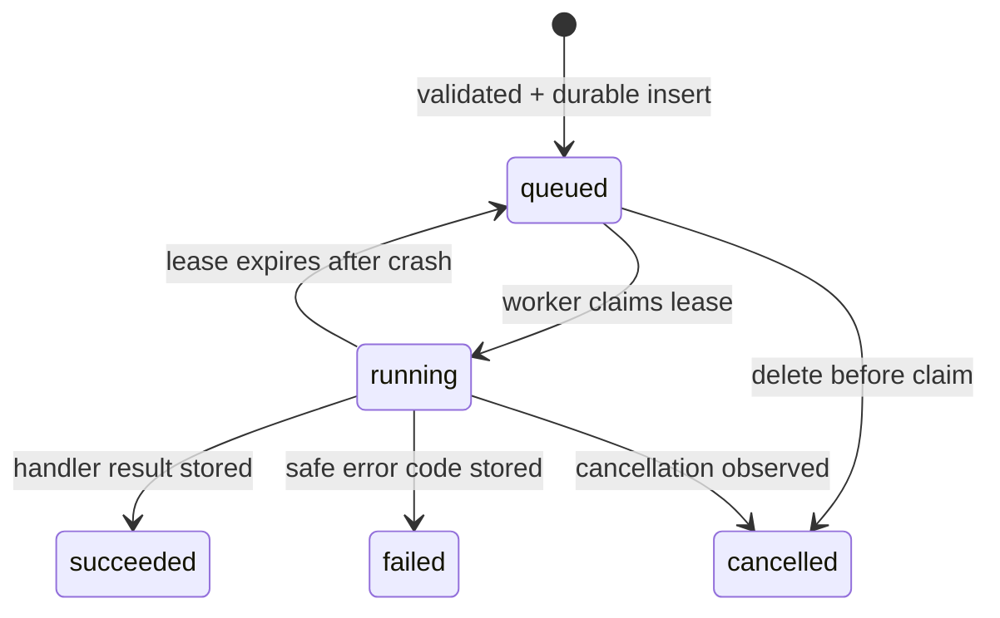

# Day 62 — Async APIs, queues, workers, and cancellation

## 1. Learning objectives

Design a request path that acknowledges durable admission without waiting for a long model/tool run. Explain where async code can still block, distinguish the request task from a worker task, cap active work, enforce a per-owner pending limit, and define cancellation as a state transition rather than a promise that side effects were undone. Add an idempotency key so a client retry after a lost response does not create a second job. Demonstrate every state with a local handler fixture.

## 2. Required prerequisites

You should know `async def`, `await`, `asyncio.Task`, cancellation exceptions, `asyncio.to_thread`, JSON, and the Week 5 semaphore/rate-bound lesson. Day 61 introduced bearer identity and returned a job ID. Week 8 introduced durable operation intent and the `pending`, `complete`, and `unknown` distinction for external side effects. The main distinction today is between a coroutine that answers HTTP and one that performs work after the request has ended. If async scheduling is new, first read the standard library's asyncio task and cancellation documentation linked below.

## 3. Problem motivation

An agent may make several provider calls and tools. A client connection can disappear while that work continues, and a reverse proxy can time out before the agent finishes. Holding a request open ties user-visible latency to execution duration and makes retry behavior ambiguous. Conversely, dropping a submitted request when the socket closes loses work the server already appeared to accept. We need a fast admission transaction, a durable status resource, and an explicit worker lifecycle with a defined capacity.

## 4. Intuitive explanation

At a restaurant, the host accepts an order ticket and gives a number. The kitchen cooks it; the host does not pretend the meal is ready when the ticket was accepted. A queue ticket has an owner, a session, and a stable ID. The kitchen has a finite number of cooks. When all seats in the queue are occupied, new requests receive a clear overload response. A cancellation ticket asks the kitchen to stop; it cannot reverse food already prepared or an external action already completed.

## 5. Deep technical explanation

The service route validates and persists the request, then returns HTTP 202. Workers claim queued rows and call the injected `run_handler(owner, session_id, input_text)`. Blocking database operations run in `asyncio.to_thread`, preventing SQLite calls from monopolizing the event loop. Each worker is one coroutine, so `worker_count` bounds simultaneously active handlers in a process. A durable pending quota is checked inside `BEGIN IMMEDIATE`; two requests for the same owner cannot both observe the last slot and exceed the bound.

The rate bucket controls arrival frequency, while the pending quota controls queued plus running inventory. They solve different overload modes. The former is currently process-local, so multiple replicas multiply its effective allowance; production enforcement must move to a shared store or API gateway. The durable quota is database-backed and shared by replicas. The queue is also polled from SQLite, which is suitable for a small single-host reference but not a substitute for a broker when throughput, fan-out, or cross-region delivery demands one.

Idempotency keys are scoped to `(owner, session_id)`. A retry with the same key and same body returns the original job; reusing the key with changed input returns a conflict. This is transport-level deduplication, not exactly-once execution of tools. Worker cancellation uses `Task.cancel()` locally and a persisted request flag that other replicas can observe. The handler must propagate cancellation and use Week 8 operation receipts around irreversible effects.

## 6. Mathematical foundations

Little's Law relates average in-system jobs `L`, arrival rate `λ`, and mean time in system `W`: `L = λW`. If 0.2 jobs/second arrive and average completion takes 15 seconds, expect about 3 jobs in progress or waiting in steady state. A worker pool of `c` handlers with mean service time `S` has idealized capacity `c/S`; for 4 workers and 10-second service time, that is 0.4 jobs/second before overhead and variance. Operating near 100% utilization causes queue delay to rise sharply, so admission limits and load shedding are part of reliability.

## 7. Architecture and execution diagrams



```mermaid
sequenceDiagram
    participant C as Client
    participant R as Route
    participant DB as SQLite queue
    participant W as Worker
    C->>R: POST with Idempotency-Key
    R->>DB: BEGIN IMMEDIATE; enforce owner quota; insert
    DB-->>R: committed queued job
    R-->>C: 202 + job ID
    W->>DB: claim queued job
    W->>W: await injected async handler
    C->>R: GET /jobs/id
    R->>DB: owner-scoped status lookup
    DB-->>C: queued/running/terminal status
```

## 8. Implementation from first principles

This standard-library model shows why a worker needs a bounded semaphore and why cancellation is allowed to propagate. It also shows a tiny injectable handler: tests can supply a fast fake without connecting to a provider. Production uses persisted worker claims instead of only an in-memory `asyncio.Queue`, but the scheduling boundary is visible here.

```python
import asyncio


async def handle(text):
    await asyncio.sleep(0.01)
    return {"characters": len(text)}


async def bounded_worker(queue, active, outcomes):
    while True:
        job_id, text = await queue.get()
        try:
            async with active:
                outcomes[job_id] = await handle(text)
        except asyncio.CancelledError:
            outcomes[job_id] = {"status": "cancelled"}
            raise
        finally:
            queue.task_done()


async def example():
    queue = asyncio.Queue(maxsize=2)
    semaphore = asyncio.Semaphore(1)
    outcomes = {}
    await queue.put(("j1", "fixture"))
    worker = asyncio.create_task(bounded_worker(queue, semaphore, outcomes))
    await queue.join()
    worker.cancel()
    try:
        await worker
    except asyncio.CancelledError:
        pass
    assert outcomes["j1"] == {"characters": 7}


asyncio.run(example())
```

## 9. Worked execution walkthrough

Client sends the same request twice because it lost the first response. The route authenticates the same owner and session, then the store finds the idempotency key and matching input. It returns the existing queued row instead of inserting another. A worker claims it and begins the handler. The client asks for status and sees `running`. It sends DELETE; the server writes `cancel_requested=1` and cancels a local handler if that replica owns it. A second replica's heartbeat observes the flag and cancels its handler. A handler cancellation ends the job in `cancelled`; a provider charge or tool side effect that already happened remains real and must be reconciled.

## 10. Independent laboratory

Complete `labs/week-11/starter/worker.py`. Implement `run_many(jobs, handler, concurrency)` with an `asyncio.Semaphore`, preserve input order in the result list, and propagate cancellation instead of converting it to a successful result. Then implement a pending quota check in `ownership.py`. Run `python labs/week-11/checks.py --day 2` and add a fake handler controlled by `asyncio.Event` so you can prove only the configured number of handlers enter at once. The solution includes reasoning about `Queue.task_done()` and worker shutdown.

## 11. Experiments

Set concurrency to one, submit three handlers with distinct sleep durations, and record start/end times. Increase it to two and compare elapsed time; do not assume it halves if one task has serial work. Cancel before claim, during a cancellable wait, and after a simulated irreversible side effect. Observe the distinct job states and side effect counter. Replay an idempotency key with identical input, then with altered input. Check that one returns the existing ID and the other conflicts. Finally, add an artificial blocking call and move it to a thread; compare whether a health request can respond while it runs.

## 12. Failure analysis

A common failure is `async def endpoint(): time.sleep(5)`, which blocks every coroutine sharing the event loop. Another is `except BaseException: return {"ok": True}`, which swallows `CancelledError` and falsely reports success. An unbounded in-memory queue converts overload into memory growth. A worker exception that includes `str(error)` can leak user data. Finally, a client retries after a timeout without idempotency and creates two jobs. The fix is not one magic queue: use bounded admission, safe state transitions, durable IDs, and retry semantics together.

## 13. Engineering tradeoffs

SQLite makes the durable queue inspectable and dependency-light, but polling creates database work and SQLite serializes writers. Local async cancellation is prompt; remote cancellation can wait up to the polling interval. A broker can provide delivery features, but does not make external effects exactly once. Idempotency storage uses more disk and needs retention policy. A handler may need a timeout, but a timeout cannot kill arbitrary native code or reverse a remote action. Bound each resource separately: requests per minute, jobs in flight, input bytes, handler duration, and worker count.

## 14. Real-world connection

The same admission pattern appears in report generation, video transcoding, data exports, and agent tool runs. HTTP is the control plane: submit, inspect, cancel. A queue worker is the execution plane. Keeping them separate allows retries, autoscaling, and operational status without requiring a client connection to survive the task. For agents, however, a job can include paid model calls and external writes; the run handler must therefore carry correlation and idempotency context into those downstream boundaries.

## 15. Common misconceptions

“Async makes CPU work parallel” is false; Python coroutines switch when they await. CPU-heavy work may require a process pool. “A 202 means it completed” is false; it means the server accepted asynchronous processing. “A bounded worker count bounds everything” is false if the queue is unbounded or request bodies are unlimited. “Cancellation rolls back the task” is false for remote effects. “Retry is harmless” is false without idempotency or a reconciliation record. These distinctions should appear in operational docs and client behavior, not only in code comments.

## 16. Technical examination

Given `c=3` workers, average service time 8 seconds, and arrival rate 0.5 jobs/second, calculate the idealized capacity and utilization before overhead. Explain why queue latency can still become unstable near saturation. Then describe what should happen when a client repeats the same key after losing a 202 response. Finish by distinguishing a local cancellation, a cancellation seen by a remote worker, and a completed external write. State one test for each case.

## 17. Daily mastery gate

Pass when your worker pool never exceeds the requested concurrency, the service rejects work at a clear durable pending limit, identical idempotent retries do not duplicate jobs, handler exceptions produce only a safe error code, and cancellation remains visibly distinct from success. Demonstrate a test where the client disconnects after admission but the worker completes and status remains queryable. Submit a short capacity estimate and list the limits that still need a shared rate limiter in a multi-replica deployment.

## 18. Resources

Use the official [Python asyncio task documentation](https://docs.python.org/3/library/asyncio-task.html) for task lifetimes and cancellation, and [asyncio queues](https://docs.python.org/3/library/asyncio-queue.html) for queue semantics. FastAPI's official [background tasks guide](https://fastapi.tiangolo.com/tutorial/background-tasks/) describes small in-process work and its limitations. The reference service uses independent worker tasks because long-running work needs durable status and recovery beyond a response's lifetime.

## 19. Revision and retention

Tomorrow, turn `queued`, `running`, and `cancelled` into a persisted state table with transition rules. In two days, calculate capacity from a measured handler duration rather than a guess. In one week, inspect a test where cancellation arrives from another process. Keep notes of the handler's true side effects and which are reversible. The distinction between “request stopped” and “world state restored” is crucial for safe agents.

## 20. Next lesson connection

Day 63 replaces the remaining in-memory assumption with atomic job records, leases, fencing, and restart recovery. A worker can crash after claiming a row; the next worker must know when the old claim is stale. The execution queue therefore becomes a persistent coordination protocol. We will also connect handler side effects to Week 8 pending/unknown receipts so recovery never confuses retry permission with exactly-once guarantees.
