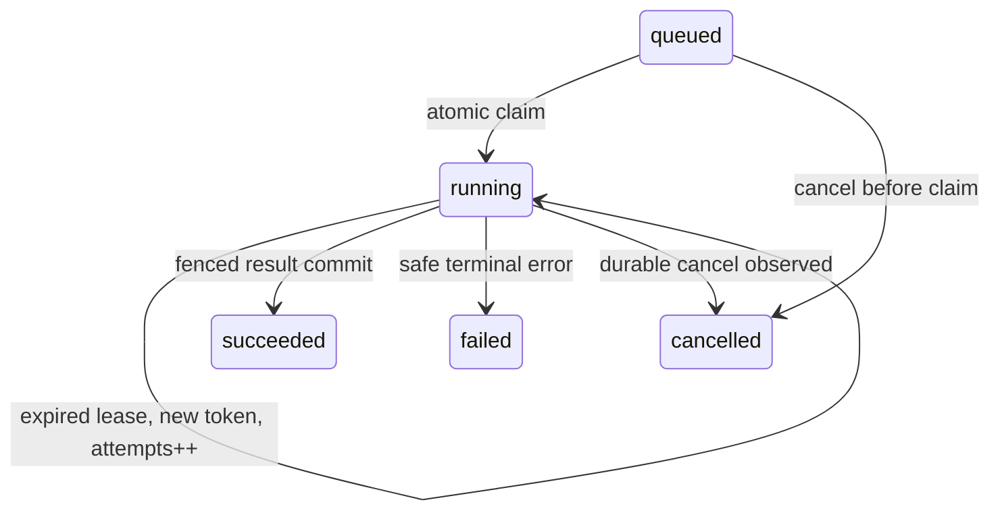

# Day 63 — Persistent jobs, leases, and recovery

## 1. Learning objectives

Model a background job as a persisted state machine rather than a Python object. Define legal transitions, atomically claim work, let a crashed worker's lease expire, renew a long-running lease, and fence off a stale worker whose lease was replaced. Explain what restart recovery can guarantee and what it cannot guarantee about external effects. Connect job rows to Week 8's owner/session event journal and operation receipts without conflating the two persistence concerns.

## 2. Required prerequisites

You need SQL transactions, SQLite constraints and indexes, timestamps, unique keys, async worker tasks, and Week 8's `EventJournal`/operation intent API. Day 62 introduced queued admission and finite workers. A lease is a time-limited claim, not a lock held in a Python process. A fencing token is a generation value that a stale claimant cannot use after another claimant takes over. If the difference between database atomicity and external side-effect atomicity is unclear, revisit Week 8's `pending` and `unknown` operation states before continuing.

## 3. Problem motivation

An in-memory queue disappears on process restart. Persisting only a `running` flag is not enough: after a crash, nobody knows whether the old worker is still alive. Marking every running job failed loses recoverable work; immediately retrying can run a long but healthy job twice. Durable leases give the database an explicit expiration time, while a new claim replaces a unique lease token. The old worker can finish late, so writes must be conditional on its current token.

## 4. Intuitive explanation

A library loans one key to a worker with an expiration time and a stamped receipt. If the worker vanishes, another can claim the key after the lease expires. The receipt has a generation number. If the first worker returns after the second has taken over, its old receipt is rejected. This prevents stale completion from overwriting the current state. The library still cannot know whether the worker sent an email before disappearing; that external action needs its own receipt and reconciliation.

## 5. Deep technical explanation

`JobStore.claim` begins `IMMEDIATE`, selects one queued row or a running row with `lease_until < now`, updates it to running, increments attempts, stores a fresh random token and expiration, then commits. Concurrent claimers serialize at the transaction boundary and choose different eligible rows. The worker renews its lease periodically only while the row still has the same token. Completion checks `job_id`, running state, and lease token in a transaction. If a second worker reclaimed the job, the first worker's finish attempt has no matching row and is ignored.

The state machine distinguishes `queued`, `running`, `succeeded`, `failed`, and `cancelled`. Queued cancellation is immediately terminal. Running cancellation sets a durable request flag; workers poll it or the local API signals its active task. Shutdown cancellation is different: the job stays running until its lease expires, so a restarted service may retry it. The attempt count helps diagnose repeated crashes. A production system also needs maximum attempts, backoff, dead-letter review, retention, schema migration, and a lease duration based on observed tail latency.

Week 8's event journal records ordered domain events for a `(owner, session)` stream with expected-revision compare-and-swap. A queue row answers “who owns this job and what is its execution state?” An event answers “what happened in the session?” An operation receipt answers “what is the status of this side-effect intent?” Keep these records separate but correlate them with the job ID and operation ID. After a crash around a non-idempotent tool, a `pending` receipt may have an unknown outcome; do not blindly execute the effect again just because the job lease expired.

## 6. Mathematical foundations

Let `t_exp` be a lease expiration time, `Δ` the heartbeat interval, and `δ` maximum expected scheduling/database delay. A conservative lease needs `t_lease > Δ + δ`; a heartbeat interval near one third of the lease leaves room for one delayed pulse. Recovery delay after a crash is approximately the remaining lease time, between 0 and `t_lease`. Short leases improve recovery speed but increase false expiry when a worker pauses. A fencing token is not a clock: it prevents stale writes even if clocks skew, provided every completion checks the token in the database.

## 7. Architecture and execution diagrams

```mermaid
sequenceDiagram
    participant W1 as Worker A
    participant DB as Job database
    participant W2 as Worker B
    W1->>DB: claim queued row, token A, lease t+60s
    W1->>DB: renew token A
    Note over W1: process crashes
    Note over DB: lease expires
    W2->>DB: claim expired row, token B, attempts + 1
    W1->>DB: late finish with token A
    DB-->>W1: no matching lease; ignore
    W2->>DB: finish with token B
```



## 8. Implementation from first principles

This compact model demonstrates fencing independently of SQLite. A generation token changes when the lease is reclaimed. The real service stores the token in the job row and checks it when finishing. This block is a deterministic local example that runs using only the standard library.

```python
class Lease:
    def __init__(self):
        self.generation = 0
        self.owner = None
        self.value = None

    def claim(self, worker):
        self.generation += 1
        self.owner = worker
        self.value = f"generation-{self.generation}"
        return self.value

    def finish(self, worker, token):
        if worker != self.owner or token != self.value:
            return False
        self.owner = None
        return True


lease = Lease()
old_token = lease.claim("worker-a")
new_token = lease.claim("worker-b")
assert lease.finish("worker-a", old_token) is False
assert lease.finish("worker-b", new_token) is True
```

## 9. Worked execution walkthrough

Worker A claims job `j` at 10:00:00 with token `a1`, expiration 10:01:00, and attempt one. It sends a request to an external tool and stalls. Its heartbeat no longer runs. At 10:01:01 worker B's atomic claim selects the expired row, increments attempts to two, and writes token `b2`. Worker A wakes and tries to commit a result with `a1`; the conditional update affects zero rows. Worker B finishes with `b2` and its result becomes durable. The external tool may have been called twice, so the operation receipt must tell B whether the first call completed, remained pending, or is unknown.

## 10. Independent laboratory

Implement `labs/week-11/starter/leases.py`: `claim(rows, now, lease_seconds, token)` chooses the oldest queued or expired running job and returns a copy updated to running; `finish(rows, job_id, token, result)` accepts only the current token; `recover(rows, now)` returns expired work to a claimable state. Add a crash/reclaim/stale-finish test. Run `python labs/week-11/checks.py --day 3`, then pass a second worker token to verify fencing. Compare the reference transaction order and identify where `BEGIN IMMEDIATE` prevents two claimers from taking the same row.

## 11. Experiments

Set a lease to 100 ms and a heartbeat to 30 ms; pause the worker for 250 ms to trigger a reclaim. Then test a worker with renewal and record whether duplicate claims occur. Attempt completion with an old token and verify the row remains owned by the newer claim. Restart the application after a job enters `running`; wait for lease expiry and confirm it is attempted again. Finally, simulate an external side effect that succeeds immediately before process termination. Inspect the Week 8 receipt and articulate what the recovery policy can safely conclude.

## 12. Failure analysis

A stale worker overwrite is prevented only if every terminal update checks the lease token. An application-level “I still own it” check followed by an unconditional update has a race. Clock jumps can make timestamp leases expire too early or too late; synchronized clocks help, but token fencing remains the write safety mechanism. A worker that spends longer than the lease in a blocking call can be reclaimed while still alive. Heartbeats reduce that risk; downstream idempotency controls duplicate effects. Finally, storing raw exception messages in job rows turns durable storage into a private-data archive and an error disclosure channel.

## 13. Engineering tradeoffs

The reference uses random fencing tokens rather than an integer epoch. Tokens need only be unguessable and compared for equality; an integer is easier to inspect but requires atomic increment correctness. SQLite polling keeps the lesson self-contained and supports one-host deployments. A distributed broker often provides visibility timeouts, but application handlers still need idempotency because brokers commonly deliver at least once. Retaining complete input forever eases recovery but raises privacy and storage risk; define expiry, deletion, and audit retention before deployment.

## 14. Real-world connection

Leased state appears in task queues, workflow engines, database migration runners, and leader election. A coding agent may have emitted a patch or run a command before a worker dies. A retry should inspect durable evidence and filesystem state, not assume the previous attempt made no progress. This is why the Week 8 context checkpoint, event journal, and effect operation records complement a job queue: they let us reconstruct which step was complete and which outcome requires operator reconciliation.

## 15. Common misconceptions

“A lease means only one worker ever executes” is false; a stalled worker and a reclaimer can overlap. “Exactly once” is not a transport guarantee: local SQLite cannot atomically commit a remote provider call. “Restart recovery means retry everything” ignores unknown effects. “The current owner can always finish” is false after a new token replaces the old one. “A successful HTTP DELETE means the handler rolled back” is false. State names must describe observed transitions, not aspirational behavior.

## 16. Technical examination

Two workers race to claim one queued job. Specify the SQL transaction boundary and the claim predicate. Then a first worker's lease expires and a second worker claims with a new token. Show the condition for rejecting the first worker's completion. Explain why a lease heartbeat alone does not prevent duplicate external effects. Given a tool call that timed out after a remote side effect may have happened, state which Week 8 operation status should be recorded and what reconciliation must do before retry.

## 17. Daily mastery gate

Pass when your store persists each state transition, safely limits owner pending work, reclaims an expired lease, rejects a stale finish, and recovers a running job after process restart. Also demonstrate cancellation on a second application instance via the durable flag. Provide one test for an external effect with an unknown outcome. Do not claim exactly-once execution; document the remaining idempotency and reconciliation contract in the runner interface.

## 18. Resources

Read [SQLite transaction control](https://www.sqlite.org/lang_transaction.html) and the [SQLite locking documentation](https://www.sqlite.org/lockingv3.html) for writer serialization and journal modes. Review the project's `forgeagent/durable.py` API for CAS events, checkpoints, and operation receipts. The queue implementation is in `forgeagent/service.py`; its lease mechanics are purposefully small enough to test using a temporary file-backed database.

## 19. Revision and retention

Tomorrow, add only safe observability to the transitions; do not place payloads in metrics labels. In two days, estimate duplicate-work exposure from lease duration and handler tail latency. In one week, write a failure drill at the boundary between tool success and receipt resolution. Keep separate notes for job state, session event revision, and external effect state. These three timelines answer different recovery questions.

## 20. Next lesson connection

Day 64 makes state transitions visible through structured logs, spans, and metrics. We will use the job state machine as a source of low-cardinality events while keeping prompt text, credential values, and session identifiers out of routine telemetry. OpenTelemetry will be shown with an in-memory exporter so a learner can inspect a span without deploying a collector or exposing a live endpoint.
