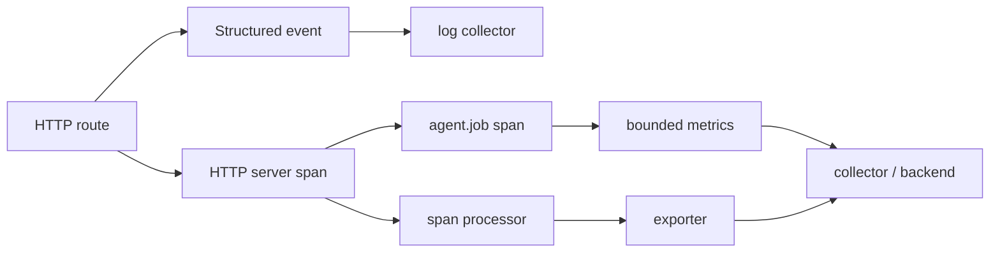

# Day 64 — Structured logs, traces, metrics, and OpenTelemetry

## 1. Learning objectives

Choose whether a service question belongs in a log, metric, or trace. Emit structured low-cardinality events for admission and state changes; derive latency and queue delay from timestamps; create a span with reviewed attributes using OpenTelemetry; and test its output in memory. Apply a redaction policy that excludes credentials, prompts, answers, owner/session/job identifiers, tool arguments, and raw exceptions from routine exported telemetry. State the difference between an SDK span and an exported production trace.

## 2. Required prerequisites

You need dictionaries/JSON, percentile intuition, HTTP service timing, and Week 10's `forgeagent.telemetry` redaction helper. Days 61–63 establish authenticated requests, jobs, and persisted transitions. OpenTelemetry concepts are provider, tracer, span, attributes, processor, and exporter. The API lets application code create telemetry; the SDK records and processes it; an exporter sends it elsewhere. This chapter runs one span through an in-memory exporter and does not require a collector. The optional `service` extra contains the compatible API and SDK.

## 3. Problem motivation

“The agent feels slow” is not a diagnosis. A request might wait in the queue, spend time in provider calls, or block on a tool. “It failed” is not enough to find whether admission, execution, or result persistence failed. Structured events give machines stable fields; metrics summarize populations over time; traces connect one request to nested work. Observability can itself create harm if it captures user text or secrets. Good telemetry supports a concrete operational question and has an explicit data budget.

## 4. Intuitive explanation

Logs are a flight recorder with named fields. Metrics are the dashboard gauges that summarize many flights. A trace is a map of one flight's route through checkpoints. A job ID can connect the internal records during a restricted incident investigation, but putting it on every metric label creates a new time series for each request. A prompt in a log may be searchable but is also a second copy of private data. Keep high-cardinality details in access-controlled storage and keep aggregate signals small.

## 5. Deep technical explanation

The service uses structured `logging` extras with a reviewed event name, state, and attempt count. It does not emit job IDs, owner names, sessions, input, or exception text. Week 10's telemetry module demonstrates explicit field allowlisting for runtime summaries. OTel's manual span demo creates `agent.job`, records a few bounded attributes, and finishes with `InMemorySpanExporter`. This tests SDK wiring and span contents. It does not prove network export, sampling behavior, collector authentication, retention, or production instrumentation.

A span has a start and end timestamp plus optional events, attributes, and parent context. A trace groups spans by context propagation. Service middleware can automatically create an HTTP server span, while code can add an application span around a job. Avoid storing raw prompts, answers, tokens, tool inputs, and unbounded IDs in span attributes or exception events. OTel semantic conventions evolve; use stable standard HTTP attributes where instrumentation supplies them and keep application attributes documented. Protect the telemetry pipeline like any other data store.

Metrics must have bounded dimensions. `jobs_total{state}` and `job_duration_seconds` are useful; `jobs_total{job_id}` is usually not. Histogram buckets support latency percentiles across instances when aggregated correctly. A counter increments on a transition; a gauge reports current queue depth; a histogram records duration. Labels should come from finite sets such as state and outcome code, never arbitrary owner or session values. Metrics are not a replacement for a per-job status resource.

## 6. Mathematical foundations

For each job, `queue_delay = started_at - accepted_at`; `execution_duration = finished_at - started_at`; `end_to_end = finished_at - accepted_at`. A p95 is the value at or above 95% of observations under the chosen estimator; always report the sample window and estimator. If a histogram buckets at 1, 5, 10 seconds and 80% of observations fall under 5 seconds but 98% under 10, the p95 lies in the 5–10 interval, not exactly 5 seconds. Combining per-instance p95s by averaging is mathematically invalid; aggregate bucket counts or raw samples first.

## 7. Architecture and execution diagrams



The demo stops at the in-memory exporter. The diagram's backend is a deployment option, not a configured destination in the example. Sensitive payloads stay in application storage with its own access controls.

## 8. Implementation from first principles

The first block shows a standard-library allowlist. It deliberately drops unknown values even if a caller provides them. The second block builds a span through the OTel SDK and is optional: run it with `.venv/bin/python -m forgeagent.otel_demo` after installing the service extra. This Python block is fully executable in the core environment because the optional import is inside a guarded example path.

```python
SAFE = {"event", "state", "attempt", "seconds", "status"}


def redact(record):
    return {key: value for key, value in record.items() if key in SAFE}


event = redact({"event": "job_finished", "state": "succeeded",
                "job_id": "private-id", "prompt": "private text", "seconds": 1.2})
assert event == {"event": "job_finished", "state": "succeeded", "seconds": 1.2}
```

```python
# Optional demonstration; run only after installing the service extra:
# .venv/bin/python -m forgeagent.otel_demo
def safe_span_attributes(state, step_count, token_count):
    return {"job.state": state, "agent.steps": step_count,
            "agent.tokens.reported": token_count}


attributes = safe_span_attributes("succeeded", 2, 18)
assert "prompt" not in attributes and "owner" not in attributes
```

## 9. Worked execution walkthrough

An accepted job receives a structured `job_accepted` event with state `queued`. A worker emits `job_started` with state and attempt. After completion it emits `job_finished` with terminal state. A trace may contain the HTTP request span and an `agent.job` child span. A duration histogram records queue and execution seconds. An operator sees that p95 queue delay rose while execution duration stayed steady, indicating admission or worker capacity trouble. The operator can then inspect a protected job status record by authorized ID, without searching all prompts in a log system.

## 10. Independent laboratory

Complete `labs/week-11/starter/telemetry.py` by implementing `safe_event`, `durations`, and `histogram_bucket`. Reject or drop arbitrary keys; calculate queue, execution, and end-to-end durations from numeric timestamps; assign each observation to exactly one configured bucket. Run `python labs/week-11/checks.py --day 4`. Then run `forgeagent.otel_demo.capture_demo_span()` under the optional environment and assert the returned span name and attributes contain only the reviewed set. Do not configure an OTLP URL for this exercise.

## 11. Experiments

Create 100 synthetic job observations where queue delay is near zero but execution duration grows, then reverse the two distributions. Check that the two histograms lead to different operational conclusions. Add an owner identifier as a metric label and calculate the number of new time series after 10,000 owners; remove it and compare. Add prompt text to a span in a scratch file, inspect `get_finished_spans()`, then delete that attribute and prove it is absent. Finally, sample the same error through a safe code and a raw exception path and compare disclosure risk.

## 12. Failure analysis

A metric with one label value per job can exhaust the backend's series budget and make dashboards slower. A span attribute containing a credential can persist longer than the request body itself. An exception formatter may include the entire input text; a generic `logger.exception()` can leak it even if the client receives a safe code. Missing context propagation splits one logical job into unrelated traces. Incorrect percentile aggregation can hide a slow replica. Treat the exporter endpoint and collector credentials as deployment configuration; the in-memory demo intentionally avoids these network and secret risks.

## 13. Engineering tradeoffs

Automatic instrumentation is fast to enable but may produce noisy spans and capture framework attributes that need review. Manual spans give control but can miss nested calls. In-memory export is deterministic for examples but loses data at process exit. OTLP adds network, exporter, collector, sampling, authentication, retention, and cost questions. Begin with a few signals answering known questions: acceptance rate, queue depth, rejection rate, job queue delay, execution duration, cancellation count, and safe failure code. Add attributes only when a concrete query justifies them.

## 14. Real-world connection

Production teams use traces to follow a slow request across API, queue, provider, database, and tool boundaries. For an agent, a single “model call” may include retries, tokens, tool calls, and durable transitions. Span hierarchy can expose where time goes, while token and known-cost summaries help explain resource use. These measures do not prove output quality or actual provider billing. Pair them with fixed evaluation data and controlled route comparisons from Week 10, and label inferred cost as an estimate.

## 15. Common misconceptions

“OpenTelemetry is a hosted dashboard” is false; it is a vendor-neutral set of APIs, SDKs, and conventions. “A span automatically tells us everything” is false; code must define useful boundaries and propagate context. “More labels mean more useful metrics” is false when labels create unbounded cardinality. “Redaction after exporting is enough” is false because collectors and exporters may already have stored the raw value. “A successful in-memory span proves production tracing” is false; network export and operations are separate validation steps.

## 16. Technical examination

For an accepted job, specify one low-cardinality log event, one counter, one histogram, and one span. For each, give its intended question and dimensions. Explain which values must not be included. Given 100 observations, calculate queue delay and execution duration for one job, then describe why per-instance p95s cannot simply be averaged. Finally, state precisely what the in-memory exporter test establishes and what it leaves unverified.

## 17. Daily mastery gate

Pass when a structured event is valid JSON with only approved fields, metrics use finite labels, queue and execution durations are independently measured, and the in-memory span test returns one span with expected safe attributes. Show a test that drops a fake prompt and token field. Include a short data-retention note covering logs, traces, metrics, and job inputs separately. Your observability claim must match the configured exporter; do not report that telemetry reached a collector when the demo used memory.

## 18. Resources

Read the official [OpenTelemetry Python instrumentation guide](https://opentelemetry.io/docs/languages/python/instrumentation/) and [Python FastAPI instrumentation documentation](https://opentelemetry-python-contrib.readthedocs.io/en/latest/instrumentation/fastapi/fastapi.html). Review the official [zero-code Python configuration](https://opentelemetry.io/docs/zero-code/python/configuration/) before enabling automatic instrumentation. For logging privacy, inspect the local `forgeagent/telemetry.py` allowlist and the service's `_safe_log` helper.

## 19. Revision and retention

Tomorrow, pair queue delay with arrival rate and worker capacity to identify overload. In two days, attach a bounded cost estimate to a completed job without adding a prompt to the span. In a week, read a sample trace and reproduce its timing calculation from start/end timestamps. Keep separate ownership and retention rules for event logs, metrics, trace spans, and persistent job records; a field safe for one surface may be unsafe for another.

## 20. Next lesson connection

Day 65 uses these observations to build rate limits and cost/latency decisions. A rate limit is a control, not merely a graph. Metrics show whether the control rejects bursts, whether queue delay grows, and whether known cost per successful result changes. We will derive the dimensions needed for decisions and keep reported token counts distinct from provider invoices.
