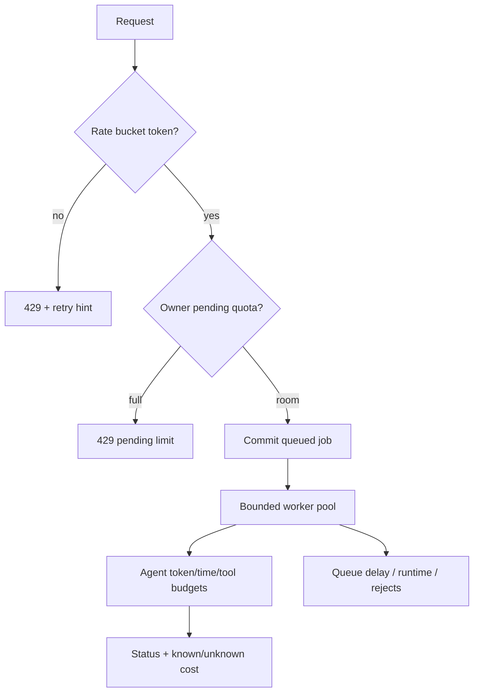

# Day 65 — Rate limits, performance, and cost observability

## 1. Learning objectives

Separate request rate, pending-job quota, active-worker concurrency, and model/tool budget. Implement a token bucket and explain its burst behavior. Estimate queue stability with Little's Law and compare offered load with worker capacity. Calculate known cost from caller-supplied token rates while labeling its limitations. Make a bounded load experiment that records rejection rate, queue delay, end-to-end latency, throughput, reported tokens, and estimated cost per successful job.

## 2. Required prerequisites

You need arithmetic, async workers, histograms, HTTP 429, and the telemetry from Day 64. Day 62 introduced a process-local token bucket and database-backed pending count. Week 7 supplied model token and cost accounting, but provider-reported token counts may be missing or estimated. Week 10 taught fixed route evaluation. The measurements today are operational signals; they do not replace quality grading. Keep rates and budgets injected or configured, never infer a user's identity from their requested spend.

## 3. Problem motivation

An agent request can consume a provider quota, a worker slot, memory, database writes, and paid tokens. Limiting only requests per second may still allow a single enormous prompt or many long jobs. Limiting only worker concurrency may still admit an infinite backlog. A cost graph based on guessed token counts may look precise while being wrong. Sustainable service needs independent bounds and a measurement vocabulary that distinguishes known values, estimates, and unknown values.

## 4. Intuitive explanation

A building has a turnstile, a waiting room, and a fixed number of service desks. The turnstile limits how quickly people enter. The waiting room caps people who have not been served. The desks cap work happening at once. A person may spend different amounts of time at a desk, so headcount alone does not predict finish time. Agent services have the same layers, plus a meter whose total can be estimated from known input/output token rates but may not match a final invoice.

## 5. Deep technical explanation

The token bucket stores current tokens and the time they were observed. On each request, it adds `elapsed * refill_rate`, capped at burst capacity, then consumes one token. The implementation serializes updates with an asyncio lock per application process. It provides smooth average rate with a finite burst, but each replica has its own bucket, so N replicas permit approximately N times the configured burst. For a production fleet, use a shared gateway, atomic Redis script, or central limiter. The response returns 429 and a retry hint when no token remains.

The durable pending quota is separate: queued plus running jobs for an owner may not exceed a configured maximum. The worker count is a third cap. Input byte limits, provider timeout, model step/token limits, and per-tool timeout are other resource controls. A strong limit has a clear dimension and enforcement location. For a fast response, token-bucket admission should occur before the database insertion; the SQLite transaction then enforces in-flight inventory.

For known cost, if `I` input tokens and `O` output tokens were reported and prices are `r_i` and `r_o` dollars per million tokens, estimated cost is `(I*r_i + O*r_o)/1,000,000`. If rates are unknown, preserve `unknown` rather than writing zero. Provider invoices may include caching, batch discounts, retries, tools, or different tokenization. Cost per successful job should use the same input corpus and success definition across runs; comparing means alone can hide a quality regression or a long tail.

## 6. Mathematical foundations

The token bucket evolution is `tokens(t) = min(capacity, tokens(t0) + rate*(t-t0))`. With rate 2/minute and capacity 3, three requests can arrive together; thereafter one new token appears every 30 seconds. For worker capacity `μ = c/S`, offered utilization is `ρ = λ/μ`. At `ρ >= 1`, a stable queue is impossible under steady arrival assumptions. Even below one, bursty arrivals and high service-time variance increase latency. Little's Law gives `L=λW`; use it to sanity-check observations, not to promise a per-job finish time.

## 7. Architecture and execution diagrams



Each boundary blocks a different kind of resource exhaustion. The response contract should name which limit rejected the request without revealing internal quota details across owners.

## 8. Implementation from first principles

This token-bucket model uses a supplied clock to make refill tests deterministic. It rejects invalid configuration and never allows tokens to exceed capacity. The service's async implementation wraps the state update with a lock. Run this standard-library block without sleeping or contacting a provider.

```python
class Bucket:
    def __init__(self, rate_per_second, capacity, now=0.0):
        if rate_per_second <= 0 or capacity < 1:
            raise ValueError("positive rate and capacity required")
        self.rate = rate_per_second
        self.capacity = float(capacity)
        self.tokens = float(capacity)
        self.updated = now

    def take(self, now):
        if now < self.updated:
            raise ValueError("clock must not move backward")
        self.tokens = min(self.capacity, self.tokens + (now - self.updated) * self.rate)
        self.updated = now
        if self.tokens < 1:
            return False
        self.tokens -= 1
        return True


bucket = Bucket(rate_per_second=1 / 30, capacity=2)
assert bucket.take(0) and bucket.take(0)
assert not bucket.take(0)
assert bucket.take(30)
```

## 9. Worked execution walkthrough

Assume 3 workers, 12-second mean execution time, and 0.15 arrivals per second. Ideal capacity is 0.25 jobs/second, giving `ρ=0.6`. Little's Law suggests `L=0.15*20=3` jobs in system if end-to-end time is 20 seconds. A load run reports p95 queue delay of 3 seconds, p95 execution of 17 seconds, 2% 429 responses, 98 successes, average reported 1,200 tokens, and known estimate $0.0018 per successful job. The next load step pushes utilization toward one; if queue delay increases sharply, admission should reject before storage is overwhelmed rather than silently growing backlog.

## 10. Independent laboratory

Finish `labs/week-11/starter/limits.py`: implement deterministic `Bucket.take(now)`, `estimate_cost(input_tokens, output_tokens, input_rate, output_rate)`, and `capacity(worker_count, mean_seconds)`. Validate nonnegative finite values and preserve `None` when rates are unknown. Run `python labs/week-11/checks.py --day 5`; then build a fixed workload of 100 jobs with a fake provider that returns known usage. Report offered rate, throughput, 429 fraction, p50/p95 queue time, p50/p95 execution time, success rate, and estimated USD per success. Do not tune from only the mean.

## 11. Experiments

Compare token bucket capacities 1 and 5 at the same refill rate to see the burst difference. Run a load below estimated capacity, near capacity, and above it; keep the input mix fixed. Observe whether p95 queue delay grows before handlers slow down. Repeat with two processes to demonstrate that a local rate bucket doubles allowance. Compare a route that reports token usage with one that omits it; preserve unknown cost rather than treating missing usage as free. Lastly, add a pending quota and record which requests receive 429 before the database row exists.

## 12. Failure analysis

A rate limit keyed by an untrusted body `owner` lets attackers rotate identities. A per-process limiter is bypassed by adding replicas. A too-low capacity causes legitimate short bursts to fail; a too-high capacity allows overload. A timestamp comparison bug can mint tokens when the clock moves backward. Cost is understated if retries or cached-token pricing are omitted. Using input length as a token count is an approximation, not a provider report. Record the source and unit of every measurement, and test limit behavior through authenticated API requests rather than a bucket helper alone.

## 13. Engineering tradeoffs

A centralized limiter is more accurate across replicas but introduces a network dependency and shared failure mode. A local limiter is fast and available but must be described as per-process. Strict quotas protect cost but may reject desirable work; soft warnings can be useful during rollout but do not protect a provider budget. A per-owner limit may need an organization-wide aggregate cap. Keep configuration in a typed settings boundary and expose bounded status codes; never return another customer's usage totals to the caller.

## 14. Real-world connection

Inference systems often combine a provider's request-per-minute limit, token-per-minute limit, model-specific rate, user spend budget, queue capacity, and SLA. An agent may also invoke tools with separate quotas. A gateway can enforce fleet-wide limits, while the application tracks per-job budgets and reports known token usage. Evaluation results from Week 10 help choose a route; operational metrics indicate how it performs under load. A lower-cost route is not a win if it reduces task success below an agreed threshold.

## 15. Common misconceptions

“Rate limiting is the same as concurrency limiting” is false: one controls arrival frequency, one active work. “A 429 is a failure of the service” is false; it is controlled load shedding, but clients should receive a stable retry policy. “Estimated cost equals invoice” is false. “A token bucket prevents all overload” is false if body parsing, queue storage, or a downstream provider has different constraints. “Capacity `c/S` guarantees p95 latency” is false; it is an idealized average model that ignores variance and bursts.

## 16. Technical examination

A service has four workers, mean service time 10 seconds, and arrival rate 0.3 jobs/second. Calculate ideal capacity and utilization. A bucket has capacity four and refills at one request every 20 seconds; how many immediate requests can it admit from full, and when does the next token arrive? Then calculate estimated cost for 2,000 input tokens at $0.50/M and 500 output tokens at $2/M. State how you would report missing usage, and list one reason the invoice can differ.

## 17. Daily mastery gate

Pass when your token bucket respects both burst and refill, invalid time movement is rejected, the API returns 429 after the configured admission budget, durable pending work never exceeds its owner limit, and reported vs estimated costs remain labeled. Include one concurrency estimate and one overload experiment with fixed input. Demonstrate the local limiter's multi-process limitation and document the production alternative. Include the measured quality outcome alongside cost if comparing different agent routes.

## 18. Resources

Review the official [OpenTelemetry metrics concepts](https://opentelemetry.io/docs/concepts/signals/metrics/) for counters, gauges, and histograms. Use the [Python asyncio synchronization primitives](https://docs.python.org/3/library/asyncio-sync.html) reference for locks and semaphores. The token bucket in `forgeagent/service.py` is intentionally process-local; its limitation is part of the contract. For usage accounting, inspect Week 7's model cost function and Week 10's route comparison helper.

## 19. Revision and retention

Tomorrow, package the service with bounded configuration and a health check, while deciding which limits survive restart. In two days, run the same fixed workload with a changed worker count and report tail latency. In one week, recompute cost from retained provider usage and compare it with the estimate. Preserve workload version, token price assumptions, and success definition so a later comparison remains interpretable.

## 20. Next lesson connection

Day 66 turns the service into a deployment artifact. A Docker image must make its nonroot identity, port, database path, secret source, health check, and worker settings explicit. We will rehearse restart recovery and explain which sample credentials are disposable. A code-level bound only matters if the deployed process actually receives the setting and the deployment's replica topology matches the limiter's assumptions.
