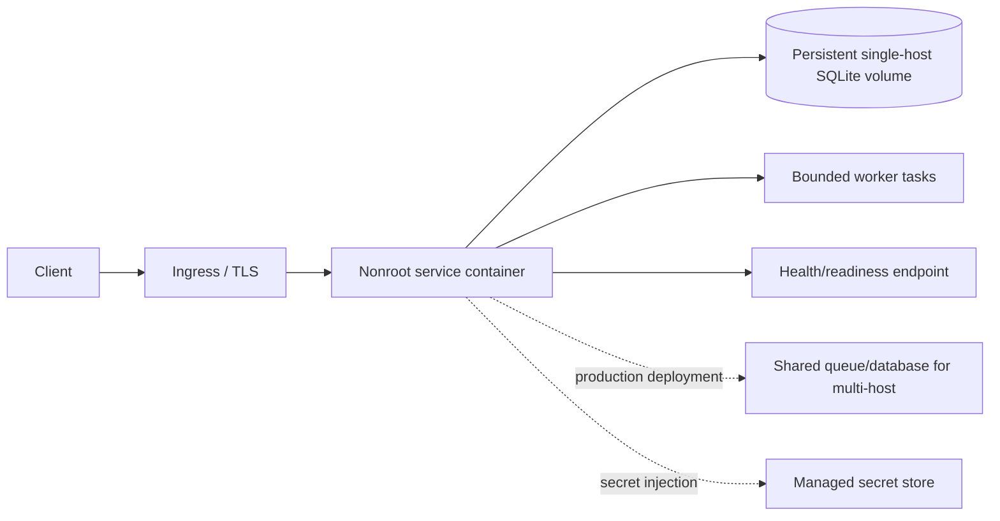

# Day 66 — Docker, secrets, deployment, and recovery

## 1. Learning objectives

Describe how a container packages a service process and its runtime dependencies. Build a minimal nonroot Dockerfile with explicit port, working directory, environment configuration, and health endpoint. Separate credentials from image layers and source control. Explain persistent volume and restart behavior for a file-backed SQLite queue. Design a deployment smoke check and recovery drill, and name the limits that still need production infrastructure such as TLS termination, secret rotation, multi-host storage, and CI image scanning.

## 2. Required prerequisites

You need shell commands, environment variables, Python package extras, HTTP health checks, and the job lease recovery from Day 63. Docker basics include image, container, layer, port mapping, volume, and entrypoint. The production reference uses `forgeagent.service:create_app` through a small ASGI factory module described in `projects/forgeagent/OPERATIONS.md`. The current sandbox may not have a container engine; inspect and build only when available, and state the actual result. Do not turn documentation into a claim that a container was tested.

## 3. Problem motivation

A service that works on a developer laptop may fail when its database path is ephemeral, it runs as root, or a secret is copied into an image layer. Restarting an API process should not erase accepted jobs. Running multiple replicas on local SQLite files does not create one shared queue. Health status must distinguish a live process from one that can reach required dependencies. Deployment is part of the system contract: identity, storage, secrets, and restart semantics decide whether code-level recovery actually works.

## 4. Intuitive explanation

A container is a packaged workbench, not a magic server. The image contains the tools and application; the container gets a runtime identity and mounted storage. Environment settings describe the deployment, and secrets are injected at run time from a protected source. If the workbench is thrown away but the database is on a persistent shelf, the next workbench can reopen accepted job records. If the database lived only on the discarded workbench, recovery code has nothing to recover.

## 5. Deep technical explanation

The Dockerfile uses a pinned Python base image, installs the optional service extra, copies only the project files needed to import the ASGI factory, switches to a nonroot user, exposes the configured port, and runs an ASGI server. A production lock should pin the base image by digest and application dependency lock. The sample `FORGEAGENT_TOKENS` environment value is clearly disposable and must not be a production secret. Production should inject rotated credentials through a managed secret mechanism and terminate TLS at a controlled ingress.

SQLite WAL needs its database directory on persistent local storage and must be used with a compatible single-host deployment. A volume preserves the file across container replacement but does not make SQLite suitable for arbitrary multi-host shared writes. The API can be scaled horizontally only when queue state, rate limits, and cancellation coordination live in shared services. A readiness probe can verify process and database initialization; a liveness probe should avoid marking the process healthy merely because `/health` returns a static response if the DB is required to accept work.

Recovery is a procedure, not just a restart policy. Stop one process during a running job, preserve the volume, start a replacement, wait for the lease to expire, and check that the job is reclaimed. Verify that attempts increment and stale workers cannot finish under old leases. If the handler may have performed a side effect, check its Week 8 operation receipt and reconcile unknown state. Also test deletion and retention for stored input, job results, logs, and trace data.

## 6. Mathematical foundations

A deployment's effective capacity is bounded by its tightest layer: `C_effective <= min(C_workers, C_provider, C_database, C_rate_limit, C_memory)`. Adding containers increases worker capacity only if downstream and shared storage capacity also increase. If each of 3 replicas has a local token bucket of 30/min, the fleet may admit about 90/min; configuration parity does not imply shared enforcement. A durable database volume preserves one host's files after process replacement, but availability remains bounded by host and disk failure. This is why measured throughput and recovery objectives must be tied to topology.

## 7. Architecture and execution diagrams



Solid storage is the local educational reference. Dashed components are production choices when replica topology outgrows a single host; they are not included or claimed as deployed in this repository.

## 8. Implementation from first principles

The standard-library example reads required configuration without embedding a credential. A deployment should fail at startup when credentials are absent rather than silently use an example default. The Dockerfile in `deploy/Dockerfile` uses this same fail-closed requirement through an ASGI factory and a nonroot account. Execute this block locally to inspect behavior; it never prints the secret.

```python
import os


def require_config(environment):
    secret = environment.get("FORGEAGENT_TOKEN")
    database = environment.get("FORGEAGENT_DATABASE", "/data/forgeagent.sqlite3")
    if not secret:
        raise RuntimeError("FORGEAGENT_TOKEN must be configured")
    if not database.startswith("/"):
        raise RuntimeError("database path must be absolute")
    return {"database": database, "token_configured": True}


assert require_config({"FORGEAGENT_TOKEN": "disposable", "FORGEAGENT_DATABASE": "/data/jobs.sqlite3"})["token_configured"]
try:
    require_config({})
except RuntimeError:
    pass
else:
    raise AssertionError("missing credentials must fail startup")
```

## 9. Worked execution walkthrough

An operator builds the image from a locked project, starts one container, mounts `/data`, and injects a temporary bearer token from a local `.env` file that is excluded from version control. The service creates its SQLite schema in `/data/jobs.sqlite3` and exposes health. A client submits a job; the route commits the queue row. The operator stops the container abruptly. A replacement uses the same mount and configures the same owner token mapping. It finds the running row after lease expiry and retries. The operator checks the status API and event history, then inspects the external operation receipt before deciding whether any effect needs reconciliation.

## 10. Independent laboratory

Review `deploy/Dockerfile`, `deploy/compose.yaml`, and `projects/forgeagent/OPERATIONS.md`. Implement `labs/week-11/starter/deployment.py` checks for required token, absolute persistent DB directory, nonroot configuration declaration, and health path. Run `python labs/week-11/checks.py --day 6`. If Docker or Podman exists, build and start the sample with a throwaway secret, confirm `/health`, submit a fake job, and restart with the same volume. If no engine exists, record that as untested and complete the static configuration checks instead; do not claim an image build passed.

## 11. Experiments

Start once with a database in a temporary writable directory and once with a mounted named volume. Submit a fake job, restart the container, and compare status. Remove the volume and document what is lost. Inspect the built image history for tokens, `.env` files, and cached credentials. Run as the configured nonroot user and verify write permissions are limited to the data directory. Finally, run two app replicas against separate SQLite files and explain why they do not share status or cancellation; then sketch the shared queue/backend needed before scaling.

## 12. Failure analysis

A missing secret should fail closed at startup. A Docker `ENV SECRET=...` instruction bakes a value into image metadata and layers; never do this. A read-only root filesystem can reveal that the database path was not writable by the service user. An ephemeral filesystem loses accepted jobs. A two-replica deployment with independent files partitions job state and allows duplicate admissions. A health probe that checks only process liveness may send traffic to a service whose database is unavailable. A restart loop can make every job repeatedly expire without any useful progress; backoff, attempt caps, and operator visibility are needed.

## 13. Engineering tradeoffs

SQLite on a persistent single-host volume is simple and reviewable, but it constrains horizontal scaling and host-failure tolerance. A managed database or broker improves shared coordination but adds service configuration, cost, credentials, and operational dependencies. A minimal image reduces attack surface but must still include runtime libraries and CA roots. Nonroot execution may require explicit ownership of the volume directory. Compose is a local demonstration; production orchestrator readiness, rollout, and secret injection vary by platform. Pinning a base image digest improves repeatability but requires planned updates for security fixes.

## 14. Real-world connection

Agent services hold sensitive prompts and may perform code changes, external API calls, or paid inference. Deployment controls must align with those effects: restrict egress, scope credentials, store only necessary data, protect the job database, and maintain audit records. A repository service should mount only the selected repository workspace, not the host root. CI should run tests and security checks before packaging, but this curriculum's code does not assert that a CI pipeline, image build, or external deployment has occurred unless recorded evidence exists.

## 15. Common misconceptions

“A Dockerfile is a deployment” is false; it describes an image build. “EXPOSE publishes a port” is false; runtime mapping or orchestration does that. “A restart policy recovers jobs” is false without durable storage and reclaim logic. “Volumes make SQLite cluster-safe” is false. “An environment variable is automatically a secure secret” is false; exposure depends on how the platform injects, logs, and inspects it. “A green health endpoint proves provider connectivity or agent correctness” is false; health checks need a precisely scoped contract.

## 16. Technical examination

Draw the storage path from container to durable job database. State what survives a process restart and what survives host loss. Explain why the local SQLite reference must run as a single-host deployment, and calculate the approximate fleet request allowance if three replicas each have a 30/minute process-local bucket. Describe a nonroot secret injection path and one health/readiness distinction. Finally, outline a crash recovery drill that checks the lease, attempt count, fencing token, and any pending external effect receipt.

## 17. Daily mastery gate

Pass when the Dockerfile runs nonroot, configuration fails closed without a token, the database path is explicitly persistent, and the health command matches the documented endpoint. Demonstrate either a real container restart recovery with evidence or mark it untested because the engine is unavailable. Verify no sample credential appears in image layers or committed files. Document the supported single-host topology, production secret source, DB backup/retention approach, and exact behavior for an interrupted job.

## 18. Resources

Read Docker's official [Dockerfile reference](https://docs.docker.com/reference/dockerfile/), [nonroot user guidance](https://docs.docker.com/build/building/best-practices/), and [Compose volumes documentation](https://docs.docker.com/reference/compose-file/volumes/). Review the official [FastAPI container deployment guide](https://fastapi.tiangolo.com/deployment/docker/). The repository's production notes are `projects/forgeagent/OPERATIONS.md`; the Docker artifact intentionally uses a disposable credential example in its documentation only.

## 19. Revision and retention

In two days, review the complete service boundary from authenticated request to persistent worker result. In one week, repeat the crash drill and confirm job input and telemetry retention behavior. Before any real deployment, replace temporary credentials, select shared storage appropriate to the topology, pin and patch the base image, and record evidence for build, health, and recovery claims. Retain a short rollback plan that names which state is durable and how an unknown side effect is reconciled.

## 20. Next lesson connection

Week 12 assembles the agent loop, repository context, controlled patches, tools, approvals, and benchmark into the runner injected here. The service must remain a narrow identity, admission, and persistence layer; it should not become an alternate shell or approval path. The next phase will connect job IDs and owner/session scopes to actual coding-agent policy and verify the integration with fixed and adversarial fixtures.
