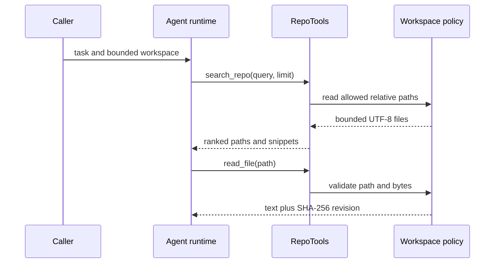

# D67 — Repository tools and the system boundary

## 1. Learning objectives

By the end of this lesson, you can describe a coding agent as a composition of
capabilities, trace repository search and read requests through a closed tool
registry, and distinguish a provider suggestion from an authorized effect. You
will implement deterministic search over a finite file set, report evidence with
path and line provenance, enforce bounded reads, and explain why the resulting
agent still does not understand a program merely because it found matching text.
Your review should identify the owner of every boundary: the caller supplies a
workspace root, the workspace policy resolves relative paths, the registry
publishes only selected tools, and the runtime validates each call before a
handler sees it. A useful learning outcome is being able to say exactly what a
search result means and what it does not mean. That precision prevents a common
failure in agent design: turning a retrieval hint into implicit permission.

## 2. Required prerequisites

Complete the Week 7 tool runtime and Week 9 policy material, especially the
closed argument schema, path containment checks, and distinction between read
and write effects. Week 6 retrieval is also required: its BM25 and tokenization
work gives a useful deterministic baseline, but the code index in this lab is
intentionally smaller. Be comfortable with UTF-8, SHA-256, `pathlib`, and
exceptions as explicit failure signals. Before beginning, read the local
implementations of `forgeagent.runtime.Registry`, `forgeagent.policy.Workspace`,
and the Week 6 `BM25` class. Note how each has a narrow responsibility. The
workspace object is not a secure operating-system sandbox, the tool registry is
not a permission source by itself, and lexical search does not replace tests or
human review. These boundaries are part of the prerequisite knowledge, not
optional caveats to add after an implementation is complete.

## 3. Problem motivation

An agent cannot repair a repository it cannot inspect, but unrestricted
inspection exposes unrelated secrets, generated files, or enormous binary
payloads. “Give the model a shell” combines search, read, write, process launch,
network access, and environment inspection into one capability that is hard to
audit. A smaller interface lets the system ask focused questions: which files
mention a symbol, what is the exact current file content, and what revision did
the caller observe? Search should be fast enough to rank candidate files, but
the result is only a navigation aid. The agent must read a chosen file before
suggesting edits and the reviewer must know which revision was read. This is
particularly important when another process can modify the workspace during a
long model call. Provenance gives the next stage a concrete object to validate;
it does not stop concurrent mutation, establish intent, or prove correctness.

## 4. Intuitive explanation

Treat the repository toolset like a librarian with a key to one room. The
librarian can search an allowed shelf and return a short catalog card. It cannot
walk into the rest of the building, execute a book, or make changes to a page.
The catalog card includes a relative path and a line number so another person
can retrieve the original passage. If the page changes after the card is made,
the card is stale. The next step reads the page and hashes its exact bytes. This
analogy also shows why the model is not the authority: a librarian can report a
request, but only a separate human process can authorize a particular change.
The interface intentionally makes the safe route easy to trace and the broad
route unavailable. A file returned from search is untrusted input. It can
contain comments that sound like instructions, strings with secrets, generated
content, or misleading examples. Search results must never be elevated into
policy because they happen to use imperative language.

## 5. Deep technical explanation

`RepoTools` enumerates a capped number of regular files beneath a `Workspace`
root, excludes common generated directories, reads each candidate through the
policy object, and computes a lexical score from normalized terms. Results sort
by descending score and then path, so ties are stable. Each result includes a
single matching line, a bounded snippet, and a score that is a count of line
matches rather than a calibrated probability. A caller can then use `read` to
obtain the complete bounded text plus a SHA-256 digest of its UTF-8 encoding.
The registry publishes `search_repo` and `read_file` as read-only tools with
closed schemas. The runtime checks exact argument names and primitive types
before dispatch. Thus malformed model output cannot smuggle an extra path field
into a handler. The owner should still validate lengths and semantics in the
handler; schema validation is one layer, not a substitute for policy checks.

The file enumeration cap is a resource bound, not a proof that every relevant
file was searched. Sorting after the cap would produce stable results only for
the selected traversal prefix, so the implementation orders the paths before
choosing the cap. A production index would also need file-size, total-byte,
symlink, encoding, ignored-file, and time limits. The workspace policy rejects
symlink path components and traversal in reads, but this educational path does
not claim to resist a hostile process swapping links concurrently. A stronger
boundary requires OS-level handles or a sandbox that owns the workspace.

## 6. Mathematical foundations

Let query terms be the set \(Q\), and let a candidate line have term set
\(L_i\). The simple score is \(s_i=|Q\cap L_i|\), accumulated over lines in a
file. It is transparent and cheap, but it has no inverse document frequency,
length normalization, stemming, or semantic similarity. If a term appears in
every file, it contributes as much as a rare identifier. A normalized score
could be written as \(s(d,q)=\sum_{t\in Q}w_t\,tf(t,d)\), where \(w_t\) is an
IDF weight; this would improve ranking for some repositories but still cannot
resolve aliases or control flow. The hash \(h=SHA256(bytes)\) provides a
compact content revision identifier. Equality of hashes gives strong evidence
that the bytes match under the collision-resistance assumption; it does not
show that the bytes are safe or that two semantically equivalent files match.
Model token estimates, search scores, and hashes answer different questions and
must not be conflated.

## 7. Architecture and execution diagrams

The sequence has no implicit write transition. Search and read can run without
an approval state because both are bounded observation operations. The model
receives the descriptions and schemas, emits a JSON call, and the runtime checks
that the name is in its allowlist before invoking a handler. Tool results return
as untrusted observations. The proposal and approval path belongs to later
lessons. Keeping the sequence explicit also makes tracing easier: if a returned
path is surprising, inspect the index, the path validator, and the selected
tool. There should be no hidden fallback to a shell, broad recursive read, or
provider-specific magic. A trace can record the call identity and tool outcome
without recording full file contents, reducing accidental disclosure in logs.



## 8. Implementation from first principles

First enumerate paths without following symlinks, then use a policy-checked read
for each file. Normalize text consistently, keep deterministic tie-breaking,
and return a snippet with a one-based line. Do not put raw bytes into model
instructions; observations are data and should be labeled accordingly. The
following small function demonstrates the scoring rule independently of the
workspace policy. It is suitable for a lab fixture, not a production file
walker. Notice that a query with no normalized terms produces no useful ranking
signal. Reject it rather than returning arbitrary files and creating an
illusion of relevance. A real application should also report truncation and
index coverage so an empty result cannot be mistaken for proof of absence.

```python
import re

def score_lines(query, text):
    terms = set(re.findall(r"[a-z0-9_]+", query.casefold()))
    if not terms:
        raise ValueError("query has no searchable terms")
    rows = text.splitlines()
    return [(number, len(terms & set(re.findall(r"[a-z0-9_]+", row.casefold()))))
            for number, row in enumerate(rows, 1)
            if terms & set(re.findall(r"[a-z0-9_]+", row.casefold()))]
```

## 9. Worked execution walkthrough

Suppose `src/cache.py` contains a line `def invalidate_cache(key):`, and the
query is `invalidate cache`. Case folding leaves two unique terms. Both match
the function definition, so that line contributes 2. A second line containing
only `cache` contributes 1. The path score is 3, and the response points to the
first matching line. The caller then reads the file, computes SHA-256 over the
exact UTF-8 text, and sees 812 bytes. A later edit changes one comment; the
revision digest changes even though the function behavior may not. That is the
desired result: the digest detects byte-level staleness, not semantic change.
The runtime records a tool start and end event. If the provider emits an
unknown tool name, dispatch rejects it without reaching the filesystem. If the
file is a symlink or the relative path contains `..`, the workspace rejects the
read. These failures are evidence that a boundary worked, not reasons to retry
with a broader capability.

## 10. Independent laboratory

Complete D67 in `labs/week-12`. Implement `search_sources(root, query, limit)`
for a finite in-memory mapping of relative paths to text. Return deterministic
records containing `path`, `score`, `line`, and `snippet`; require a nonempty
normalized query, positive bounded limit, and valid text values. Add tests for
stable ties, repeated terms, punctuation-only input, empty files, and a line
longer than the snippet cap. Then inspect the real `RepoTools` behavior and
identify the extra controls it provides over the pure function. Your written
trace must show a search result, a subsequent read, the digest, and a rejected
path traversal attempt. Do not call arbitrary repository content executable.
The lab check verifies behavior and boundary cases; it does not grade code
understanding. Submit a short explanation of what ranking is optimized and
which repository files may have been omitted because of the configured cap.

## 11. Experiments

Use a fixed 12-file fixture containing common words, rare identifiers, one
repeated query term, and a file with a matching comment but no executable use.
For ten queries, record top-three paths and the judged relevant set before
looking at results. Compare simple overlap against Week 6 BM25. Report
reciprocal rank at three and the count of missed relevant files; do not invent
judgments after seeing the ranking. Add one query with punctuation and one with
an identifier containing underscores. Then alter a comment and compare the
content hash while keeping the relevant behavior fixed. This demonstrates that
revision tracking is orthogonal to search quality. The fixture is visible and
small, so scores describe regression behavior only. It is not evidence that a
model can locate relevant code in arbitrary repositories or that lexical
search understands imports, types, or runtime data flow.

## 12. Failure analysis

An empty search result may mean no match, a query normalization problem, an
unsupported encoding, a file-size limit, a file cap, or an ignored directory.
The result should state its coverage conditions. Returning partial results
without a truncation marker is misleading. A malformed UTF-8 file should be
reported as skipped rather than silently decoded with replacement characters,
since replacement can alter identifiers. Symlinks need explicit policy because
they can escape the root; merely checking the initial path before reading can
still race with hostile mutation. Oversized files need bounded reads instead
of allocating unbounded text. Search snippets can expose secrets even if the
agent never writes, so apply a caller-selected root and data classification
policy. Finally, an agent may treat a high score as proof that a file solves a
bug. The correct response is to inspect surrounding code and later verify a
concrete hypothesis with tests or a human review.

## 13. Engineering tradeoffs

The educational index scans files on demand, which keeps implementation small
and makes the data path easy to audit. Its cost is roughly the bytes read on
each query and its quality is limited to lexical overlap. A persistent index
reduces repeat latency but introduces stale-index invalidation, schema version,
and data-retention concerns. Returning snippets minimizes context use but can
hide the code needed to understand a branch; returning entire files costs more
tokens and may expose unrelated material. A path allowlist improves focus but
requires maintenance. Larger limits improve coverage while increasing
latency and disclosure. Choose these bounds in configuration owned by the
caller, include them in traces, and make a limit hit visible. Do not treat a
search service's network location as a substitute for authorization; a remote
index still needs a scoped identity and data policy.

## 14. Real-world connection

Code review assistants, repository question-answering systems, and automated
maintenance bots all need source discovery. Mature developer tools use syntax
trees, symbol indexes, compiler databases, or language servers because these
capture relationships that lexical search misses. A small agent can still be
useful when it is tasked with a bounded change and uses these systems as
evidence providers. The most important transfer is interface design: present
only the capability needed for the next decision, preserve provenance, and
separate data from instructions. Search can guide a human reviewer to a likely
definition; a compiler can identify type references; a test backend can check
behavior. Each source has a distinct authority and failure mode. Combining
them does not make any one source infallible, but it lets the reviewer compare
independent evidence rather than relying on generated confidence language.

## 15. Common misconceptions

“The model has read the repository” is too broad: it may have seen a capped
subset of files and only selected snippets. “A hash proves correctness” is
false; it binds a decision to bytes. “Search score is confidence” is false; it
is a ranking heuristic with no calibration. “A read-only tool is harmless” is
also false, because private source can be disclosed through observations, model
requests, traces, or logs. “The workspace root is a sandbox” overstates a
library path check; process and kernel capabilities are outside its authority.
“A tool schema prevents all attacks” misses semantic validation and content
from untrusted files. Finally, “more files always means better context” ignores
attention budget, sensitive data, stale information, and distraction. Keep each
claim matched to the component that can actually establish it.

## 16. Technical examination

On a whiteboard, define the input and output schema for search and read. Explain
how you reject an extra argument, an absolute path, a traversal component, a
symlink, a non-UTF-8 file, and an oversized response. Given two files with
scores 2 and 2, state the tie-breaker. Given a one-line comment edit, state
whether the content digest changes. Explain why the code index cannot establish
that a function is called. Then propose a test to distinguish an agent that
searched the full corpus from one that silently stopped after a file cap. You
must name the actor that owns each decision and distinguish policy rejection
from an empty but valid result. A complete answer includes one limitation that
cannot be repaired by changing the ranking formula alone.

## 17. Daily mastery gate

Pass when your pure search function satisfies the public contract, your trace
includes exact path and digest provenance, and your security review identifies
the file cap and symlink race limitation. The submission must be deterministic
across repeated runs and must not introduce a shell tool, unrestricted file
read, hidden network call, or network dependency. A reviewer should be able to
reproduce the score from the fixture by hand. If you fail, reduce the interface
and isolate the defect: first test normalization, then line scoring, then
ordering, and finally the path policy. Remediation is complete after you repair
the implementation and produce a new trace with the original failing case
retained. Passing this gate shows mastery of a bounded retrieval primitive; it
does not show autonomous coding quality.

## 18. Resources

Use the local Week 6 chapter on sparse ranking, the Week 9 policy source, and
the Week 7 runtime code as primary resources. The `pathlib` and `hashlib`
standard-library documentation can clarify path and digest APIs, but the lab
contract is fully stated here and does not depend on an external reference.
When reading external security guidance, check the actual threat model and
platform assumptions before copying a recommendation. This project uses a
framework-free standard-library baseline. The teaching fixture is deliberately
small so you can inspect every item. A production rollout would need repository
access controls, log redaction, OS isolation, and a measured retrieval corpus;
those are separate pieces of evidence. Record the Python version and exact
commands used for an experiment. Never describe a static code inspection as a
run or a benchmark result as a security certification.

## 19. Revision and retention

Without opening the code, sketch the sequence from a user query to a ranked
path, then write the score calculation for one file. Draw the boundary between
`Registry.prepare` and the file handler. Recall which checks belong to the
workspace and which belong to the runtime. One day later, recreate the
traversal rejection and content-hash walkthrough from memory. One week later,
revisit your failure notes and explain why a source comment is untrusted even
when it is in a first-party repository. Retention means reproducing the
reasoning, not memorizing method names. If your mental model says that the
provider itself can access a file, correct it: the provider sees only messages
and tool observations that your runtime chooses to send.

## 20. Next lesson connection

The next lesson turns these observations into a plan and a trajectory. A coding
agent must do more than call search once: it needs to state a verifiable goal,
inspect evidence, propose one constrained change, and check the result. The
search and read records become inputs to that planning process, but they remain
observations rather than trusted facts. The next day's central question is how
to preserve causal order and stop a plausible narrative from being confused
with a verified outcome. Keep today's content hashes and coverage limits in
mind: a plan that refers to a revision should say which revision, and a plan
that claims a check passed must cite the actual check evidence.
