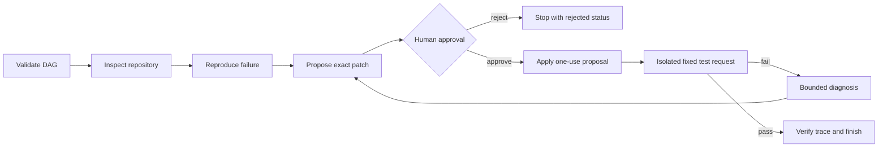

# D68 — Plans, trajectories, and verification

## 1. Learning objectives

Construct an execution plan whose dependencies are explicit, then produce a
trajectory that records observations and verifiable state transitions. You
will distinguish “the provider said it ran tests” from a tool observation, and
distinguish a valid plan from a correct solution. The acceptance artifact is a
single-file bug repair whose trace contains: initial search, exact source read,
reproducible failure evidence, proposed change, reviewer decision, applied hash,
fixed test evidence, and final answer. You should be able to locate the first
unverified edge in an incomplete trace and explain how budgets bound a loop.

## 2. Required prerequisites

Complete D67 and review `forgeagent.runtime.Agent`, its typed `RunResult`, and
the Week 8 deterministic DAG functions `plan` and `verify_plan`. Know how the
runtime counts steps, tool calls, tokens, wall time, and known monetary cost.
Review the Week 10 telemetry event names and the Week 9 write-effect gate.
Understand that dependency order only constrains execution order: it does not
prove an observation is truthful or that a proposed change satisfies a task.
You should also know cancellation behavior in `asyncio`, because a client can
cancel a request while a provider call or tool is in flight. A cancelled run
must be represented as cancelled or uncertain, not silently converted to
completed. Keep all execution in the injected components; no direct subprocess
call belongs in the model-facing trajectory.

## 3. Problem motivation

A coding agent often produces a confident summary while skipping a required
check. In a long exchange, the text transcript becomes hard to audit: which
version of the file did the model see, what call caused a write, and did the
test result occur after that write? A trajectory is an event-ordered record of
decisions and observations. It exposes the causal chain and lets a reviewer
find an unsupported claim. Explicit plans also help organize independent reads
while serializing effectful steps. A dependency DAG is useful even when the
model's prose is not: it lets trusted runtime code reject cycles or missing
predecessors before tool execution. The practical aim is a trace concise enough
to inspect, rich enough to recover, and bounded so a malformed loop cannot run
forever.

## 4. Intuitive explanation

Think of a repair as a lab notebook, not a story. The notebook begins with a
goal and a set of tests. It records what was inspected, the exact patch that was
proposed, who approved that patch, and what result the test backend returned
after applying it. A note saying “tests passed” is only a sentence until it is
connected to a test observation. Likewise, “the patch fixed the bug” is a
conclusion that requires both a relevant test and evidence that the test ran on
the applied revision. The plan is a checklist with prerequisite arrows. The
trajectory is the actual record of what happened. A checklist can be correct
while execution diverges; a clean execution record can still end in failure.

## 5. Deep technical explanation

Represent steps by identifiers and predecessor IDs. Validate that IDs are
unique, every dependency exists, and the graph is acyclic before any side
effect. Topological layers reveal which read-only operations could run in
parallel. The runtime further serializes write-effect tools, even if a model
places two calls in the same batch. Each observation should include call ID,
tool name, success flag, bounded result or bounded error code. Do not log raw
secret-bearing contents by default. The run result separately carries status,
answer, usage, observations, and events. A `completed` status means the bounded
loop obtained a finish decision; it does not mean the underlying task is
correct. A higher-level verifier must require the evidence applicable to the
task. For a patch, that includes its approved revision and a test result tied to
the post-apply tree.

For a repair with steps `inspect`, `reproduce`, `propose`, `approve`, `apply`,
and `test`, dependencies are chained except that independent reads may happen
after inspect in parallel. The approval is a human action, not a model tool.
The runtime must not infer approval from natural-language output. Trajectory
events can record a proposal identifier and redacted digest; the workspace
retains exact replacement bytes in its proposal state. A snapshot taken before
dispatch should include pending calls. On recovery, the system must reconcile
possible effect completion before retrying. Otherwise a crash after applying a
patch but before recording the observation can cause duplicate or confusing
effects.

## 6. Mathematical foundations

For a directed acyclic graph \(G=(V,E)\), a valid ordering \(\pi\) satisfies
\(\pi(u)<\pi(v)\) for every edge \((u,v)\in E\). Layering repeatedly selects
all nodes whose predecessors are done, taking \(O(|V|+|E|)\) time with an
adjacency-list implementation. This proves only structural validity. Let
\(e_i\) be the evidence predicate for step \(i\); successful completion needs
all required predicates, not just a topological ordering. A simple acceptance
predicate might be \(A = H_{after}=H_{approved} \land T(H_{after})=pass\),
where the test result is from an isolated backend and refers to the resulting
revision. Budgets constrain the run: \(steps\le S\), \(calls\le C\),
\(tokens\le N\), and elapsed time \(\le \tau\). Token overshoot can be
detected only after a provider response if usage is reported after completion;
therefore one call can cross a budget and must not lead to another action.

## 7. Architecture and execution diagrams

This diagram emphasizes a gate between proposal and effect. A model call may
request a proposal and a check, but a write is unavailable until the external
reviewer binds approval to one exact proposal. The trace records the approved
content digest, while test evidence records the revision under test. A failed
check returns the workflow to diagnosis with bounded iterations; it must not
trigger an unbounded series of model calls. The final response is assembled
from verified status and useful evidence, rather than copied from a provider's
claim. The DAG validator runs before execution so malformed dependencies cannot
partially execute a plan.



## 8. Implementation from first principles

Start with a pure plan representation and a verifier. Build the runtime tools
only after the plan validates. Then add event capture around every boundary:
provider start/end, tool start/end, proposal created, human approval, patch
applied, test start/end, and terminal state. Event fields need stable IDs and
low-cardinality names. The following acceptance helper is deliberately simple;
production code should validate typed observations rather than relying on
strings. Note its most important rule: a provider answer cannot supply a test
result. The result must be attached by trusted execution code after it receives
the backend response. Keep a maximum trace size and redact sensitive contents.

```python
def repair_is_verified(events):
    kinds = [e["event"] for e in events]
    try:
        proposed = kinds.index("patch_proposed")
        approved = kinds.index("patch_approved", proposed + 1)
        applied = kinds.index("patch_applied", approved + 1)
        tested = kinds.index("tests_end", applied + 1)
    except ValueError:
        return False
    proposal, consent, write, result = (events[proposed], events[approved],
                                        events[applied], events[tested])
    return (proposal["proposal_id"] == consent["proposal_id"] == write["proposal_id"]
            and proposal["review_sha256"] == consent["review_sha256"]
            and consent["approved"] is True
            and proposal["after_sha256"] == write["revision"] == result["revision"]
            and result["status"] == "passed")
```

## 9. Worked execution walkthrough

Use the fixture `retries=attempts` with a test requiring `attempts >= 0`. The
baseline failure is observed by a backend as assertion failure at revision
`h0`. The provider reads the implementation and proposes a complete replacement
with `if attempts < 0: raise ValueError(...)`. That replacement has digest
`h1`. A reviewer approves the exact displayed content. Apply checks that the
current bytes still hash to `h0`, then writes and reports `h1`. The isolation
backend runs the fixed test argv against the workspace and returns exit code 0
plus bounded output. The trusted adapter records `tests_end(revision=h1,
status=passed)`. The verifier checks the revisions match. If an unrelated actor
edits the file after approval, apply rejects stale `h0`; no test is run. If a
crash occurs after apply but before `tests_end`, the snapshot has an ambiguous
pending action; resume must inspect the current hash and operation receipt
before deciding whether to retry. This is why trajectory state is more than
assistant prose.

## 10. Independent laboratory

In D68, implement `acceptance(trace)` over a six-event fixture. Reject a trace
where a test passes before apply, where the tested hash differs from the applied
hash, where the approval is missing, where a provider claims a passing result
but no trusted `tests_end` exists, or where a test backend reports a timeout.
Implement a DAG plan with one independent read branch and a write depending on
both reads. Add a cycle and a missing dependency. Use the Week 8 `plan` and
`verify_plan` as references, but write your own acceptance predicate. Make the
check consume only fixed fixtures and never invoke a command. The lab report
includes one complete trace table, the exact acceptance result for each
mutation, and a short note on what evidence the trace intentionally omits to
avoid disclosing source text or credentials.

## 11. Experiments

Construct a 20-case trace fixture, half valid and half broken by exactly one
defect: stale revision, missing approval, test before apply, missing tool
observation, timeout, or provider-only claim. Evaluate a strict verifier and a
naive verifier that only checks whether the final answer contains “fixed.”
Publish the confusion matrix and each false positive. Then vary the step budget
from two to eight and show the fraction of fixture plans that can reach the
required test. This is a bounded workflow reachability result, not a coding
success benchmark. Freeze cases and expected outputs before running the
implementation, retain all rows, and explain any case that cannot be represented
by the current event schema. A metric without a fixed denominator hides
coverage. Do not call a test executor's return value passed unless the backend
defines what that status means and the adapter validates its shape.

## 12. Failure analysis

A corrupt event stream can contain duplicate IDs, reordered events, oversized
payloads, or impossible state transitions. Reject or quarantine it instead of
repairing it by guessing. A telemetry sink failure should not erase a completed
side effect; use durable intent and reconciliation where the operation is
recoverable. A model may ask for a test before approval; the fixed policy should
permit read-only checks but never imply that they validate a proposed patch.
Cancellation during an external request may leave outcome uncertain. Mark the
operation unknown and reconcile. If an isolated backend is unavailable, return
`test_unavailable`; do not run locally as fallback. If the model repeats the
same failed strategy, budgets and duplicate-call handling should stop a loop.
Every failure status needs a specific next human action and must preserve the
evidence that led to it.

## 13. Engineering tradeoffs

One event per meaningful boundary improves auditability but increases storage.
An event-sourced design supports reconstruction, while a snapshot-plus-log
design resumes faster but must version snapshots and retain a compatible event
tail. A verbose transcript can help debugging while creating privacy risk; a
digest and minimal metadata reduce exposure but may make incidents harder to
investigate. Store exact proposed text only in the protected proposal store and
store its digest in routine telemetry. At-most-once effect handling is not
available from a local event journal alone across an arbitrary external
executor. A two-phase intent protocol can expose pending/unknown states and let
an operator reconcile. Choose clear uncertainty over false exactly-once claims.
For teaching, finite deterministic fixtures make these design consequences
visible without needing a real provider.

## 14. Real-world connection

The same trajectory discipline applies to database migrations, release
automation, infrastructure changes, and incident response. Each workflow needs
an authorized plan, evidence from the action actually taken, and a recovery
path when the caller disconnects. Build systems use dependency graphs because
they make ordering and parallelism explicit. Workflow engines add durable
states because a process may crash between actions. Coding agents combine both
ideas with untrusted model output. A mature deployment will also need policy
versioning, operator identity, tamper-evident logs, and an isolated executor
whose implementation has been reviewed. The classroom trajectory is not a
certification, but the invariants transfer directly: bind effects to the
approved artifact, verify after the effect, and report ambiguous completion
honestly.

## 15. Common misconceptions

“A plan is a guarantee” confuses static order with runtime success. “A finish
message means done” ignores task-specific acceptance. “If the test passed, the
patch is safe” ignores test coverage, isolation, and the revision under test.
“The trace is the full truth” ignores omitted logs, backend integrity, and
concurrent changes. “A timeout means the command did nothing” is unsafe for
external effects. “A retry is harmless” depends on idempotency and current
state. “The assistant can approve if it explains why” collapses a trust
boundary. Finally, “more telemetry is always better” omits privacy and
retention. Each claim must be scoped to the evidence that supports it, and the
final answer should distinguish verified conditions from remaining limits.

## 16. Technical examination

Given an event trace, calculate whether the task-level predicate passes. Draw
the causal graph and identify any result whose predecessor is missing. Explain
how a pending call is represented before execution and what resume does after a
crash between patch apply and journal append. Show how the runtime enforces
maximum steps and tool count. Then describe a trace schema version migration
that does not reinterpret an old `unknown` operation as a failure. Your answer
must also describe a false positive of a final-answer string check and a
false-negative of a verifier that requires tests even when the request is
strictly read-only. A strong defense identifies which verdict belongs to the
agent runtime and which verdict belongs to the application acceptance layer.

## 17. Daily mastery gate

Pass when the DAG rejects invalid structure before effects, the acceptance
helper rejects every planted false-positive trace, and the valid worked trace
ties approval, apply, and tests to one revision. Retain a complete event order
with bounded outputs. Explain exactly what your event record cannot prove about
the injected backend. If the test backend is absent, your system must return a
typed unavailable status. If resume support is absent, it must refuse resume
rather than silently restarting the task. Remediate by adding the smallest
missing state field or invariant, then repeat all fixtures. This gate validates
trajectory reasoning and workflow logic; it does not establish that the agent
can devise a correct patch for an unfamiliar repository.

## 18. Resources

Use the local Week 7 runtime and Week 8 `durable.py` as the primary source for
dispatch, DAG validation, event journal, checkpoint, and operation intents. Use
the Week 9 policy implementation to inspect the approval binding. The
standard-library `asyncio` documentation is useful for cancellation semantics,
and `unittest` explains test discovery, but the acceptance fixtures are
self-contained. Read Week 10 telemetry carefully: summaries should be derived
from events without exposing raw user content. These sources show an
educational implementation, not a production certification. Record source
versions if you compare with a workflow framework. Your report must distinguish
design review, deterministic fixture execution, and real isolated test results;
they are different evidence categories.

## 19. Revision and retention

After a day, redraw the six-step repair trajectory and state the evidence
required to cross each edge. Recreate the false-positive example where the
assistant says “all tests passed” but the test backend never ran. One week
later, explain why a test result carries a revision identifier. Review your
events and remove fields that disclose raw source while preserving the
information needed to bind the result. If you cannot reconstruct an event's
meaning from its name and fields, improve the schema before adding more event
types. Retention practice asks you to defend not only what the workflow did but
what its available evidence cannot establish.

## 20. Next lesson connection

The next lesson focuses on human authorization. The trajectory has a proposal
step and an approval step, but they must be distinct actors and distinct
interfaces. You will bind approval to path, original content hash, replacement
hash, session, and tool arguments. That design turns a vague “looks good” into
a one-use authorization for a reviewable object. Carry forward the event
sequence and use it to reason about stale content, replay, and refusal cases.
