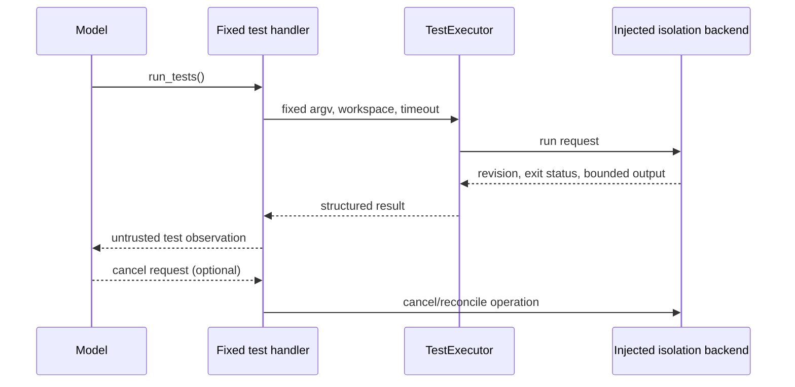

# D70 — Execution isolation and cancellation

## 1. Learning objectives

Explain why testing model-proposed code is a separate capability from reading
and writing it. Build a fixed test request that delegates to an explicitly
injected isolation backend and refuses when the backend is absent. Demonstrate
that the provider cannot choose executable argv, working directory, environment,
network policy, or timeout. Trace a cancellation at three boundaries: before
dispatch, while a backend runs, and after the backend completes but before its
result is recorded. Your acceptance artifact is an adapter contract test plus
a written isolation threat model. A passing adapter test does not prove that a
real backend meets the isolation claim; that requires review and evidence from
the backend implementation.

## 2. Required prerequisites

Complete D69 and inspect `forgeagent.policy.TestExecutor`. Know the difference
between Python's `asyncio` cancellation and terminating an operating-system
process. Review the bounded `Agent.run` loop and how it emits cancellation
events. Understand that a subprocess started on the same host inherits access
according to the host user's permissions unless a separate boundary changes
them. A temporary directory is not a sandbox. A timeout limits waiting but
does not necessarily stop descendants, undo writes, or prevent network access.
This day's lab runs only against a fake injected backend that records the
request; it must never execute fixture code. A deployment can inject a reviewed
container, microVM, remote runner, or OS-specific sandbox implementation, but
that operational component is outside the code's current proof.

## 3. Problem motivation

Tests execute the code under test, test helpers, package imports, and sometimes
build scripts. A malicious or simply buggy change can read credentials, delete
files, contact remote hosts, or exhaust resources. Giving the model a generic
command tool grants this capability directly and makes it difficult to inspect
the exact action. The capstone instead uses one fixed test argv and an injected
backend. The model can request a test run, but only trusted code chooses the
command and the backend decides how it runs. If no backend exists, the correct
behavior is a clear refusal. A local fallback may look convenient and produce
a green check, but it destroys the security boundary the interface was meant to
create. Test evidence is meaningful only when its execution environment is
known and the tested revision is recorded.

## 4. Intuitive explanation

Think of a test runner as a sealed workshop. You can hand it a labeled package
and request one standard inspection, but you cannot ask it to open your home
office or use your credentials. The label says which repository snapshot is
being tested and the result returns with a revision. If the workshop is not
available, you do not run the test on your desk and still call it isolated.
The model may suggest what to test, but the trusted adapter chooses from a
small set of preapproved requests. Cancellation is a request to stop waiting,
not proof that the workshop stopped. The result may be unknown until the
operator checks the backend. A truthful system reports that uncertainty rather
than inventing a pass or silently repeating a potentially effectful run.

## 5. Deep technical explanation

`TestExecutor.run` accepts an argv tuple, a workspace directory, and timeout.
It has no default backend and raises `PolicyDenied` when absent. `RepoTools`
fixes argv to the configured Python interpreter and standard-library unittest
discovery under `tests`; no provider arguments are interpolated. This avoids
shell expansion and basic command injection, but it does not by itself create
isolation. The backend must validate its own contract, constrain CPU, memory,
wall time, file descriptors, filesystem visibility, network, environment, and
child processes, and return a bounded structured result. It should identify the
input snapshot by digest. A stronger adapter can create an immutable worktree
or snapshot after approval and pass that identifier to the runner. The present
interface uses a path, so the injected backend must ensure the observed tree
cannot change underneath it or must report the actual snapshot hash.

Cancellation during an in-process coroutine can propagate `CancelledError`,
but a synchronous child or remote job may continue. The API should distinguish
`cancel_requested`, `cancelled`, and `unknown`; only the backend can confirm
termination. If it cannot, operation state needs a durable intent ID and
reconciliation query. A retry with a fresh operation ID can duplicate expensive
work or cause further side effects. The coding agent should checkpoint its
decision before tool dispatch and store a pending call ID so restart can
reconcile. Even a read-only test run can consume resources or disclose data.

## 6. Mathematical foundations

Isolation is a conjunction of enforced constraints, not a scalar score:
\(I=F\land N\land R\land T\land C\), where \(F\) is filesystem scope,
\(N\) network policy, \(R\) resource bounds, \(T\) time and termination, and
\(C\) credential separation. If any required term is unknown, the system
cannot claim the full property. A timeout \(t\) only bounds the caller's wait
unless the backend enforces process-tree termination. A fixed argv removes a
class of injection: model text is never parsed into shell syntax. It does not
remove risk from the selected interpreter, import hooks, test code, or inherited
environment. For a test report with input revision \(h\), useful evidence is
the tuple \((h, command, backend\_identity, exit, bounded\_output, time)\).
Without \(h\), a passing result may refer to a different tree. Without a backend
identity, the claimed isolation cannot be reviewed.

## 7. Architecture and execution diagrams

The provider requests a tool by name with no command parameter. The handler
constructs one fixed argv and passes it to `TestExecutor`; the backend owns
process creation. The response is bounded and labeled untrusted. On cancellation
the application records the state and asks the backend to cancel. A confirmed
stop and an uncertain state are different outcomes. A caller must not map a
timeout directly to “test failed” or “nothing happened.”



## 8. Implementation from first principles

Build the handler so it accepts no command, path, or timeout argument from the
model. Configuration is owned outside the tool schema. The fake test backend
below records the exact tuple and returns a fixture result; it does not run the
command. Then verify that missing backend raises. A production backend must
replace this fake after a separate security review and should bind its result
to a snapshot digest. Keep response size bounded before returning it to the
runtime, which already validates JSON serializability and caps observations.

```python
from forgeagent.policy import TestExecutor

class RecordingBackend:
    def __init__(self): self.calls = []
    def run(self, argv, *, cwd, timeout):
        self.calls.append((argv, str(cwd), timeout))
        return {"status": "fixture_only", "executed": False}

backend = RecordingBackend()
executor = TestExecutor(backend)
result = executor.run(("python", "-m", "unittest"), cwd="/fixture", timeout=2)
assert result["executed"] is False
```

The optional Linux backend mounts the reviewed fixture read-only,
starts a fresh network namespace, clears the child environment, drops
capabilities, and runs only the fixed unittest discovery command with a
deadline. Run `python scripts/verify_linux_isolation.py` from the repository
root to verify those boundaries on your host. It requires Linux and Bubblewrap.
The smoke exercises an owned test fixture and records a process exit status.
Resource controls such as CPU and memory limits remain separate deployment
requirements.

## 9. Worked execution walkthrough

After a reviewer approves patch digest `h1`, the host creates a candidate
snapshot `s7` whose digest is `h1`. The coding agent calls `run_tests` with an
empty argument object. The trusted handler builds `(<sys.executable>, "-m",
"unittest", "discover", "-s", "tests")`, calls the injected backend with the
workspace and a 30-second budget, and receives `{status: "passed", revision:
"h1", operation_id: "op9"}`. The adapter validates the response shape and
records the test event. If the provider calls `run_tests` again, the runtime
counts a second tool call and eventually reaches its tool budget. If the caller
cancels while `op9` is executing, cancellation is sent to the backend; a
confirmed termination becomes cancelled, while a dropped connection leaves
unknown. The system checks `op9` before it decides to retry. With no injected
backend, the first request returns `test_unavailable` and no command runs.

## 10. Independent laboratory

D70 implements `run_fixed_tests(executor, cwd, python_executable)` and a
recording backend. Assert exact argv ordering, the fixed working directory,
and timeout value. Assert that an unexpected model-provided string cannot
change any of them because the function accepts no such value. Then construct
`TestExecutor()` with no backend and assert it rejects before calling an OS
process API. Add response validation for malformed output, oversized output,
and missing revision identity. Do not create a backend that calls `subprocess`
or `os.system`; this lab is a request-contract exercise. In your report,
compare a temporary directory, subprocess, container, and microVM in terms of
what each does not guarantee by itself. Clearly mark the isolation behavior as
unverified when you only used the fake.

## 11. Experiments

For 15 fixed test requests, inject three outcomes: pass, fail, and uncertain
timeout. Track how many requests have an operation ID, snapshot revision,
status, and bounded output. Mutate the backend response to omit the revision,
return 10 KiB of output, or claim both pass and timeout; verify the adapter
rejects contradictory or oversized data. Then compare retry policies: always
retry, never retry, and query operation status before retry. Include a case
where the backend completed but the client timed out waiting. Report each case
and the exact invariant that stopped a duplicate action. This fixture measures
adapter protocol behavior, not real security containment or benchmark task
success. Never assert that a container is isolated merely because it has a
container label; inspect its mounted paths, network, identity, and resource
configuration.

## 12. Failure analysis

The backend can ignore the requested timeout, leak output, inherit credentials,
mount the host home directory, or report a stale revision. The handler can
accidentally include a user command, environment variable, or arbitrary cwd.
The model can request repeated tests until a resource budget is exhausted. A
test subprocess can spawn descendants that survive cancellation. A remote
runner can finish after the client disconnects. A green exit status can hide
skipped tests or a runner misconfiguration. Each layer needs an explicit
contract and observability. If the backend is missing, the safe outcome is
unavailable. If the result is malformed, reject it. If completion is uncertain,
do not call it failed or passed; retain an operation ID for reconciliation.
Do not run on the host as a fallback, even when the patch appears harmless.

## 13. Engineering tradeoffs

A fixed test suite is auditable but may not match the requested change. Letting
the model select a test file improves flexibility but opens a larger execution
surface; a trusted selector can instead choose from a repository policy. A
container starts quickly but shares a kernel; a microVM adds stronger separation
at higher cost. A remote runner can isolate credentials from the host but adds
network, identity, retention, and availability dependencies. Capturing full
stdout helps diagnose failures but may expose secrets; cap and redact. Immediate
termination reduces resource use but can leave build state inconsistent. A
backend protocol should make these tradeoffs explicit and report what it
enforced. The core interface remains injected so the learning project does not
pretend that one portable standard-library function can supply a sandbox.

## 14. Real-world connection

CI systems, package builders, browser agents, and notebook services execute
untrusted or semi-trusted code. They commonly use ephemeral workers, restricted
credentials, network controls, filesystem snapshots, and resource quotas. The
agent interface is only one layer; executor hardening and provenance remain
separate responsibilities. In a high-assurance flow, a signed artifact digest
is tested in a reproducible environment and the result is attached to that
digest. Re-running tests after the artifact changes invalidates the prior
result. This applies to generated infrastructure plans and ML model packaging
as well as source code. A developer should be comfortable saying “the adapter
contract passed with a fake backend; isolation has not been demonstrated” when
that is the evidence available.

## 15. Common misconceptions

“A subprocess is isolated” is false. “A temporary directory is isolated” is
false if the process can read outside it. “A 30-second timeout kills the
process” depends on backend implementation. “Fixed argv makes tests safe” only
removes model-controlled command construction. “Passing tests prove safety”
ignores test coverage and runtime environment. “A canceled request did not
run” confuses client cancellation with backend state. “No output means success”
is a malformed assumption. “The offline fixture ran tests” is false if it only
records a request. Clearly label the executor used, the tree revision, and the
scope of any claim. If you do not have evidence, keep the status unknown or
unavailable.

## 16. Technical examination

State which component owns argv, cwd, timeout, environment, network, and
credentials. Explain what the `TestExecutor` abstraction guarantees and what it
delegates. Walk through cancellation before dispatch, during backend work, and
after backend completion but before journal persistence. Define a reconciliation
query using an operation ID. Explain how a test result is tied to the applied
revision and why a path alone may not define an immutable snapshot. Then assess
whether a fake backend proves container security. A passing answer explicitly
refuses that inference and names backend properties that remain unverified.

## 17. Daily mastery gate

Pass when exact fixed argv reaches only the injected backend, no-backend
execution refuses, malformed output is rejected, and cancellation outcomes
distinguish confirmed stop from uncertainty. Submit a backend threat model and
mark which claims are tested versus assumed. If a proposed solution uses a
local subprocess or claims that a temporary directory is a security boundary,
it fails the gate. Remediate by replacing process execution with an injected
recording fake, then explain how a separately reviewed sandbox would attach.
This gate proves that the adapter fails closed; it does not prove that any
particular backend is secure.

## 18. Resources

Use `forgeagent.policy.TestExecutor`, the `asyncio` cancellation documentation,
and the Week 11 worker contract as local sources. The repository intentionally
has no default sandbox package or container dependency. Any claim about a
specific container, microVM, or runner must be based on that backend's
authoritative technical documentation and a review of its actual deployment
configuration. Do not add network dependencies to finish the lab. Save the
fake backend request records as reproducible evidence. Distinguish source code
inspection from an executed containment test and a passed business test from
an isolation audit.

## 19. Revision and retention

One day later, reconstruct the three cancellation points and classify each
result as not started, confirmed stopped, completed, or unknown. Recreate the
missing-backend test. One week later, compare the actual contract of a backend
you have reviewed with the assumptions in your adapter. Update the threat model
when you discover a new inherited capability. The key retention question is
not “did the test pass?” but “what exact bytes ran, where, under whose
authority, and what evidence confirms the process stopped?”

## 20. Next lesson connection

The next lesson makes context and recovery durable. The agent will need to
preserve which repository facts it selected, which proposal is still pending,
and whether a test action is unresolved. Compaction can reduce context size,
but summarized evidence is derived and untrusted. A checkpoint can resume a
decision, but it must reconcile effectful actions before repeating them. Carry
the snapshot revision and operation ID into that design.
