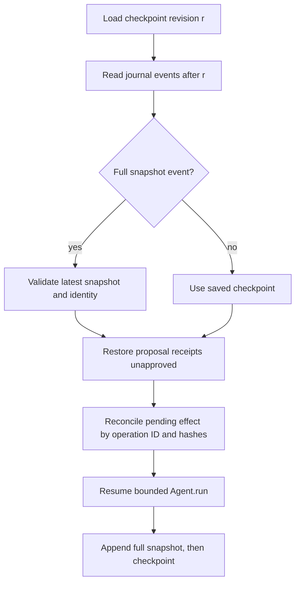

# D71 — Context, checkpoints, and resume

## 1. Learning objectives

Select a bounded context set with provenance, compact it without inheriting
source authority, and persist an agent snapshot that can resume a pending
decision after process restart. Reconstruct the difference between a checkpoint
and an event log, identify the append-before-checkpoint failure window, and
reconcile proposal state before continuing. Demonstrate an actual restart with
a new provider and a pending call, not just a second call on the same object.
Your acceptance artifact shows the checkpoint bytes, restored proposal state,
the next provider request count, and the final event order. If any state cannot
be restored safely, refuse resume or ask for human reconciliation.

## 2. Required prerequisites

Complete D68 and D70. Read `forgeagent.context.select_context`, `compact`, and
the Week 8 `EventJournal` append, checkpoint, resume, intent, and resolve APIs.
Review `Agent.run` snapshots: identity, typed messages, counters, known cost,
observations, pending calls, answer, status, deadline, and events. Know the
limits of a local SQLite journal: it is useful durable state but does not make
an arbitrary external side effect exactly once. Know that compacted text is
lossy, derived, and untrusted. A resumed runtime should verify task and tool
identity before trusting snapshot messages. A proposal receipt can be restored
as unapproved, forcing the reviewer to reapprove after restart. An apply
operation may only be repeated after file hashes and durable operation state
show that it has not already completed.

## 3. Problem motivation

Agent tasks can outlive a browser request, worker lease, or process. Restarting
from the original task loses the tool history and can repeat a patch proposal,
apply, or external test run. Keeping the entire transcript forever is costly
and may retain secrets. A useful system balances compact evidence with enough
state to recover exact decisions. Context selection decides what to present to
the next model call; checkpointing records where execution can safely continue.
These are related but different operations. A summary can help reasoning but
cannot substitute for call IDs, budget counters, pending arguments, and
operation receipts. Durable state must preserve uncertainty. If an effect may
have happened, the agent should query its status or stop for review rather than
blindly replay it.

## 4. Intuitive explanation

Think of context as the small set of notes on a workbench and a checkpoint as
the page in a machine's recovery journal. You can rewrite notes to fit the
bench, but that rewriting loses details and must not make them more authoritative.
The journal, in contrast, must preserve exact machine state needed to resume:
which message was sent, which call was pending, and how much budget remains.
If a process crashes after writing an event but before updating the checkpoint,
the event log may contain a newer valid snapshot. Recovery should use the
latest complete snapshot event, not discard it or infer missing details. For
an approval lost at restart, request approval again; do not reconstruct a
human's intent from a previous model message.

## 5. Deep technical explanation

The context selector scores fresh items by lexical overlap, then trust class,
creation time, and stable ID, while reserving caller-selected policy content
first. It estimates tokens as UTF-8 bytes divided by four, a heuristic rather
than tokenizer truth. The compactor truncates text and retains source refs and
revisions; it labels the result lossy and says authority is not inherited. The
runtime checkpoint, by contrast, is structured state. It validates version,
task identity, messages, counters, deadline, observations, and pending calls.
The callback writes a full snapshot event and then a checkpoint row. If the
process fails between those writes, resume reads events after the checkpoint's
revision and restores the latest complete snapshot. This recovery strategy
depends on storing a full bounded JSON snapshot in each recovery event.

Proposal persistence is separate. Week 9 exports a receipt containing proposal
ID, exact binding, and replacement text. On restart, `restore_proposal` validates
the receipt but resets approval to false. Thus the human must review and approve
again. Patch apply uses a durable journal intent keyed by proposal ID and binds
the expected before and after hashes. On recovery, read the current file: if it
matches the after hash, treat the write as reconciled; if it matches the before
hash and intent is still pending, a controlled apply can proceed after renewed
approval; if it matches neither, mark unknown and stop. An `unknown` terminal
operation is not silently converted into complete.

## 6. Mathematical foundations

For context item \(i\), approximate token cost is \(c_i=\lceil bytes_i/4\rceil\).
Selection chooses a deterministic subset \(S\) such that
\(\sum_{i\in S}c_i\le B\), while reserved items are charged first. This is a
heuristic ranking, not an optimal knapsack solution. A checkpoint state can be
modeled \(C=(v,id,M,n_s,n_t,n_k,p,o,d)\): version, identity, messages, step
count, tool count, token count, pending calls, observations, and deadline. The
event stream has revisions \(r_0<r_1<...\). If a full snapshot append at
revision \(r_{k+1}\) succeeds but checkpoint update fails at \(r_k\), resume
selects the latest valid snapshot event after \(r_k\). For external effects,
the state machine `pending → complete|unknown` preserves uncertainty; exactly
once cannot be guaranteed without cooperation from the effect owner.

## 7. Architecture and execution diagrams

The resume path loads a checkpoint, replays only validated full snapshots from
the event tail, restores proposals as unapproved, and then lets the runtime
resume its pending decision. Human approval is a new action. A pending apply
intent is reconciled against current bytes before any attempt to write. The
context summary can be sent to a provider as a note, but its source references
and trust label remain visible and it does not overwrite raw event state.



## 8. Implementation from first principles

Keep recovery snapshots serializable and versioned. On every model decision,
persist the exact pending call set before dispatch; after dispatch, persist
observations and updated messages. The callback should add protected proposal
receipts to the runtime snapshot. On resume, restore these receipts through the
workspace's validating import method. Do not restore approval. The following
pure helper illustrates the journal gap rule used in the lab. It chooses the
highest revision full snapshot and ignores unrelated event types; malformed
snapshot events should be rejected rather than partially interpreted.

```python
def recover(saved, revision, events):
    state = saved
    for event in events:
        if event["revision"] > revision and event["kind"] == "agent_snapshot":
            state = event["payload"]["snapshot"]
            revision = event["revision"]
    if state is None:
        raise ValueError("no checkpoint to resume")
    return revision, state
```

## 9. Worked execution walkthrough

The provider asks to read `src/parser.py`; the runtime validates the call and
stores snapshot `s1` with that call pending. Dispatch returns an observation,
then the runtime stores `s2` with messages and counters. It proposes a patch;
snapshot `s3` is appended before dispatch. The policy creates proposal `p4`;
the observation includes its ID; snapshot `s4` stores the exported receipt. The
process dies after `s4` is appended but before checkpoint row update. On restart,
the wrapper loads checkpoint revision 3, finds event revision 4, validates the
full state, restores proposal `p4` as unapproved, and resumes. The human must
review the exact diff again. After approval, operation intent `apply-p4` is
recorded; the file is written to hash `h1`; the process dies before resolving
the intent. Recovery sees a pending intent and reads the file. Current hash
`h1` equals the expected after hash, so the wrapper resolves the operation as
complete and does not write again. If current bytes match neither before nor
after, it marks uncertainty and asks for operator action.

## 10. Independent laboratory

D71 first creates an on-disk `EventJournal` in a temporary directory. Append a
checkpoint at revision one, append a full snapshot event at revision two, and
simulate failure before the checkpoint update. Recover the snapshot using the
event tail. Then create a proposal, export its receipt, construct a new
workspace over the same fixture, restore the proposal, and verify that apply
still fails until a human reapproves. Simulate an apply intent with before and
after hashes and test all three current-file cases: before, after, and neither.
Finally, use a new `CodingSession` and new provider object to resume a pending
Agent decision and confirm the provider does not receive a duplicate first
request. No live provider or command execution is involved. Your report should
show revisions and call counts so a reviewer can distinguish a true resume from
a fresh run.

## 11. Experiments

Create 30 fixed recovery fixtures: ten with only a checkpoint, ten with a
newer full snapshot event, and ten with malformed, stale, or conflicting
state. Measure correct resume, safe refusal, duplicate provider calls, and
duplicate file writes. Include a proposal restored without approval, a
completed operation whose file changed afterward, and an unknown operation
whose file matches neither digest. Compare storing full snapshots in every
event against delta events plus a checkpoint; count serialized bytes and
recovery complexity. The full-snapshot strategy is simple and costly, while a
delta strategy needs a deterministic reducer and stronger migration policy.
Keep the fixture set frozen and list every row. These measurements describe a
small local journal, not resilience under power loss or multi-host contention.

## 12. Failure analysis

An old checkpoint can conflict with a partially written event. A snapshot can
be too large for SQLite or contain non-JSON provider data. A tool may perform
an effect and die before its result is logged. An imported proposal receipt
can be tampered with unless the journal is trusted and the import validates
hashes and paths. A repeated session can have an identity mismatch if task,
model, or tool descriptions changed. A deadline may have expired while stopped.
Context items can be stale or over budget. Recovery must reject unsupported
versions, preserve the deadline, enforce current budgets, validate proposal
receipts, and reconcile pending effects. It must never execute a pending model
decision under a new identity. A failed recovery is an explicit status for
human handling, not a reason to reset counters and start over.

## 13. Engineering tradeoffs

Full snapshot events make crash recovery easy to reason about and can duplicate
large message histories. Snapshots plus compact deltas reduce storage but
require replay code, event versioning, and a checkpoint compaction policy.
Persisting proposal text permits later review but increases the sensitivity of
the journal; encrypting it and applying retention are deployment concerns.
Resetting approval after restart adds friction but prevents old in-memory
authorization from being mistaken for durable human consent. Context summaries
save tokens but can omit relevant qualifiers and create false certainty. A
source-reference list preserves navigation, not semantic faithfulness. The
capstone chooses explicit, conservative rules over minimal write volume. Measure
storage and recovery before optimizing; preserve exact state around pending
effects even if older conversation context is compacted.

## 14. Real-world connection

Durable queues, workflow systems, payment processors, and CI workers face the
same crash window. A request can be accepted, an external effect can occur,
and a response can be lost. Idempotency keys and operation status APIs let the
caller reconcile. A coding agent can use proposal IDs and test-run IDs similarly.
Context compaction resembles summarization in customer support or incident
response, where derived notes must retain source references and uncertainty.
Production systems need owner-scoped journal keys, access control, encryption,
backups, schema migrations, deletion, and integrity monitoring. The local
SQLite exercise demonstrates state-machine design but not multi-region
availability or adversarial storage protection.

## 15. Common misconceptions

“A checkpoint is a transcript” confuses runtime state with conversation text.
“The latest event is always safe” ignores validation and identity. “Resume means
start again” is exactly the duplicate-effect hazard. “A restored proposal keeps
approval” is intentionally false in this design. “A matching after hash proves
who wrote it” confuses reconciliation with attribution. “A compact summary
retains source authority” is false. “SQLite makes external operations exactly
once” is false. “A checkpoint event without the checkpoint row is lost” ignores
the event-tail recovery path. State what is durable, what is reconstructible,
and what requires human review.

## 16. Technical examination

Given checkpoint revision 7 and a full snapshot at event revision 8, describe
the state selected after restart. Add a crash after file apply but before
operation resolution and reason through before/after/neither hash cases. Show
how restored proposal approval behaves. Explain how the Agent identity prevents
resuming a snapshot for changed instructions. Then compare the token heuristic
used by context selection with provider-reported token usage. Identify the
minimal fields needed to resume a pending call without repeating a provider
decision, and explain why an expired deadline should not reset. A correct answer
ends with the cases that must pause for human reconciliation.

## 17. Daily mastery gate

Pass after a new process and new provider resume a pending Agent call without
restarting the task, a full snapshot event repairs the checkpoint gap, and a
restored patch requires fresh human approval. The apply reconciliation test
must not repeat a completed write. Include the exact operation ID and file
digests in the trace. If any resume path silently restarts or marks unknown as
complete, it fails. Remediate with an explicit state transition or refusal and
retain the failing crash fixture. This gate demonstrates local durable
workflow semantics under designed cases; it does not establish transactional
filesystem behavior against hostile concurrent writers.

## 18. Resources

Use `forgeagent/context.py`, `forgeagent/durable.py`, the Week 7 runtime's
snapshot contract, and Week 9 proposal receipt methods. The standard-library
SQLite docs explain the journal substrate, but the application-level recovery
rules are stated here. Do not infer exactly-once execution from a database
transaction that does not encompass the external action. Keep local test data
under a temporary directory and use deterministic providers. When reviewing a
workflow engine, compare its lease, idempotency, and retry semantics rather
than its marketing label. No external service is needed to complete this lab.

## 19. Revision and retention

Draw two timelines: one for context selection and one for durable execution.
Mark where information is intentionally lossy and where it must be exact.
One day later, reproduce the append/checkpoint crash and proposal approval
reset. One week later, explain what operation ID a human can use to reconcile
an uncertain apply. Review your journal retention: do you need raw messages, or
would redacted state and protected proposal receipts suffice? Ensure your
summary never hides that a result was unknown.

## 20. Next lesson connection

The final lesson evaluates the assembled system. A checkpoint that resumes
correctly and a policy that rejects an unsafe write are necessary, but they do
not show that the agent solves tasks reliably. You will freeze development and
held-out fixtures, measure per-case outcomes, discuss leakage and denominators,
and defend the system's limitations. Carry the actual trace and recovery cases
into that defense rather than relying on a successful demo narrative.
