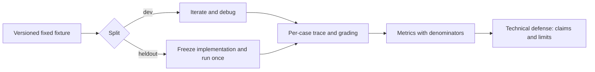

# D72 — Evaluation and technical defense

## 1. Learning objectives

Present a fixed evaluation with a declared task set, split, per-case result,
failure categories, and denominators. Explain why scripted provider fixtures
measure protocol integration rather than autonomous coding skill. Defend the
agent's threat model and known limitations using an actual trace: what was read,
which patch was approved, what backend ran, which revision was tested, and what
remains unproven. Distinguish development cases used to change the system from
held-out cases used for one final report. Your acceptance artifact is a
reproducible benchmark report plus a concise technical defense that includes
one failure, one rejected attack, one uncertain result, and one design tradeoff.

## 2. Required prerequisites

Complete D67–71 and inspect `forgeagent.evaluation.evaluate`, the Week 10
telemetry summarizer, and the local fixed fixture files. Understand per-case
grading, split labels, pass rate denominators, latency percentiles, supplied
cost rates, and confidence intervals. Review the tests you authored and the
exact source revisions used. A visible deterministic suite is useful regression
evidence but not an unbiased quality estimate. Do not train or tune on the
held-out fixture after reading its expected outputs and then claim independent
generalization. A technical defense should show where evidence came from and
where it stops. You are not being asked to claim senior production experience
or general agent capability.

## 3. Problem motivation

A polished demo can hide fragile behavior. It may use one easy fixture, omit
timeouts, present only successful traces, or count retries as separate solved
tasks. Evaluation makes these choices visible by freezing the task set and
reporting every case. A useful coding-agent benchmark must test more than whether
the model emits a plausible answer: it should include stale writes, rejected
approvals, failed tests, missing backends, budget exhaustion, and recovery after
restart. It should also state which cases are protocol fixtures and which are
real code tasks. If all model decisions are scripted, the fixture measures
integration, deterministic handling, and boundaries. It cannot show how a live
model would plan or implement unfamiliar software. Honest reporting is a
technical requirement because deployment decisions depend on the evidence.

## 4. Intuitive explanation

Think of evaluation as a race course with a map published before the race. Every
runner sees the same obstacles and gets scored under the same rules. If you
change the map after a run or quietly remove a difficult obstacle, the result
cannot be compared. A development set is the practice track where you improve
the system. A held-out set is a final measurement that you do not use for
tuning. Since a coding agent can be stochastic, repeated trials are needed for
quality claims, but this capstone's scripted fixtures are deterministic. The
goal is not to produce a large pass rate; it is to make the claim fit the
measurement. A fail-closed behavior on a missing sandbox is a success for
security policy even though the requested coding task was not solved.

## 5. Deep technical explanation

The local evaluation harness loads a fixture with schema version, split, cases,
provider decisions, expected tool order, expected side effects, and budget
limits. It instantiates a deterministic fake provider and a minimal tool
registry, then checks exact outputs. It includes cancellation and budget cases.
The fixed coding-agent fixture should add acceptance predicates that bind
proposal, approval, apply, and test to the same revision. Report all per-case
rows with case ID, split, outcome, failure category, and relevant counters.
Do not aggregate away a safety failure. A weighted score can obscure severity;
separate task success, safe refusal, protocol correctness, and recovery. A
held-out result should be run only after code, thresholds, and grading rules
are frozen. If you inspect a held-out failure and change behavior, call the next
result exploratory or create a new versioned held-out fixture.

Useful measures include task success among tasks where the backend is available,
safe refusal when it is unavailable, stale-write rejection, unauthorized
approval rejection, false-completion rate, recovery duplication, p50/p95 local
latency, and provider-reported tokens. State the denominator for each metric.
For example, `safe_refusal_rate = unavailable cases correctly refused /
unavailable cases`. Do not combine safe refusal with coding success as though
they were the same outcome. Cost only reflects rates supplied to the fixture;
it is not an invoice. Latency is machine-specific. Tests that use a fake
provider do not estimate model quality, and tests that use a recording fake
backend do not demonstrate isolation.

## 6. Mathematical foundations

For fixed cases \(i=1...n\), exact pass rate is \(\hat p=x/n\). A Wilson
interval helps communicate uncertainty for binomial samples, though a small
visible fixture still has limited external validity. When cases share a common
template, they are not independent samples, so the interval can overstate
confidence. If every case is fixed protocol data, the observed pass count is a
regression result, not a random estimate of deployment success. Define separate
class metrics: task success \(x_t/n_t\), safe refusal \(x_r/n_r\), false
completion \(x_f/n_f\), and recovery correctness \(x_c/n_c\). A zero false
completion count on four cases does not prove a zero population rate. Latency
percentiles use local wall-clock timings and should include units and machine
context. Costs are \(C=(n_{in}r_{in}+n_{out}r_{out})/10^6\) under caller supplied
rates and provider reported token counts.

## 7. Architecture and execution diagrams

The development split feeds implementation work; the held-out split is frozen
until the end. Each run produces a trace and a per-case grading row. A reviewer
checks the fixture, code version, and report together. The test backend identity
is included when available. If it is missing, the report records refusal rather
than inventing a pass. The technical defense then interprets the evidence and
states limits. A report generation command must preserve the original fixture
and write results to a separate file, not overwrite expected judgments.



## 8. Implementation from first principles

Define a fixture case schema and exact grader before running the code. Keep
expected outcomes separate from learner submissions. The following summary
keeps every case and rejects duplicate IDs, preventing a benchmark from hiding
hard rows through overwriting. Do not report a split if the fixture label
disagrees. For a real coding test, the grader should inspect repository state
and backend evidence rather than use a model judge. Add a version ID for the
fixture and source commit so the report can be recreated. Include “not run” as
a status; do not remove cases that require unavailable infrastructure.

```python
def summarize(cases, split):
    rows = [c for c in cases if c["split"] == split]
    ids = [c["id"] for c in rows]
    if not rows or len(set(ids)) != len(ids):
        raise ValueError("nonempty unique fixed split required")
    passed = sum(row["passed"] is True for row in rows)
    return {"split": split, "n": len(rows), "passed": passed,
            "rate": passed / len(rows), "cases": rows}
```

## 9. Worked execution walkthrough

The dev fixture contains a valid read/search task, a malformed tool call, an
unauthorized write, a stale approval, a missing test backend, and a checkpoint
recovery case. Five of six pass their declared contract; the stale approval
case fails because the implementation accepted a changed source. The report
must show that specific failure even though aggregate rate is 5/6. After fixing
the policy integration, run the same development fixture and confirm all six
expected results. Freeze code and grading. The held-out fixture contains a
different path, wrong-session approval, a journal append/checkpoint gap, and a
backend timeout. Suppose the session fails to recover one case; publish three
of four with the failure. This result says the fixed system passed three of
four visible protocol cases. It does not say a live model would solve three of
four software issues. Keep the output from before the fix in development
history, not as held-out data.

## 10. Independent laboratory

D72 runs a small fixed fixture through an injected runner and grades every case
using exact expected status, tool sequence, side-effect count, and revision
match. Include at least one case per property: content binding, safe refusal,
budget exhaustion, cancellation, pending-call resume, stale file, and backend
unavailability. Split cases before implementation tuning and preserve case IDs.
Produce separate development and held-out JSON reports with case count,
pass/fail, metric denominator, and limitations. Add one failure analysis with
the event trace that demonstrates the defect. Your defense must include a
diagram of authority boundaries and explain how approval is separated from the
model. No command should execute fixture-provided code. The benchmark runner
itself is deterministic and does not contact a provider or external service.

## 11. Experiments

Report protocol pass rate by split, safe refusal rate, false completion count,
stale-write rejection, duplicate-effect rate after simulated crash, p50/p95
latency, reported tokens, and supplied-rate cost. Include Wilson intervals for
binomial rates but explain the fixture is not a representative sample. Repeat
one development fixture ten times to check determinism; do not use repeated
identical scripted runs as ten independent tasks. Then change exactly one
policy setting and compare its effect on both task outcomes and rejected
attempts. Freeze held-out cases in source control and document when they were
used. Do not use held-out failures to claim a newly fixed result on that same
fixture as independent confirmation; create a new held-out version or call it
exploratory.

## 12. Failure analysis

An evaluator can encode the wrong expected answer, omit a dangerous action, or
grade only final text. A fixture can leak its expected patch in the prompt.
Case duplication can inflate denominator or produce stable-looking results.
Split contamination can turn held-out into development data. A false positive
may appear if a checker trusts provider claims rather than observations. A
false negative may mark safe refusal as failure when the backend is correctly
unavailable. Report these separately. Preserve the full case list, including
timeouts, cancellations, and malformed inputs. If the benchmark runner itself
fails, mark the report invalid rather than treating missing rows as failures or
successes. Ensure runtime version, fixture digest, and output file are recorded.

## 13. Engineering tradeoffs

Small fixtures are readable and help diagnose a single invariant but offer weak
coverage. Large randomized suites improve breadth but need deterministic seeds,
shrinking, and understandable failure traces. Hidden tests reduce leakage but
make grading less transparent; an educational capstone should favor visible
fixed cases and cautious claims. Exact rule-based grading is reproducible but
may not capture usefulness. A model grader is flexible but introduces its own
variance and can reward persuasive prose. The capstone uses exact protocol and
state checks, then asks a human to assess design reasoning. More metrics help
diagnose classes of failure but can create a misleading dashboard; keep the
headline tied to a clear task and denominator. Use no single scalar as a
replacement for safety review.

## 14. Real-world connection

Teams evaluate coding agents using issue suites, repository benchmarks, replay
traces, and human review. Results depend on model version, tools, prompt,
repository snapshot, test harness, and environment. A high score on one public
benchmark can encourage benchmark-specific tuning and does not assure secure
production behavior. Operational evaluation also tracks cost, latency, human
approval rate, rollback, and incident categories. This capstone teaches the
discipline of versioning the full system and reporting what was actually run.
Production defenses may need independent red teams, secret scanning, tenant
isolation, and privacy review. A scripted fixture remains valuable as a
deterministic integration test, provided it is labeled correctly.

## 15. Common misconceptions

“A held-out file is automatically held out” ignores whether it influenced code
or prompt changes. “A hundred repeated fixture runs are a hundred tasks” is
false. “A high aggregate score means safe behavior” can hide one critical
authorization failure. “A fake provider result proves model quality” is false.
“A green fake-backend result proves isolation” is false. “A confidence interval
fixes biased cases” is false. “Only failures need publication” omits successful
rejection evidence and denominators. “A technical defense requires pretending
production experience” is false; state the artifacts you actually built and
the experiments actually run. Evidence scope is part of engineering honesty.

## 16. Technical examination

Defend four claims with direct evidence and identify one unsupported claim you
refuse to make. Given a report with 8/10 task cases and 3/3 safe refusals,
explain the separate denominators and why a weighted average could conceal a
security regression. Explain the confidence interval's limits for correlated
fixtures. Describe how you freeze a dev/held-out split and what happens when a
held-out result causes code changes. Then walk through an actual trace from
read to approved patch and same-revision test, including a failure or
uncertainty. The examiner may change one requirement, such as backend absent or
source stale, and ask you to predict the system's safe response before looking
at code.

## 17. Daily mastery gate

Pass when both fixed splits have complete case rows, aggregate metrics match
their denominators, and the report distinguishes protocol integration from
model coding quality. The technical defense must cite actual local artifacts
and include a known limitation. A report with dropped failures, invented test
results, or an unqualified “held-out” claim fails. Remediate by restoring the
case, correcting the grading rule, and versioning the next fixture. This gate
validates reproducibility and claim scope; it does not grant a production
readiness certification.

## 18. Resources

Use the local `forgeagent/evaluation.py`, `forgeagent/telemetry.py`, the fixed
assessment fixture files, and the Week 10 benchmark reading. The evaluation
harness's interpretation field explicitly limits its scope to deterministic
protocol regression. Standard-library `statistics` can help compute summaries;
the project already includes a Wilson interval helper. No external benchmark
service is required. If you compare published coding-agent benchmarks, inspect
the task version, allowed tools, test protocol, and contamination policy before
comparing numbers. Record exact outputs and do not convert design inspection
into claims of executed performance.

## 19. Revision and retention

One day later, recreate the split labels, denominator, and four distinct metric
classes from memory. One week later, present the system using only the event
trace, fixture digest, and test result. Ask a peer to find one place where the
claim exceeds evidence. Preserve old development reports after fixes so change
impact remains visible. A versioned honest limitation is more useful than an
unstated risk hidden behind a polished demo.

## 20. Next lesson connection

D72 completes the instructional sequence. The final defense synthesizes the
course: retrieval finds evidence, bounded tools act, policy gates authority,
isolation contains execution, context limits model input, durability preserves
state, and evaluation measures declared outcomes. Review the entire capstone as
one system and identify the trust boundary that carries the highest unresolved
risk. State a concrete next experiment that could reduce that uncertainty.
