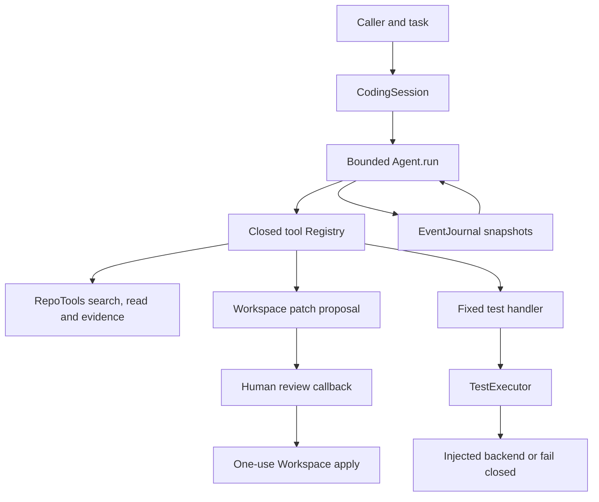

# ForgeAgent architecture

## Request path

The provider emits decisions in the runtime's strict JSON protocol. The runtime
validates names, arguments, effect permissions, dependency structure, budgets,
and deadlines before dispatch. Repository handlers use `Workspace` for path
checks and bounded reads. Search returns ranked line evidence; it is not a
semantic code index. Reads return text and a hash. The model can propose a
replacement bound to the observed revision. The app's human callback checks a
review digest and invokes the policy's approval and apply methods; neither is
registered with the provider.

Test execution is a separate fixed request. `RepoTools` supplies the
interpreter and unittest discovery argv; it does not accept a model command.
`TestExecutor` requires an injected backend and refuses by default. Calls to
synchronous runners and MCP use `asyncio.to_thread`; cancellation of the
awaiting coroutine cannot guarantee the worker or external action stopped. The
backend itself needs a deadline and operation reconciliation.

## Durable state

`Agent.run` checkpoints the exact typed messages, task/tool identity, counters,
observations, pending calls, known cost, absolute deadline, answer, status, and
trace. The wrapper appends a full snapshot event, then updates the checkpoint.
If it crashes between those writes, resume restores the latest complete
snapshot event. Workspace receipts are added to the snapshot; after restart,
`Workspace.restore_proposal` validates them and resets approval to false.
Approval must be repeated by a human. Patch apply creates a durable operation
intent and reconciles current bytes against before/after hashes. An unknown
operation is not blindly replayed.

Context selection uses a documented character-to-token estimate and stable
ranking. Compaction is lossy, records source IDs and revisions, and does not
inherit source authority. Context summaries are not a replacement for runtime
checkpoint state.

## MCP and evaluation

MCP tools are selected by an explicit caller allowlist, filtered again by a
read-only set, and rejected if their schema exceeds the runtime's small closed
object subset. Remote result text remains untrusted. The stdio client is
synchronous and has protocol/time bounds; a timed-out worker may outlive the
caller. Evaluation uses frozen scripted traces and exact graders. These
fixtures test integration and safety contracts, not general model capability.

## HTTP request adapter

FastAPI authenticates and owns queue admission. The optional repository
handler configures a single owner and immutable root location at startup.
It constructs read-only sessions and forwards one bounded query to the
evidence tool. The result is typed JSON stored with the durable job.
The synchronous filesystem reads are bounded and use the operator's owned
fixture. This deployment path can retry a read after a lease expiry. The
local patch path uses its separate event journal and human review callback.
